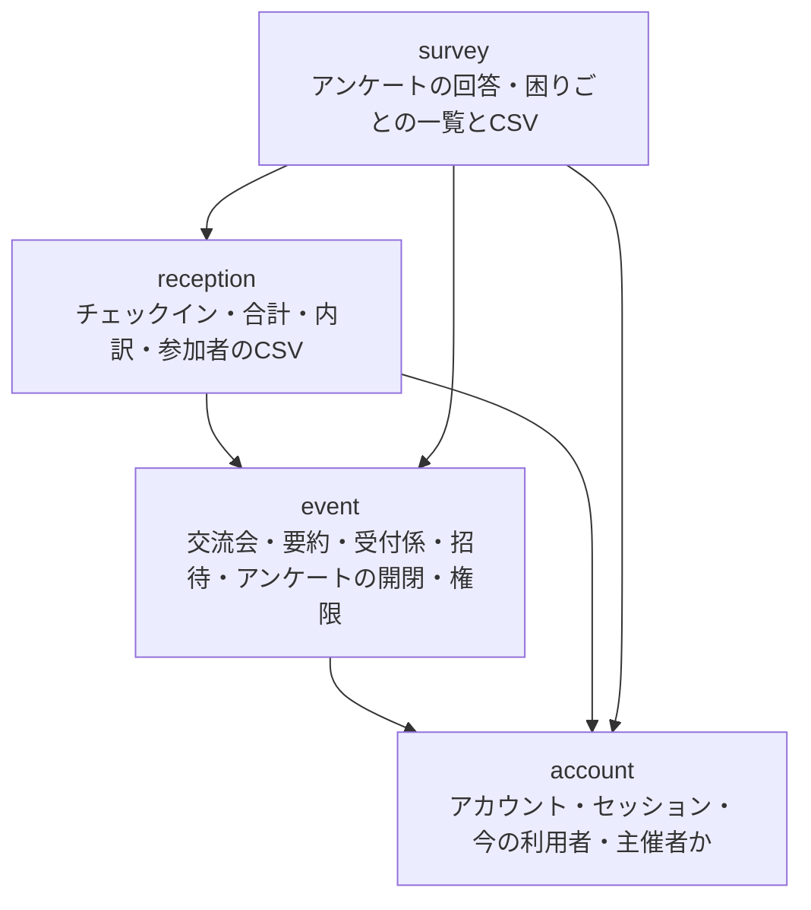
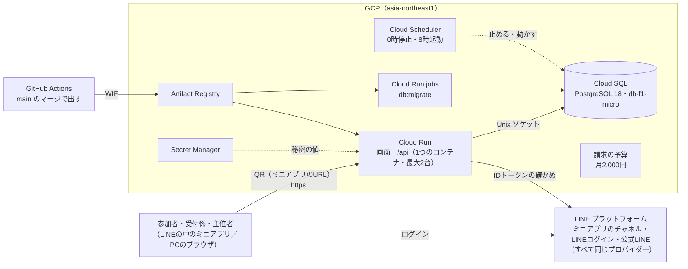
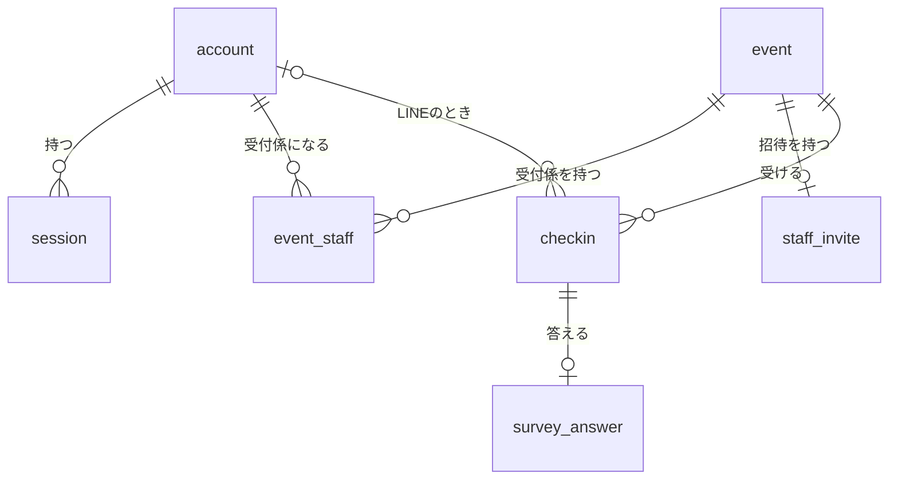

# 構成の決めごと — kanaeru

作成：2026-11-19（決めた理由は [.memlog.md](./.memlog.md)。いまのコードの形は [docs/architecture.md](../../docs/architecture.md)。点検の記録は [reviews/](./reviews/)）

## Design Paradigm

**モジュラーモノリス**。API・画面・DB を1つずつ持ち、スイートのアプリと機能は**領域**（`apps/api/src/modules/<領域>/`・`apps/web/src/features/<領域>/`・`packages/contracts/src/<領域>/`）として足す。依存はテンプレートの骨組みどおり **組み立て → 領域 → 共通 → 土台** の一方向で、領域どうしは相手の `index.ts` からだけ読む（[docs/architecture.md](../../docs/architecture.md) 2章。lint の境界の規則が止める）。

最初の版の領域と、領域どうしの依存（矢印の向きにだけ読む）：



## Invariants & Rules

### AD-1 — スイートは1つのモジュラーモノリス [ADOPTED]

- **Binds:** all
- **Prevents:** アプリごとに別のサーバー・DB・ログインができ、共通のアカウントが割れること
- **Rule:** スイートの新しいアプリは、新しい領域として同じ API・画面・DB に足す。別の置き場所に切り出すのは、この文書を直してから。

### AD-2 — アカウントは account の領域だけが持つ [ADOPTED]

- **Binds:** account・すべての領域、FR-4・FR-16・FR-21
- **Prevents:** アプリごとに利用者の表ができ、同じ人が別人になること
- **Rule:** 利用者（LINEのユーザー）の表とセッションの表は account の領域だけが持つ。ほかの領域は `account.id` を外部キーで参照するだけで、LINEのユーザーID・表示名を自分の表に写さない（チェックインの名前は例外。AD-6）。LINE のチャネルは、すべて同じプロバイダーの下に作る（LINEのユーザーIDはプロバイダーごとに変わるため）。

### AD-3 — 表の持ち主は1つの領域 [ADOPTED]

- **Binds:** all
- **Prevents:** 2つの領域が同じ表を書き、どちらが正しいか分からなくなること
- **Rule:** 表は、それを作った領域だけが読み書きする。ほかの領域の表が要るときは、その領域の `index.ts` が出す関数（1つ目の引数はいつも `db`）を呼ぶ。外部キーのためだけに、持ち主の `index.ts` から表を出してよい（`.references()` にだけ使い、読み書きに使わない）。表を作る PR は **account → event → reception → survey** の順に develop へ入れる。持ち主は次のとおり。

| 領域 | 持つ表 |
|---|---|
| account | `account`（LINEのユーザーID・表示名・登録日）・`session`（`account_id`・期限だけ） |
| event | `event`（名前・日時・会場・参加費・GoogleフォームのURL・LINEグループの招待リンク・アンケートの開閉）・`event_staff`（受付係）・`staff_invite`（招待のリンク） |
| reception | `checkin`（名前・申し込みの媒体・知ったきっかけ・支払い方法・金額・`account_id`（LINEのとき）・入れた人（手のとき）） |
| survey | `survey_answer`（`checkin_id`・困りごと・月いくら・テスター・仕事の立場・職種） |

### AD-4 — ログインは LINE のIDトークンを API が確かめ、自前のセッションを出す [ADOPTED]

- **Binds:** account・すべての画面、FR-3・FR-4・FR-21
- **Prevents:** 画面が送ったプロフィールを信じてなりすまされること。画面ごとに LINE の始め方・ログインの確かめ方が変わること
- **Rule:** `liff.init()`・ログイン・IDトークンを送ってセッションを作る処理は、画面の共通（`apps/web/src/lib/liff.ts`）に1つだけ置き、組み立てがルーターより先に呼ぶ。画面は `liff.getIDToken()` の生のIDトークンだけを `POST /api/v1/auth/line` に送る（ログインだけをし、ほかの用事を載せない）。API は LINE の `POST /oauth2/v2.1/verify`（`id_token`・`client_id`）で確かめ、`sub` を LINEのユーザーIDとして account を作るか探し、`session` の行と `HttpOnly; Secure; SameSite=Lax` のクッキーを出す。確かめる `client_id` は設定 `LINE_CHANNEL_IDS`（並び）で持つ。画面から送られた表示名やユーザーIDは使わない。LINEのトークンを長く持たない。セッションの期限は30日。LIFF ID は公開してよい値なので、組み立てのとき（`VITE_LIFF_ID`）に埋める。

### AD-5 — 権限は「主催者か」と「交流会ごとの受付係か」の2つだけで、要求のたびに引く [ADOPTED]

- **Binds:** account・event・reception・survey、FR-3・FR-9・FR-10・FR-21
- **Prevents:** 領域ごとに権限の確かめ方がばらばらになること。外した受付係がセッションの期限まで使えること。参加者の画面が交流会の情報を読めないこと
- **Rule:**
  - **主催者**は設定 `ORGANIZER_LINE_USER_ID`（秘密ではない。Terraform で Cloud Run の環境変数に渡す）と、今の利用者の LINEのユーザーIDが同じかで決める。表に印を持たない。この比べ方は account の `index.ts` が `isOrganizer` として出す。
  - **受付係**は `event_staff`（交流会と account の組）で決まり、その交流会の中だけで効く。
  - 権限は、event の `index.ts` が出す1つの関数（その account がその交流会で主催者か・受付係か・どちらでもないか）を**要求のたびに**通す。セッションに写さない。受付係に許すのは PRD FR-3 の表の「受付係 ○」だけで、困りごと・書き出し・削除・交流会の作成の窓口は、主催者でなければ `403`。
  - **参加者向けの要約**：event は、ログインしていれば誰でも読める要約を1つだけ出す（`GET /api/v1/events/{eventId}/summary` と `index.ts` の `getEventSummary`）。中身は名前・日時・会場・参加費・アンケートが開いているか・GoogleフォームのURL・LINEグループの招待リンク だけ。
  - **招待**は event の窓口 `POST /api/v1/staff-invites/{inviteToken}/accept`（ログイン必須）で受け、`event_staff` を作る。招待のリンクは交流会ごとに1本・何人でも使える・作り直すと前のは使えない。期限は「交流会の日時の、日本時間の日付が終わるまで」で、受けるときに交流会の今の日時から計算する。

### AD-6 — チェックインは、そのときの名前と金額を写して持つ [ADOPTED]

- **Binds:** reception・survey、FR-4・FR-7・FR-8・FR-12・FR-14・FR-15
- **Prevents:** あとで参加費や表示名を直すと、過去の合計や名簿が変わること。支払い方法を直したときの金額が作る人しだいになること
- **Rule:** `checkin` は名前と金額を写して持つ。金額を決めるのは、チェックインを作るときと支払い方法を直すときだけで、無料なら0円、ほかは `getEventSummary` で引いたその時の参加費。参加費を直しても、すでにあるチェックインの金額は変えない（交流会を直す画面にその旨を出す）。合計（FR-12）は `checkin` の金額の和で出す。金額は円の整数。名前の初期値は reception が出す（前回のチェックインの名前、なければ account の表示名）。困りごとの一覧と書き出しの名前は、いつも `checkin` の名前（survey は reception の `index.ts` から引く）。

### AD-7 — 消すのは本人のデータだけ。取り消しは行を消す [ADOPTED]

- **Binds:** account・event・reception・survey、FR-8・FR-16
- **Prevents:** 受付係のアカウントを消すと、その人が手で入れたほかの参加者のチェックインまで消えること。消したはずのデータが残ること
- **Rule:**
  - 本人のデータを指す外部キーだけ `ON DELETE CASCADE`：`session.account_id`・`event_staff.account_id`・`checkin.account_id`・`survey_answer.checkin_id`。account を消せば、その人のセッション・受付係の割り当て・チェックイン・回答が消える。
  - 「誰がしたか」の記録（`checkin` の入れた人と、同じ種類の列）は `ON DELETE SET NULL`。
  - `event` を指す外部キーは `RESTRICT`（この版は交流会を消す機能を作らない）。
  - チェックインの取り消し（FR-8）は行を消す（`DELETE`）。回答も一緒に消える。取り消しの確かめの枠に「アンケートの回答があれば一緒に消えます」と出す。FR-5 の重なりをまとめるときは、LINE のほうを残し、手のほうを消す。

### AD-8 — 置き場所は1つの Cloud Run と1つの Cloud SQL [ADOPTED]

- **Binds:** all（運用）
- **Prevents:** 画面と API が別の源になってクッキーが使えなくなること。費用がかかる部品が知らないうちに増えること。Terraform が既定のエディションで落ちること。会場の回線で受付が止まること
- **Rule:**
  - 1つのコンテナ（Cloud Run・asia-northeast1）が、画面の組み立てたファイルと `/api` を同じ源で返す（`/api` 以外は `index.html` に戻す）。`/api` の下は API の CSP、ほかは画面の CSP（LINE の SDK が要る源を足す）。これは組み立て（`app.ts`）を直す共通の PR で入れる。
  - DB は Cloud SQL for PostgreSQL を1つだけ：`edition = "ENTERPRISE"`・`tier = "db-f1-micro"`・`database_version = "POSTGRES_18"`（共有コアで SLA の対象外）。公開IPに承認済みネットワークを付けず、Cloud Run に備わっている Cloud SQL の接続（Unix ソケット）だけでつなぐ。
  - Cloud Run の最大の台数は2、最小は0。pg の接続のプールは1台あたり5まで（合計が Cloud SQL の上限を超えない）。
  - 会場では参加者が同じIPに見えるので、本番は `TRUSTED_PROXY_HOPS=1`・`RATE_LIMIT_MAX` を受付の山に見合う値（600）にする。
  - ロードバランサ・VPC のつなぎ口・最小の台数1・Enterprise Plus は、この文書を直さずに足さない。

### AD-9 — GCP の資源はすべて Terraform で持ち、費用とデータを守る設定を入れる [ADOPTED]

- **Binds:** all（運用）
- **Prevents:** 画面で手で作った資源が残り、作り直せない・費用が分からなくなること。作り直せない交流会の記録を失うこと
- **Rule:**
  - Cloud Run（サービスと jobs）・Artifact Registry・Cloud SQL（台・DB・利用者）・Secret Manager・サービスアカウントと権限・GitHub からのデプロイの権限（Workload Identity Federation で入り、デプロイ用のサービスアカウントになりすます。鍵は作らない。Cloud Run は WIF の直接の権限〈Direct WIF〉に対応していないため。core-002 R-1）・Cloud Scheduler・請求の予算は `infra/` の Terraform で作る。手で作ってよいのは、Terraform の状態を置く GCS のバケット（バージョニングあり）と、最初の GCP プロジェクトだけ。
  - 秘密の値（DBのパスワード）は Secret Manager に置き、Terraform のコードとリポジトリには書かない。
  - Cloud SQL は自動のバックアップを有効にし、時間帯は DB が動いている昼（日本時間12時台）、7日分残す。`deletion_protection` を付ける。
  - 請求の予算は月2,000円で、50%・100% でメールで知らせる。

### AD-10 — DB は夜間（0時〜8時）止める。止まっていても画面は壊れない [ADOPTED]

- **Binds:** 運用・すべての画面
- **Prevents:** 夜間の停止中に、画面が開かない・分かりにくいエラーで落ちること。Terraform が停止を毎回戻すこと
- **Rule:**
  - Cloud Scheduler が毎日0時に Cloud SQL を止め、8時に動かす（日本時間。Cloud SQL Admin API の `activationPolicy` を直す）。Terraform は Cloud SQL の `activation_policy` と Scheduler の `paused` の変更を無視する（`lifecycle { ignore_changes }`）。
  - DB に届かないとき、API は `503` と code `DB_UNAVAILABLE` を返す。この読みかえは土台（`kernel`）のエラーの処理に1か所だけ置く。画面は「夜間（0時〜8時）は止まっています」と出す。
  - Cloud Run の起動の確かめ（probe）は既定のまま、DB に触る窓口を指さない。DB を定期的に起こす・叩く処理は作らない。
  - デプロイは日本時間の8時15分〜23時に始めたものだけを出す（DB の起動の直後と、0時の停止の前を避ける。deploy.yml が確かめる）。交流会が0時を越えるときは、主催者がその日の停止の仕事を `gcloud scheduler jobs pause` で止める。

### AD-11 — 本番へは main のマージで出す。DB の変更を先に当てる [ADOPTED]

- **Binds:** 運用・すべての領域
- **Prevents:** 新しいコードが古い表で動くこと。手元から本番の DB を直接直すこと。どのブランチで本番に出るかが人によって違うこと
- **Rule:** 環境は本番の1つだけ。`main` へのマージで GitHub Actions が、コンテナを作る → 同じコンテナを Cloud Run jobs で `db:migrate` として動かす → 成功したときだけ新しい版を出す。`develop` のマージでは何も出さない（ステージングを足したら出す）。文書・仕様だけの変更では動かさない（`paths` で絞る）。DB の変更は後ろに戻れる形にする。この決まりは [docs/rules/development-flow.md](../../docs/rules/development-flow.md) 5章にも書く。

### AD-12 — 今の利用者は account の1つの仕組みで受け取る [ADOPTED]

- **Binds:** account・すべての領域と画面
- **Prevents:** 領域ごとにクッキーとセッションの表を自分で読むこと。未ログインの返し方が領域ごとに違うこと
- **Rule:** account の `index.ts` が、API には `requireSession`（Hono の middleware）と `currentAccount(c)`（今の account の id と LINEのユーザーID）を、画面には `useSession()`（ログイン済みか・今の account）を出す。ほかの領域は、自分の道の前に `requireSession` を付けて `currentAccount(c)` を読むだけ。未ログインは `401`・code `UNAUTHENTICATED`。手元とテストでは、`APP_ENV` が `local`・`test` のときだけ使える試験用のログインの窓口を account が出す（本番では起動時に止める）。

### AD-13 — アンケートを受け付けるかは survey が決める [ADOPTED]

- **Binds:** event・survey、FR-9・FR-10
- **Prevents:** 開閉を event と survey の両方が確かめ、閉じたあとの扱いが食い違うこと
- **Rule:** 開閉の印は event が持ち、survey は回答を書くたびに `getEventSummary` で読む（自分の表に写さない）。閉じていて断るのは参加者自身の回答だけで、主催者の代わりの入力は閉じていても受ける。参加者が自分で答えるときは「今の account → reception の関数でその交流会のチェックイン → `checkin_id`」で回答をひもづける。チェックインがない人には、アンケートの画面が「チェックインの画面へ」を出す。

### AD-14 — 参加者が外から開く URL の形は1か所で持ち、QR にはミニアプリの URL を入れる [ADOPTED]

- **Binds:** event・reception・survey・画面、FR-2・FR-21
- **Prevents:** QR を作る領域と画面を作る領域で URL の形が食い違うこと。置き場所の URL を変えると、印刷した QR が使えなくなること
- **Rule:** 参加者が外から開く画面の道（`/e/{eventId}/checkin`・`/e/{eventId}/survey`・`/invite/{inviteToken}`）と、それを LINEミニアプリの URL（パーマリンク）にする関数は、`packages/contracts/src/core` に1つだけ置く。reception・survey・event の画面はこの道で作り、event はこの関数で QR と招待のリンクを作る。QR には Cloud Run の URL を直接入れない。

## Consistency Conventions

| Concern | Convention |
| --- | --- |
| 名前 | 領域のフォルダは英語の単数（`account`・`event`・`reception`・`survey`）。表は単数の snake_case。画面と文書の言葉は PRD 3章の用語集のまま |
| 道の頭 | account：`/api/v1/auth/*`・`/api/v1/accounts/*`／event：`/api/v1/events/*`・`/api/v1/staff-invites/*`／reception：`/api/v1/events/{eventId}/checkins/*`／survey：`/api/v1/events/{eventId}/survey-answers/*`。`operationId` は領域の名前で始める |
| ID・時刻 | 主キーは `uuid`（`uuidv7()`。PostgreSQL 18 が要る）。DB は `timestamptz`。API と画面の間の日時は時差つきの ISO 8601 だけ。「日本時間の日付」と「その日の終わり」を出す関数は `packages/contracts/src/core` に1つ置き、サーバーの時刻帯に頼らない |
| 金額 | 円の整数（`integer`）。小数を使わない |
| 選択肢 | 値は英語の短い code（例：`paypay`・`cash`・`free`）。文言と並び順は同じ列挙の隣に持つ。持ち主の領域の contracts に置く（申し込みの媒体・知ったきっかけ・支払い方法は reception、月いくら・仕事の立場・職種は survey）。DB は `text` と CHECK の制約 |
| 同じ名前 | 手とLINEのチェックインの「同じ名前」は reception の API が決めて一覧の行に印を付ける。比べ方（前後の空白を除き、NFKC でそろえ、間の空白を消す）は reception の contracts に1つ |
| 領域をまたぐ処理 | 領域をまたぐトランザクションは作らない（外部キーと一意の制約で守る） |
| エラー | テンプレートの形（`{error: {code, message, requestId, fields?}}`）。未ログインは `401 UNAUTHENTICATED`、権限なしは `403`、DB の夜間停止は `503 DB_UNAVAILABLE` |
| 一覧画面の更新 | TanStack Query の読み直しを5秒おきにする（つなぎっぱなしの仕組みは使わない）。チェックインと修正の後は、その場で読み直す |
| 書き出し | API が作る UTF-8 の BOM つきの CSV。参加者の CSV は reception、困りごとの CSV は survey（どちらも主催者だけ） |
| ログ | pino の JSON を標準出力へ（Cloud Logging が拾う）。困りごとの本文・IDトークン・クッキーはログに書かない |
| 設定 | 環境の違いは環境変数で持つ（`LINE_CHANNEL_IDS`・`ORGANIZER_LINE_USER_ID`・`OPEN_CHAT_URL`・`DATABASE_URL` など。読むのは `kernel/config.ts`）。例外は組み立てのときに埋める `VITE_LIFF_ID`。秘密の値は Secret Manager から Cloud Run に渡す |

## Stack

| Name | Version |
| --- | --- |
| Node.js | 26.13（Active LTS） |
| pnpm | 12.21 |
| TypeScript | 6.0（7 は typescript-eslint が未対応のため上げない） |
| Hono | 4.13 |
| @hono/node-server | 2.1 |
| @hono/zod-openapi | 1.6 |
| zod | 4.6 |
| Drizzle ORM | 0.45 |
| drizzle-kit | 0.31 |
| pg | 8.23 |
| Vite | 8.3 |
| React | 19.3 |
| TanStack Router | 1.170 |
| TanStack Query | 5.107 |
| Tailwind CSS | 4.3 |
| @line/liff | 2.32（2.31.1 未満は使わない） |
| PostgreSQL（Cloud SQL・Enterprise・db-f1-micro） | 18 |
| Terraform google provider | 8.12 |
| google-github-actions/auth | v3（WIF ＋ サービスアカウントのなりすまし） |

## Structural Seed

置き場所と外のサービス：



表のつながり（名前とつながりだけ）：



フォルダ（テンプレートに足すもの）：

```text
apps/api/src/modules/
  account/     # アカウント・セッション・LINEのIDトークンの確かめ・今の利用者・主催者か
  event/       # 交流会・要約・QR・受付係・招待・アンケートの開閉・権限の確かめ
  reception/   # チェックイン・合計・内訳・参加者のCSV
  survey/      # アンケートの回答・困りごとの一覧とCSV
apps/web/src/lib/liff.ts   # LINE の始め方とログイン（1つだけ）
apps/web/src/features/
  account/ event/ reception/ survey/
packages/contracts/src/core/   # 参加者が開く道とミニアプリのURL・日本時間の関数
packages/contracts/src/
  account/ event/ reception/ survey/
infra/         # Terraform（GCP の資源。状態は GCS）
.github/workflows/deploy.yml   # main のマージ：コンテナ → db:migrate → Cloud Run
```

見本の領域 `notes` は消す。最初に入れる共通の PR は次の3つ（領域の作業より先）：

1. 設定（`kernel/config.ts` に `LINE_CHANNEL_IDS`・`ORGANIZER_LINE_USER_ID`）と、`DB_UNAVAILABLE` の読みかえ
2. 画面のファイルを返すことと画面の CSP（`app.ts`）
3. `apps/web/src/lib/liff.ts` と `packages/contracts/src/core` の道・日本時間の関数

## Capability → Architecture Map

| Capability / Area | Lives in | Governed by |
| --- | --- | --- |
| FR-1・FR-2 交流会・QR | event | AD-3・AD-5・AD-14 |
| FR-3・FR-21 管理の画面の権限・受付係 | event（権限・招待）・account（主催者か） | AD-5・AD-12 |
| FR-4〜FR-6 LINEでのチェックイン・二重防止・友だち追加 | reception・account・`lib/liff.ts` | AD-2・AD-4・AD-6・AD-12 |
| FR-7・FR-8 手でのチェックイン・修正・取り消し | reception | AD-5・AD-6・AD-7 |
| FR-9・FR-10・FR-22 アンケート・Googleフォームと LINEグループへの案内 | event（開閉・URL・要約）・survey（回答） | AD-5・AD-13 |
| FR-11〜FR-13 一覧・合計・内訳 | reception | AD-6・一覧画面の更新の約束 |
| FR-14 困りごとの一覧 | survey | AD-5・AD-6 |
| FR-15 書き出し | 参加者は reception、困りごとは survey | AD-5・書き出しの約束 |
| FR-16 データの削除 | account・reception | AD-7 |
| PRD 5章（気軽さ・会場の電波・個人の情報・費用・お金を扱わない） | 画面・reception・運用 | AD-6・AD-8・AD-9・AD-10 |
| 置き場所・デプロイ・夜間停止・バックアップ・予算 | `infra/`・`.github/workflows/` | AD-8〜AD-11 |

## Open Questions

作り始め（2026-11-20〜）に実地で確かめる。交流会を止めうる順。

1. 未認証のミニアプリを、QR（パーマリンク）から開けるか。開けなければ、QR には Cloud Run の画面の URL を入れ、そこからミニアプリを開く形にする（AD-14 の関数の中だけを直す）。
2. 未認証のミニアプリで、友だち追加の案内（Add friend option・`liff.requestFriendship()`）が出るか。出なければ、チェックインのあとの画面に公式LINEの友だち追加のリンクを出す（FR-6 の確かめ方を直す）。
3. PC の外のブラウザで、ミニアプリの LINE ログインが使えるか（2025年10月から外のブラウザに対応した、と文書にある。未認証でも同じかは書かれていない）。使えなければ、受付係と主催者はスマホで使う。
4. db-f1-micro の接続の上限（第三者の記事では25）と、AD-8 の「最大2台 × 5本」で足りるか。
5. Cloud SQL の東京の実際の料金と、主催者のアカウントが新規の300ドルのクレジット（最大90日）の対象か。

## Deferred

- **ステージングの環境**：交流会のあとに足す（2つ目の DB を同じ Cloud SQL の台に作る形を第一候補にする）。足したら AD-11 を直し、`develop` のマージでステージングに出す。
- **独自のドメイン**：最初は Cloud Run の既定の URL。QR はミニアプリの URL なので（AD-14）、あとで変えても印刷した QR は使える。
- **監視と知らせ**：この版は Cloud Run の既定の指標と請求の予算の知らせ（AD-9）だけ。エラーの知らせは交流会のあとに決める。
- **Cloudflare など、ほかの置き場所への乗り換え**：運用費が問題になったら考える（DB は PostgreSQL のまま）。
- **スイートの画面の切り替え（アプリの一覧・ナビ）**：アプリが2つ目になったときに決める。
- **コールドスタートの対策**：最初は「受付の前に主催者が一度開いて起こす」。足りなければ、交流会の時間だけ最小の台数を1にする（AD-8 を直してから）。
