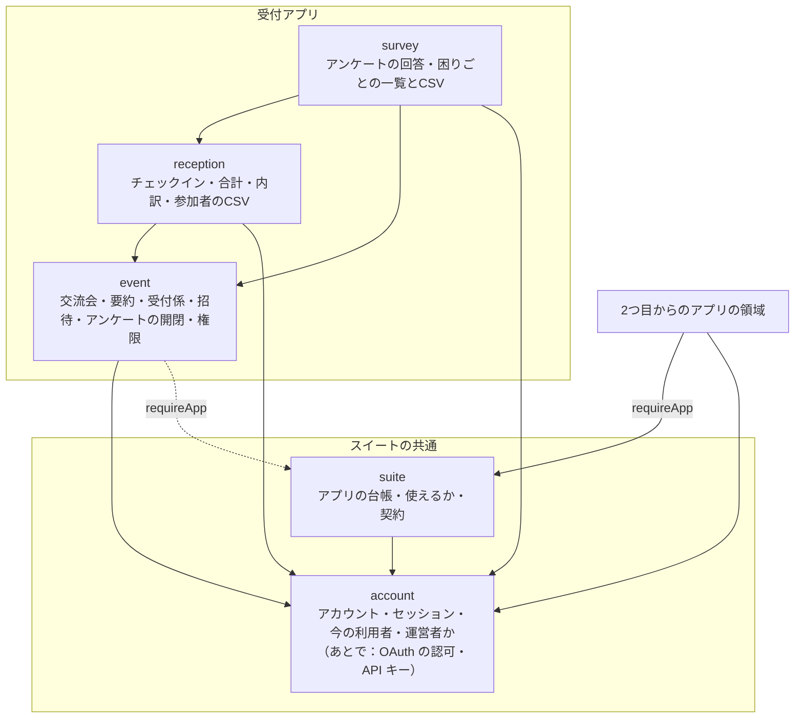
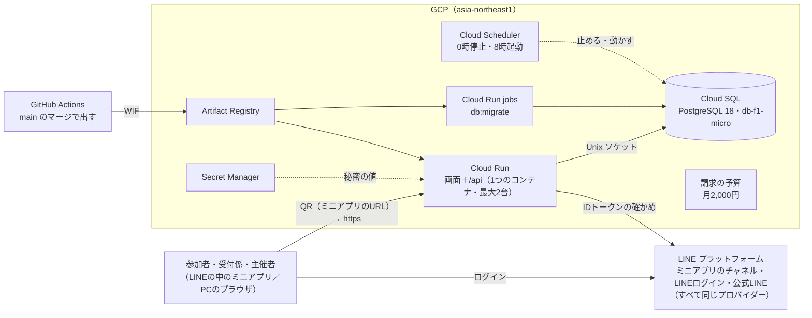
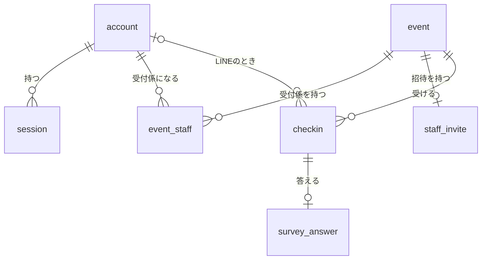

# 構成の決めごと — kanaeru

作成：2026-11-19（決めた理由は [.memlog.md](./.memlog.md)。いまのコードの形は [docs/architecture.md](../../docs/architecture.md)。点検の記録は [reviews/](./reviews/)）。2026-11-19 直した（reception-002：交流会ごとの割引。AD-3・AD-5・AD-6・AD-7・Capability map。理由は [specs/reception/002-discounts/research.md](../../specs/reception/002-discounts/research.md)）。2026-11-19 直した（スイートとして並行開発できる構成への見直し：AD-15〜AD-21 を足し、AD-1・AD-3・AD-5・AD-9 を直した）。2026-11-19 主催者が確かめた（仮決めをすべて採用。AD-18 は共通にしてよいものを技術の道具に絞り、AD-20 の外の AI は本人の記録だけに決め、B1 はこのリポジトリの中。Constitution 1.1.0）

## Design Paradigm

**モジュラーモノリス**。API・画面・DB を1つずつ持ち、スイートのアプリと機能は**領域**（`apps/api/src/modules/<領域>/`・`apps/web/src/features/<領域>/`・`packages/contracts/src/<領域>/`）として足す。依存はテンプレートの骨組みどおり **組み立て → 領域 → 共通 → 土台** の一方向で、領域どうしは相手の `index.ts` からだけ読む（[docs/architecture.md](../../docs/architecture.md) 2章。lint の境界の規則が止める）。

領域と、領域どうしの依存（矢印の向きにだけ読む）。アプリは領域の束（AD-1・AD-15）で、suite と account はスイートの共通。suite は台帳を足すとき（AD-16）に作る：



## Invariants & Rules

### AD-1 — スイートは1つのモジュラーモノリス [ADOPTED]

- **Binds:** all
- **Prevents:** アプリごとに別のサーバー・DB・ログインができ、共通のアカウントが割れること
- **Rule:** スイートの新しいアプリは、新しい領域として同じ API・画面・DB に足す。別の置き場所に切り出すのは、この文書を直してから。**アプリ**は売る・公開する単位で、1つ以上の領域の束（受付アプリ＝event・reception・survey）。account と suite はスイートの共通の領域で、どのアプリにも属さない（AD-15）。

### AD-2 — アカウントは account の領域だけが持つ [ADOPTED]

- **Binds:** account・すべての領域、FR-4・FR-16・FR-21
- **Prevents:** アプリごとに利用者の表ができ、同じ人が別人になること
- **Rule:** 利用者（LINEのユーザー）の表とセッションの表は account の領域だけが持つ。ほかの領域は `account.id` を外部キーで参照するだけで、LINEのユーザーID・表示名を自分の表に写さない（チェックインの名前は例外。AD-6）。LINE のチャネルは、すべて同じプロバイダーの下に作る（LINEのユーザーIDはプロバイダーごとに変わるため）。

### AD-3 — 表の持ち主は1つの領域 [ADOPTED]

- **Binds:** all
- **Prevents:** 2つの領域が同じ表を書き、どちらが正しいか分からなくなること
- **Rule:** 表は、それを作った領域だけが読み書きする。ほかの領域の表が要るときは、その領域の `index.ts` が出す関数（1つ目の引数はいつも `db`）を呼ぶ。外部キーのためだけに、持ち主の `index.ts` から表を出してよい（`.references()` にだけ使い、読み書きに使わない）。表を作る PR は **account → event → reception → survey** の順に develop へ入れる。DB の変更の通し方は AD-17。持ち主は次のとおり（suite・account の AI と認証の表は、その機能を作るときに足す）。

| 領域 | 持つ表 |
|---|---|
| account | `account`（LINEのユーザーID・表示名・登録日）・`session`（`account_id`・期限だけ） |
| event | `event`（名前・日時・会場・参加費・GoogleフォームのURL・LINEグループの招待リンク・アンケートの開閉）・`event_staff`（受付係）・`staff_invite`（招待のリンク）・`event_discount`（割引：名前・円の額・紹介者の名前を聞くか・使うのをやめた時刻。reception-002） |
| reception | `checkin`（名前・申し込みの媒体・知ったきっかけ・支払い方法・金額・`account_id`（LINEのとき）・入れた人（手のとき）・選んだ割引の ID とそのときの名前と額の写し・紹介者の名前（reception-002）） |
| survey | `survey_answer`（`checkin_id`・困りごと・月いくら・テスター・仕事の立場・職種） |
| suite | `app_setting`（アプリの key・公開の状態・売り方）・`entitlement`（契約。売り始めるとき。AD-16） |
| account（足すとき） | `ai_credential`（利用者の API キーの暗号文。AD-20）・OAuth のクライアントとトークン（AD-21） |

### AD-4 — ログインは LINE のIDトークンを API が確かめ、自前のセッションを出す [ADOPTED]

- **Binds:** account・すべての画面、FR-3・FR-4・FR-21
- **Prevents:** 画面が送ったプロフィールを信じてなりすまされること。画面ごとに LINE の始め方・ログインの確かめ方が変わること
- **Rule:** `liff.init()`・ログイン・IDトークンを送ってセッションを作る処理は、画面の共通（`apps/web/src/lib/liff.ts`）に1つだけ置き、組み立てがルーターより先に呼ぶ。画面は `liff.getIDToken()` の生のIDトークンだけを `POST /api/v1/auth/line` に送る（ログインだけをし、ほかの用事を載せない）。API は LINE の `POST /oauth2/v2.1/verify`（`id_token`・`client_id`）で確かめ、`sub` を LINEのユーザーIDとして account を作るか探し、`session` の行と `HttpOnly; Secure; SameSite=Lax` のクッキーを出す。確かめる `client_id` は設定 `LINE_CHANNEL_IDS`（並び）で持つ。画面から送られた表示名やユーザーIDは使わない。LINEのトークンを長く持たない。セッションの期限は30日。LIFF ID は公開してよい値なので、組み立てのとき（`VITE_LIFF_ID`）に埋める。

### AD-5 — 権限は「主催者か」と「交流会ごとの受付係か」の2つだけで、要求のたびに引く [ADOPTED]

- **Binds:** account・event・reception・survey、FR-3・FR-9・FR-10・FR-21
- **Prevents:** 領域ごとに権限の確かめ方がばらばらになること。外した受付係がセッションの期限まで使えること。参加者の画面が交流会の情報を読めないこと
- **Rule:**
  - **主催者**は設定 `ORGANIZER_LINE_USER_ID`（秘密ではない。Terraform で Cloud Run の環境変数に渡す）と、今の利用者の LINEのユーザーIDが同じかで決める。表に印を持たない。この比べ方は account の `index.ts` が `isOrganizer` として出す。 この設定の人は、スイートの**運営者**（アプリの台帳を変えられる人。AD-16）も兼ねる。受付アプリをほかの主催者に開くときは、`event` に持ち主の `account_id` を足し、交流会の主催者はそこから決める形にこの AD を直す。
  - **受付係**は `event_staff`（交流会と account の組）で決まり、その交流会の中だけで効く。
  - 権限は、event の `index.ts` が出す1つの関数（その account がその交流会で主催者か・受付係か・どちらでもないか）を**要求のたびに**通す。セッションに写さない。受付係に許すのは PRD FR-3 の表の「受付係 ○」だけで、困りごと・書き出し・削除・交流会の作成の窓口は、主催者でなければ `403`。
  - **参加者向けの要約**：event は、ログインしていれば誰でも読める要約を1つだけ出す（`GET /api/v1/events/{eventId}/summary` と `index.ts` の `getEventSummary`）。中身は名前・日時・会場・参加費・アンケートが開いているか・GoogleフォームのURL・LINEグループの招待リンク・使っている割引（名前・額・紹介者の名前を聞くか。reception-002） だけ。
  - **招待**は event の窓口 `POST /api/v1/staff-invites/{inviteToken}/accept`（ログイン必須）で受け、`event_staff` を作る。招待のリンクは交流会ごとに1本・何人でも使える・作り直すと前のは使えない。期限は「交流会の日時の、日本時間の日付が終わるまで」で、受けるときに交流会の今の日時から計算する。

### AD-6 — チェックインは、そのときの名前と金額を写して持つ [ADOPTED]

- **Binds:** reception・survey・event（割引の定義）、FR-4・FR-7・FR-8・FR-12・FR-14・FR-15・FR-23〜FR-25
- **Prevents:** あとで参加費や表示名を直すと、過去の合計や名簿が変わること。支払い方法を直したときの金額が作る人しだいになること
- **Rule:** `checkin` は名前と金額を写して持つ。金額を決めるのは、チェックインを作るときと、支払い方法か割引を直すときだけで、無料なら0円、ほかは `max(参加費 − 割引の額, 0)`（参加費は `getEventSummary` で引いたその時のもの。割引なしは参加費のまま）。選んだ割引は event の `findEventDiscount` で引き、その名前と額を `checkin` に写す（割引を変えずに支払い方法だけ直すときは、写した額を使う）。新しく選べるのは、その交流会の使っている割引だけ。参加費や割引を直しても、すでにあるチェックインの金額と写しは変えない（交流会を直す画面にその旨を出す）。紹介者の名前は任意で、主催者だけに返す（受付係と参加者の答えに入れない）。合計（FR-12）は `checkin` の金額の和で出す。金額は円の整数。名前の初期値は reception が出す（前回のチェックインの名前、なければ account の表示名）。困りごとの一覧と書き出しの名前は、いつも `checkin` の名前（survey は reception の `index.ts` から引く）。

### AD-7 — 消すのは本人のデータだけ。取り消しは行を消す [ADOPTED]

- **Binds:** account・event・reception・survey、FR-8・FR-16
- **Prevents:** 受付係のアカウントを消すと、その人が手で入れたほかの参加者のチェックインまで消えること。消したはずのデータが残ること
- **Rule:**
  - 本人のデータを指す外部キーだけ `ON DELETE CASCADE`：`session.account_id`・`event_staff.account_id`・`checkin.account_id`・`survey_answer.checkin_id`。account を消せば、その人のセッション・受付係の割り当て・チェックイン・回答が消える。
  - 「誰がしたか」の記録（`checkin` の入れた人と、同じ種類の列）は `ON DELETE SET NULL`。
  - `event` を指す外部キーは `RESTRICT`（この版は交流会を消す機能を作らない）。
  - 割引（`event_discount`）は消さない。外すと「使うのをやめる」（`archived_at`）だけで、新しいチェックインで選べなくなる。`checkin` の `(event_id, discount_id)` は `event_discount(event_id, id)` を指す複合の外部キーで `RESTRICT`（別の交流会の割引を指せない）。チェックインは名前と額を写しているので、割引を直しても外しても履歴は変わらない（event は reception の表を読めないので、使われたかで消すかを決められない。reception-002）。
  - チェックインの取り消し（FR-8）は行を消す（`DELETE`）。回答も一緒に消える。取り消しの確かめの枠に「アンケートの回答があれば一緒に消えます」と出す。FR-5 の重なりをまとめるときは、LINE のほうを残し、手のほうを消す。

### AD-8 — 置き場所は1つの Cloud Run と1つの Cloud SQL [ADOPTED]

- **Binds:** all（運用）
- **Prevents:** 画面と API が別の源になってクッキーが使えなくなること。費用がかかる部品が知らないうちに増えること。Terraform が既定のエディションで落ちること。会場の回線で受付が止まること
- **Rule:**
  - 1つのコンテナ（Cloud Run・asia-northeast1）が、画面の組み立てたファイルと `/api` を同じ源で返す（画面に戻さない道の頭〈`/api`・`/.well-known`。AD-21〉のほかは `index.html` に戻す）。`/api` の下は API の CSP、ほかは画面の CSP（LINE の SDK が要る源を足す）。これは組み立て（`app.ts`）を直す共通の PR で入れる。
  - DB は Cloud SQL for PostgreSQL を1つだけ：`edition = "ENTERPRISE"`・`tier = "db-f1-micro"`・`database_version = "POSTGRES_18"`（共有コアで SLA の対象外）。公開IPに承認済みネットワークを付けず、Cloud Run に備わっている Cloud SQL の接続（Unix ソケット）だけでつなぐ。
  - Cloud Run の最大の台数は2、最小は0。pg の接続のプールは1台あたり5まで（合計が Cloud SQL の上限を超えない）。
  - 会場では参加者が同じIPに見えるので、本番は `TRUSTED_PROXY_HOPS=1`・`RATE_LIMIT_MAX` を受付の山に見合う値（600）にする。
  - ロードバランサ・VPC のつなぎ口・最小の台数1・Enterprise Plus は、この文書を直さずに足さない。

### AD-9 — GCP の資源はすべて Terraform で持ち、費用とデータを守る設定を入れる [ADOPTED]

- **Binds:** all（運用）
- **Prevents:** 画面で手で作った資源が残り、作り直せない・費用が分からなくなること。作り直せない交流会の記録を失うこと
- **Rule:**
  - Cloud Run（サービスと jobs）・Artifact Registry・Cloud SQL（台・DB・利用者）・Secret Manager・サービスアカウントと権限・GitHub からのデプロイの権限（Workload Identity Federation で入り、デプロイ用のサービスアカウントになりすます。鍵は作らない。Cloud Run は WIF の直接の権限〈Direct WIF〉に対応していないため。core-002 R-2）・Cloud Scheduler・請求の予算は `infra/` の Terraform で作る。手で作ってよいのは、Terraform の状態を置く GCS のバケット（バージョニングあり）と、最初の GCP プロジェクトだけ。
  - 秘密の値（DBのパスワード。足すとき：利用者の API キーを包む鍵 `AI_CREDENTIAL_KEY`〈AD-20〉・LINE ログインの Web 用のチャネルのシークレット〈AD-21〉）は Secret Manager に置き、Terraform のコードとリポジトリには書かない。
  - Cloud SQL は自動のバックアップを有効にし、時間帯は DB が動いている昼（日本時間12時台）、7日分残す。`deletion_protection` を付ける。
  - 請求の予算は月2,000円で、50%・100% でメールで知らせる。

### AD-10 — DB は夜間（0時〜8時）止める。止まっていても画面は壊れない [ADOPTED]

- **Binds:** 運用・すべての画面
- **Prevents:** 夜間の停止中に、画面が開かない・分かりにくいエラーで落ちること。Terraform が停止を毎回戻すこと
- **Rule:**
  - Cloud Scheduler が毎日0時に Cloud SQL を止め、8時に動かす（日本時間。Cloud SQL Admin API の `activationPolicy` を直す）。Terraform は Cloud SQL の `activation_policy` と Scheduler の `paused` の変更を無視する（`lifecycle { ignore_changes }`）。
  - DB に届かないとき、API は `503` と code `DB_UNAVAILABLE` を返す。この読みかえは土台（`kernel`）のエラーの処理に1か所だけ置く。画面は「夜間（0時〜8時）は止まっています」と出す。
  - Cloud Run の起動の確かめ（probe）は既定のまま、DB に触る窓口を指さない。DB を定期的に起こす・叩く処理は作らない。
  - デプロイは8時〜24時に行う。交流会が0時を越えるときは、主催者がその日の停止の仕事を `gcloud scheduler jobs pause` で止める。

### AD-11 — 本番へは main のマージで出す。DB の変更を先に当てる [ADOPTED]

- **Binds:** 運用・すべての領域
- **Prevents:** 新しいコードが古い表で動くこと。手元から本番の DB を直接直すこと。どのブランチで本番に出るかが人によって違うこと
- **Rule:** 環境は本番の1つだけ。`main` へのマージで GitHub Actions が、コンテナを作る → 同じコンテナを Cloud Run jobs で `db:migrate` として動かす → 成功したときだけ新しい版を出す。`develop` のマージでは何も出さない（ステージングを足したら出す）。文書・仕様だけの変更では動かさない（`paths` で絞る）。DB の変更は後ろに戻れる形にする。この決まりは [docs/rules/development-flow.md](../../docs/rules/development-flow.md) 5章にも書く。

### AD-12 — 今の利用者は account の1つの仕組みで受け取る [ADOPTED]

- **Binds:** account・すべての領域と画面
- **Prevents:** 領域ごとにクッキーとセッションの表を自分で読むこと。未ログインの返し方が領域ごとに違うこと
- **Rule:** account の `index.ts` が、API には `requireSession`（Hono の middleware）と `currentAccount(c)`（今の account の id と LINEのユーザーID）を、画面には `useSession()`（ログイン済みか・今の account）を出す。ほかの領域は、自分の道の前に `requireSession` を付けて `currentAccount(c)` を読むだけ。未ログインは `401`・code `UNAUTHENTICATED`。手元とテストでは、`APP_ENV` が `local`・`test` のときだけ使える試験用のログインの窓口を account が出す（本番では起動時に止める）。

### AD-13 — アンケートを受け付けるかは survey が決める [ADOPTED]

- **Binds:** event・survey、FR-9・FR-10
- **Prevents:** 開閉を event と survey の両方が確かめ、閉じたあとの扱いが食い違うこと
- **Rule:** 開閉の印は event が持ち、survey は回答を書くたびに `getEventSummary` で読む（自分の表に写さない）。閉じていて断るのは参加者自身の回答だけで、主催者の代わりの入力は閉じていても受ける。参加者が自分で答えるときは「今の account → reception の関数でその交流会のチェックイン → `checkin_id`」で回答をひもづける。チェックインがない人には、アンケートの画面が「チェックインの画面へ」を出す。

### AD-14 — 参加者が外から開く URL の形は1か所で持ち、QR にはミニアプリの URL を入れる [ADOPTED]

- **Binds:** event・reception・survey・画面、FR-2・FR-21
- **Prevents:** QR を作る領域と画面を作る領域で URL の形が食い違うこと。置き場所の URL を変えると、印刷した QR が使えなくなること
- **Rule:** 参加者が外から開く画面の道（`/e/{eventId}/checkin`・`/e/{eventId}/survey`・`/invite/{inviteToken}`）と、それを LINEミニアプリの URL（パーマリンク）にする関数は、`packages/contracts/src/core` に1つだけ置く。reception・survey・event の画面はこの道で作り、event はこの関数で QR と招待のリンクを作る。QR には Cloud Run の URL を直接入れない。

### AD-15 — アプリは静的な一覧に1行で登録し、key・道・表の名前を取り合わない [ADOPTED]

- **Binds:** すべてのアプリ・suite・画面の外枠・組み立て（`app.ts`）
- **Prevents:** 2つのアプリが同じ key・道の頭・表の名前を取ること（`merge=union` は同じ key の2行を両方残し、Hono は同じ道の片方を黙って隠す）。どの領域がどのアプリのものかが文書ごとに食い違うこと。ナビの源が2つになること
- **Rule:**
  - アプリの静的な定義（key・名前・属する領域・使ってよいほかのアプリ）は `packages/contracts/src/core/apps.list.ts` に**1行に1つ**（`merge=union`。[並行開発の決まり](../../docs/rules/parallel-development.md) 3-1）で登録する。key は英小文字の単数。
  - テストで次を確かめる：key が一意。key が予約語（`api`・`admin`・`e`・`invite`・`dev`・`assets`・`apps`・`oauth`・`mcp`・`well-known`）でない。**どの領域も、ちょうど1つのアプリか、スイートの共通（account・suite）に属する**。
  - 新しいアプリの画面は `/<key>/…` の下に置く。受付アプリの今の道（`/admin/events/…`・`/e/…`）と、参加者が外から開く道（AD-14）は変えない（印刷した QR を壊さない）。
  - 新しい領域の表の名前は `<領域>_` で始め、API の道は `/api/v1/<領域>/…` の下に置く。受付アプリの4つの領域の今の名前と道は、そのまま残す例外。
  - アプリの領域が読んでよいのは、スイートの共通と、一覧の「使ってよいほかのアプリ」に書いたアプリの `index.ts` だけ。アプリどうしで輪にしない。相手のアプリが使えないとき（AD-16）は、その部分を出さない。
  - 管理の外枠のナビは、一覧のうち AD-16 で見えるアプリごとに、そのアプリの領域の `features.list` のナビの項目をまとめて並べる（アプリの名前を外枠に直接書かない。ナビの項目の源は今までどおり `features.list`）。
  - LINE ミニアプリのチャネルは、スイートで1つ（画面が1つなので）。アプリごとに作らない。

### AD-16 — 「見えるか」と「契約があるか」は suite の2つの関数だけが決める [ADOPTED]

- **Binds:** suite・すべてのアプリの API と画面・運営者の画面・組み立て（`app.ts`）
- **Prevents:** アプリごとに公開の状態や契約の確かめ方がばらばらになること。`requireApp` の付け忘れで作りかけのアプリが本番で見えること。売り始めたときに、契約のない参加者や受付係が締め出されること
- **Rule:**
  - 新しい領域 **suite** が `app_setting`（アプリごとに、公開の状態 `off`・`operator_only`・`public` と、売り方 `suite`・`individual`・`both`）を持つ。書くのは suite だけ（運営者の画面と、suite の DB の変更）。変えられるのは運営者（AD-5 の `ORGANIZER_LINE_USER_ID`）だけで、デプロイせずに切り替える。行がないアプリは `operator_only`。受付アプリは `public` の行を suite の DB の変更で入れる。
  - **見えるか**：suite の `index.ts` が `isAppVisible(db, appKey, viewer)`（ログインの前でも判定できる。運営者は `operator_only` も見える）と middleware `requireApp(appKey)` を出す。`requireApp` は各アプリが付けるのではなく、**組み立て（`app.ts`）が `apps.list.ts` の「アプリ → 属する領域」から、その領域のすべての道（参加者が外から開く道も）に自動で付ける**。見えないときは `404`。画面も同じ一覧と判定で道とナビを出し分ける。
  - **契約があるか**：売り始めたら、suite が `entitlement`（契約。持ち主は `account`＝使いたい人が払う。組織か個人かを区別しない。2026-11-19 主催者が決めた）を持ち、`hasEntitlement(db, payerAccountId, appKey)` を出す。払う人は、そのアプリの最上位の記録の持ち主（AD-19）で、参加者・受付係・共有された人は契約を要らない。売り始める前は、いつも通す。アプリは `app_setting`・`entitlement` を読まない。
  - 支払いの会社と料金の形は売り始めるときに決める。kanaeru はカードや口座の情報を受け取らず、支払いの会社の画面に任せる（Constitution I。1.1.0 で改定した）。
  - 今の `DOMAIN_FEATURES`（`kernel/features.ts`）は、領域の中の大きな機能をデプロイの設定で止める非常の切り替えとして残す。アプリ全体の公開は `app_setting` だけで決め、2つを取りかえて使わない。

### AD-17 — DB の変更は develop に同時に1本だけ通し、作り忘れと順番を `pnpm check` で止める [ADOPTED]

- **Binds:** すべての領域・`apps/api/drizzle/`
- **Prevents:** 2つのアプリが同時に DB の変更を作り、番号と `meta/_journal.json` がぶつかって、片方の変更が当たらない・順番が入れ替わること（drizzle-orm 0.45 の当てる処理は、journal の `when` が古いものを黙って飛ばす）。`schema.ts` を直して DB の変更を作り忘れること
- **Rule:**
  - Drizzle 0.45 の通し番号（`index`）のまま使う。DB の変更のある PR は、develop に向けて**同時に1本だけ**開き、ほかより先に入れる。
  - 後の PR の作り直し：`git checkout origin/develop -- apps/api/drizzle` → `pnpm db:generate` → 手元の DB を作り直す（番号・journal・snapshot を手で直さない）。
  - `pnpm check` で、`drizzle-kit check`（壊れた snapshot と、同じ親を指す2つの snapshot を止める）・`pnpm db:generate` のあとの `git diff --exit-code apps/api/drizzle`（作り忘れを止める）・journal の `when` が順に増えるかの確かめを流す。
  - Drizzle 1.0 が安定版になったら、`drizzle-kit up` で DB の変更ごとのフォルダの形（journal なし）に移し、この AD を緩める。名前の頭を時刻にする設定（`prefix: timestamp`）は journal を残すので使わない。

### AD-18 — 共通にしてよいのは技術の道具だけ。業務の共通は作らない [ADOPTED]

- **Binds:** すべての領域・`kernel`・`packages/`・`apps/web/src/lib`・`docs/`
- **Prevents:** 守りの処理などが領域ごとに写されて、直し忘れで食い違うこと（受付アプリで、CSV の作り方・式として読まれない守り・返し方と画面のダウンロードが reception と survey で二重になった）。業務の考え方を共通に置いて領域どうしが結びつき、あとで領域ごとに切り出せなくなること。共通の処理を直すたびに並行の作業がぶつかること
- **Rule:**
  - 共通にしてよいのは、**業務を知らず、状態を持たない技術の道具**だけ（例：CSV の作り方・日時・エラーの形・画面のダウンロード）。API と画面の両方から使えるもの、または API 側のものは `packages/` の小さな包み（1つの包みに1つの役目・1ファイルに1つの処理）に置き、将来に領域を別のサービスに切り出しても、そのまま取り込める形にする。画面だけの道具は `apps/web/src/lib`（画面は1つのまま）。
  - **業務の共通は作らない**（例：「参加者」の共通の型・ほかの領域の表を読む手伝い）。ほかの領域のものが要るときは、相手の `index.ts` を通す（AD-3）。
  - 共通に移すのは、2つ目の領域が要り、**形がもう固まったとき**。動きがまだ変わりそうなら、各領域の中に写してよく、固まってから移す。守り（入力の無害化・暗号・権限）に関わる処理は、写さずに先に移す。
  - 移すときと直すときは、領域の PR に混ぜず、小さな共通の PR で先に入れる（[並行開発の決まり](../../docs/rules/parallel-development.md) 3-3）。いまの二重は core-004 で `packages/` の包み（CSV）と `apps/web/src/lib/download.ts` にまとめる。
  - `docs/decisions.md` は行を足すだけの表にして `merge=union` にし、直すときも新しい行を足す。`docs/architecture.md` は共通の PR だけが直し、領域のことは `docs/apps/<領域>.md` にだけ書く。

### AD-19 — 新しいアプリの記録は持ち主の account で持ち、消し方は「ほかの人が書くか」で分ける [ADOPTED]

- **Binds:** 2つ目からのアプリ・account・suite
- **Prevents:** 新しいアプリが運営者の設定（`ORGANIZER_LINE_USER_ID`）や `isOrganizer` を「持ち主」に使い、ほかの人に売れない形になること。アプリごとに「誰のものか」の持ち方が変わること。持ち主のアカウントを消すと、DB のエラーで落ちる・ほかの人の記録まで消えること
- **Rule:**
  - 新しいアプリは、最上位の記録（例：本・レシピ・試合表）に最初から持ち主の `account_id` を持ち、読み書きの権限と払う人（AD-16）はそこから決める。運営者だけに許すのは AD-16 の台帳の操作だけで、新しいアプリは `isOrganizer` を使わない。
  - 持ち主だけが書く記録は `ON DELETE CASCADE`（本人のデータ。AD-7）。ほかの人が書きこむ記録（参加者・メンバーがいるもの）は `RESTRICT` にし、account を消す窓口は、そういう記録が残っていれば `409`・code `ACCOUNT_OWNS_SHARED_RECORDS` を返す（先に記録を消すか渡す）。
  - `entitlement`・`ai_credential`・OAuth のトークンは本人のデータなので `CASCADE`。
  - 人を共有する（例：グループ）ときの形は、そのアプリの仕様で決める。

### AD-20 — AI の作業は1か所で定義し、3つの段階は画面と同じ HTTP の窓口を通る [ADOPTED]

- **Binds:** AI を使うすべてのアプリ・`kernel/ai`・`platform/mcp`・account
- **Prevents:** 同じ AI の作業のプロンプトと答えの形が、貼り付け・自動・MCP でばらばらになること。権限は道の middleware（`requireSession`・`requireApp`・役割の確かめ）にあるので、領域の関数を直接呼ぶ AI の道だけ権限が抜けること。利用者の API キーが漏れること。ほかの人の情報が知らないうちに外の AI に渡ること
- **Rule:**
  - **AI の作業**（id・プロンプトの組み立て・答えの zod の形・確かめ）は、持ち主の領域の `packages/contracts/src/<領域>/` に1つだけ置く。
  - **どの段階も、書くときは画面と同じ HTTP の窓口を通る**。段階1は画面から、段階2とMCP のツールは API の中から `app.request` でその窓口を呼び、利用者の資格（セッションか OAuth のトークン）をそのまま付ける。領域の関数を直接呼んで書かない。
  - 段階1（コピーして貼る）：画面がプロンプトを出し、貼り戻した答えを同じ形で確かめる。形が崩れていれば `422`・code `AI_RESPONSE_INVALID`（どこが違うかを `fields` に）で、貼った文を残したまま直してもらう。書く前に、読み取った中身を利用者に見せて確かめてもらう。kanaeru から外の AI へは何も送らない。
  - 段階2（自分の API キー）：その領域の道が、account の `index.ts` から復号したキーを受け取り、`kernel/ai` に渡して同じ作業を流す（`kernel/ai` は表を読まない。AI の会社ごとの違いは `kernel/ai` の中だけ）。AI の会社のエラーは `502`・code `AI_PROVIDER_ERROR`。書く前の確かめは段階1と同じ。費用は利用者が持つ（kanaeru の AI の利用料は0。原則 V）。
  - 利用者の API キーは account の `ai_credential` に、Secret Manager の鍵（`AI_CREDENTIAL_KEY`）で AES-256-GCM で暗号化して持つ。鍵の版の番号を暗号文と一緒に持ち、AAD に `account_id` を入れ、鍵を替えるときは新しい版で包み直す。ログに出さず、画面に戻さず（末尾だけ見せる）、本人がいつでも消せる。Cloud KMS は費用の差はほぼないが、手順を増やさないために使わない。
  - 段階2と MCP で外の AI に渡してよいのは**利用者本人の記録だけ**（2026-11-19 主催者が決めた。Constitution II）。ほかの人の情報（参加者の名前・困りごと・人物メモなど）を返す・送るツールと作業は作らない。

### AD-21 — MCP と認可の窓口は `/api` の下に1つずつ置き、MCP の仕様の MUST を守る [ADOPTED]

- **Binds:** account・`platform/mcp`・`platform/web`・AI から使われるすべての領域
- **Prevents:** アプリごとに MCP のサーバーと認証ができること。`/api` の外の道が画面（`index.html`）に吸われ、本文の上限・回数の制限・源の確かめの外に出ること。LINE ログインが MCP の接続する側の登録の仕組み（CIMD）に対応しないせいで接続できないこと。AI に広すぎる権限や、別の宛先のトークンを渡すこと
- **Rule:**
  - MCP の窓口は `platform/mcp` の `/api/mcp`（Streamable HTTP）1つ。各領域は自分の `index.ts` から出すツールを、1行に1つの一覧（`merge=union`）で登録する。ツールは AD-20 のとおり画面と同じ窓口を呼ぶ。SDK は `@modelcontextprotocol/server` と `@modelcontextprotocol/hono` の 2.x（仕様 2026-07-28 の系列）。
  - 認可は account の領域が、自前の OAuth 2.1 の認可サーバーとして `/api/oauth/*` に出す。本人の確認だけを LINE ログイン（Web 用のチャネル。AD-2 のとおり同じプロバイダー。PKCE は S256・`state` 必須）に任せる。外部の認証のサービスは費用がかかるので使わない（原則 V）。
  - 守る仕様：保護資源のメタデータ（RFC 9728）・認可サーバーのメタデータ（RFC 8414）・PKCE（S256）・トークンの宛先の確かめ（RFC 8707 の `resource`。kanaeru の `/api/mcp` 宛てでなければ断る）・`iss`（RFC 9207）・CIMD。DCR を残すかは Open Questions 6。
  - `/api` の外に置いてよいのは `/.well-known/oauth-protected-resource` と `/.well-known/oauth-authorization-server` だけ。画面に戻さない道の頭（`/api`・`/.well-known`）は `platform/web` の1つの関数に並べ、画面の CSP もそこで分ける（AD-8 を直した）。
  - `/api/mcp` は Bearer のトークンだけで確かめ（クッキーを受けない）、`Origin` を確かめ、回数の制限はトークンごと。アクセストークンはセッションと同じく SHA-256 だけを DB に持ち、期限と範囲（アプリごとの `<key>:read`・`<key>:write`）をつける。読むだけが既定で、書くツールは `write` の範囲が要る。
  - account の `requireSession` を、クッキーのセッションに加えて Bearer のトークンも受ける形に広げ（AD-12）、範囲は `requireScope` で確かめる。どちらでも `currentAccount(c)` は同じ形を返す。

## Consistency Conventions

| Concern | Convention |
| --- | --- |
| 名前 | 領域のフォルダは英語の単数（`account`・`event`・`reception`・`survey`）。表は単数の snake_case。画面と文書の言葉は PRD 3章の用語集のまま |
| 道の頭 | account：`/api/v1/auth/*`・`/api/v1/accounts/*`／event：`/api/v1/events/*`・`/api/v1/staff-invites/*`／reception：`/api/v1/events/{eventId}/checkins/*`／survey：`/api/v1/events/{eventId}/survey-answers/*`／suite：`/api/v1/suite/*` ／MCP：`/api/mcp`・認可：`/api/oauth/*` と `/.well-known/oauth-*` 。新しい領域は `/api/v1/<領域>/…`（AD-15）。`operationId` は領域の名前で始める。新しいアプリの画面の道は `/<アプリのkey>/…`（AD-15） |
| ID・時刻 | 主キーは `uuid`（`uuidv7()`。PostgreSQL 18 が要る）。DB は `timestamptz`。API と画面の間の日時は時差つきの ISO 8601 だけ。「日本時間の日付」と「その日の終わり」を出す関数は `packages/contracts/src/core` に1つ置き、サーバーの時刻帯に頼らない |
| 金額 | 円の整数（`integer`）。小数を使わない |
| 選択肢 | 値は英語の短い code（例：`paypay`・`cash`・`free`）。文言と並び順は同じ列挙の隣に持つ。持ち主の領域の contracts に置く（申し込みの媒体・知ったきっかけ・支払い方法は reception、月いくら・仕事の立場・職種は survey）。DB は `text` と CHECK の制約 |
| 同じ名前 | 手とLINEのチェックインの「同じ名前」は reception の API が決めて一覧の行に印を付ける。比べ方（前後の空白を除き、NFKC でそろえ、間の空白を消す）は reception の contracts に1つ |
| 領域をまたぐ処理 | 領域をまたぐトランザクションは作らない（外部キーと一意の制約で守る） |
| エラー | テンプレートの形（`{error: {code, message, requestId, fields?}}`）。未ログインは `401 UNAUTHENTICATED`、権限なしは `403`、DB の夜間停止は `503 DB_UNAVAILABLE`。見えないアプリは `404`（AD-16）、AI の答えの形の崩れは `422 AI_RESPONSE_INVALID`、AI の会社のエラーは `502 AI_PROVIDER_ERROR`（AD-20）、ほかの人が書く記録を持つアカウントの削除は `409 ACCOUNT_OWNS_SHARED_RECORDS`（AD-19） |
| 一覧画面の更新 | TanStack Query の読み直しを5秒おきにする（つなぎっぱなしの仕組みは使わない）。チェックインと修正の後は、その場で読み直す |
| 書き出し | API が作る UTF-8 の BOM つきの CSV。参加者の CSV は reception、困りごとの CSV は survey（どちらも主催者だけ）。作り方（BOM・CRLF・式として読まれない守り）は `packages/` の CSV の包み、画面のダウンロードは `apps/web/src/lib/download.ts` の1つずつ（AD-18。core-004 でまとめる） |
| ログ | pino の JSON を標準出力へ（Cloud Logging が拾う）。困りごとの本文・IDトークン・クッキー・利用者の API キー・OAuth のトークン・AI に送ったプロンプトと答えはログに書かない |
| 設定 | 環境の違いは環境変数で持つ（`LINE_CHANNEL_IDS`・`ORGANIZER_LINE_USER_ID`・`OPEN_CHAT_URL`・`DATABASE_URL` など。読むのは `kernel/config.ts`）。例外は組み立てのときに埋める `VITE_LIFF_ID`。秘密の値は Secret Manager から Cloud Run に渡す。アプリの公開の状態と売り方は設定にせず、suite の表に持つ（AD-16） |
| 1行に1つの一覧 | 領域やアプリを足すたびに1行足すファイルは `merge=union`（[並行開発の決まり](../../docs/rules/parallel-development.md) 3-1）：API の領域・画面の領域・アプリの一覧（AD-15）・MCP のツールの一覧（AD-21）・`docs/decisions.md`（AD-18） |

## Stack

| Name | Version |
| --- | --- |
| Node.js | 26.13（Active LTS） |
| pnpm | 12.21 |
| TypeScript | 6.0（7 は typescript-eslint が未対応のため上げない） |
| Hono | 4.13 |
| @hono/node-server | 2.1 |
| @hono/zod-openapi | 1.6 |
| zod | 4.6 |
| Drizzle ORM | 0.45 |
| drizzle-kit | 0.31 |
| pg | 8.23 |
| Vite | 8.3 |
| React | 19.3 |
| TanStack Router | 1.170 |
| TanStack Query | 5.107 |
| Tailwind CSS | 4.3 |
| @line/liff | 2.32（2.31.1 未満は使わない） |
| PostgreSQL（Cloud SQL・Enterprise・db-f1-micro） | 18 |
| Terraform google provider | 8.12 |
| google-github-actions/auth | v3（WIF ＋ サービスアカウントのなりすまし） |

## Structural Seed

置き場所と外のサービス：



表のつながり（名前とつながりだけ）：



フォルダ（テンプレートに足すもの）：

```text
apps/api/src/modules/
  account/     # アカウント・セッション・LINEのIDトークンの確かめ・今の利用者・主催者か
  event/       # 交流会・要約・QR・受付係・招待・アンケートの開閉・権限の確かめ
  reception/   # チェックイン・合計・内訳・参加者のCSV
  survey/      # アンケートの回答・困りごとの一覧とCSV
apps/web/src/lib/liff.ts   # LINE の始め方とログイン（1つだけ）
apps/web/src/features/
  account/ event/ reception/ survey/
packages/contracts/src/core/   # 参加者が開く道とミニアプリのURL・日本時間の関数・アプリの一覧（apps.list.ts。AD-15）
packages/contracts/src/
  account/ event/ reception/ survey/
infra/         # Terraform（GCP の資源。状態は GCS）
.github/workflows/deploy.yml   # main のマージ：コンテナ → db:migrate → Cloud Run
```

2つ目のアプリの前に足すもの （どれも共通の PR。仕様は `specs/core/NNN-…`）：

```text
apps/api/src/modules/suite/    # アプリの台帳・canUseApp・requireApp（AD-16）
packages/csv/                  # CSV の作り方（技術の道具の包み。AD-18）
apps/web/src/lib/download.ts   # 画面のダウンロード（AD-18）
apps/api/src/kernel/ai/        # 段階2の AI の会社ごとの違い（AD-20。段階2を作るとき）
apps/api/src/platform/mcp/     # /api/mcp とツールの一覧（AD-21。MCP を作るとき）
```

見本の領域 `notes` は消す。最初に入れる共通の PR は次の3つ（領域の作業より先）：

1. 設定（`kernel/config.ts` に `LINE_CHANNEL_IDS`・`ORGANIZER_LINE_USER_ID`）と、`DB_UNAVAILABLE` の読みかえ
2. 画面のファイルを返すことと画面の CSP（`app.ts`）
3. `apps/web/src/lib/liff.ts` と `packages/contracts/src/core` の道・日本時間の関数

## Capability → Architecture Map

| Capability / Area | Lives in | Governed by |
| --- | --- | --- |
| FR-1・FR-2 交流会・QR | event | AD-3・AD-5・AD-14 |
| FR-23 割引の登録 | event（`event_discount`・A2） | AD-3・AD-5・AD-7 |
| FR-24・FR-25 割引を選ぶ・紹介者の名前・金額・内訳・書き出し | reception（チェックインの写し・金額・内訳・CSV）・event（割引の定義を `findEventDiscount`・`listEventDiscounts` で出す） | AD-5・AD-6・AD-7 |
| FR-3・FR-21 管理の画面の権限・受付係 | event（権限・招待）・account（主催者か） | AD-5・AD-12 |
| FR-4〜FR-6 LINEでのチェックイン・二重防止・友だち追加 | reception・account・`lib/liff.ts` | AD-2・AD-4・AD-6・AD-12 |
| FR-7・FR-8 手でのチェックイン・修正・取り消し | reception | AD-5・AD-6・AD-7 |
| FR-9・FR-10・FR-22 アンケート・Googleフォームと LINEグループへの案内 | event（開閉・URL・要約）・survey（回答） | AD-5・AD-13 |
| FR-11〜FR-13 一覧・合計・内訳 | reception | AD-6・一覧画面の更新の約束 |
| FR-14 困りごとの一覧 | survey | AD-5・AD-6 |
| FR-15 書き出し | 参加者は reception、困りごとは survey | AD-5・書き出しの約束 |
| FR-16 データの削除 | account・reception | AD-7 |
| PRD 5章（気軽さ・会場の電波・個人の情報・費用・お金を扱わない） | 画面・reception・運用 | AD-6・AD-8・AD-9・AD-10 |
| 置き場所・デプロイ・夜間停止・バックアップ・予算 | `infra/`・`.github/workflows/` | AD-8〜AD-11 |
| バックログ A 1 DB の変更の番号 | `apps/api/drizzle/`・決まり | AD-17 |
| バックログ A 2 アプリという単位・道・ナビ | `packages/contracts/src/core`・画面の外枠 | AD-1・AD-15 |
| バックログ A 3・4 共通の部品・手伝い・共通の文書 | `kernel`・`apps/web/src/lib`・`packages/ui`・`docs/` | AD-18 |
| バックログ A 5〜7 使える権利・公開の ON/OFF・売り方 | suite | AD-16・AD-19 |
| バックログ A 8 AIエージェントネイティブ（3つの段階・MCP） | 持ち主の領域の contracts・`kernel/ai`・`platform/mcp`・account | AD-20・AD-21 |

## Open Questions

作り始め（2026-11-20〜）に実地で確かめる。交流会を止めうる順。

1. 未認証のミニアプリを、QR（パーマリンク）から開けるか。開けなければ、QR には Cloud Run の画面の URL を入れ、そこからミニアプリを開く形にする（AD-14 の関数の中だけを直す）。
2. 未認証のミニアプリで、友だち追加の案内（Add friend option・`liff.requestFriendship()`）が出るか。出なければ、チェックインのあとの画面に公式LINEの友だち追加のリンクを出す（FR-6 の確かめ方を直す）。
3. PC の外のブラウザで、ミニアプリの LINE ログインが使えるか（2025年10月から外のブラウザに対応した、と文書にある。未認証でも同じかは書かれていない）。使えなければ、受付係と主催者はスマホで使う。
4. db-f1-micro の接続の上限（第三者の記事では25）と、AD-8 の「最大2台 × 5本」で足りるか。
5. Cloud SQL の東京の実際の料金と、主催者のアカウントが新規の300ドルのクレジット（最大90日）の対象か。

見直し（AD-15〜AD-21）で残っていること（2026-11-19 に主催者が、仮決めの採用・外の AI は本人の記録だけ・B1 はこのリポジトリの中・Constitution の改定〈1.1.0〉を決めた）：

6. MCP を作るときに試すこと：LINE ログインの Web 用のチャネルで、MCP の接続する側（Claude・ChatGPT など）からの流れ（ブラウザでのログイン → kanaeru の認可）が通るか。チャネルを「公開」にする（開発中は Admin と Tester しかログインできない）。CIMD だけでつながるか、DCR も残すか（ChatGPT は CIMD を優先しつつ DCR も使う）。LINE の規約がこの使い方を止めていないか。

## Deferred

- **ステージングの環境**：交流会のあとに足す（2つ目の DB を同じ Cloud SQL の台に作る形を第一候補にする）。足したら AD-11 を直し、`develop` のマージでステージングに出す。
- **独自のドメイン**：最初は Cloud Run の既定の URL。QR はミニアプリの URL なので（AD-14）、あとで変えても印刷した QR は使える。ただし OAuth の `issuer`・LINE ログインの戻り先・利用者が登録する MCP の URL は源に結びつくので、**MCP を作る前に**決める。
- **監視と知らせ**：この版は Cloud Run の既定の指標と請求の予算の知らせ（AD-9）だけ。エラーの知らせは交流会のあとに決める。
- **Cloudflare など、ほかの置き場所への乗り換え**：運用費が問題になったら考える（DB は PostgreSQL のまま）。
- **マイクロサービスへの分け方**：分ける理由（特定のアプリだけ負荷が大きい・別の人が持つ）が出たら考える。分けるのは領域の単位で、`index.ts` の呼び出しがネットワーク越しになる。DB の台は共有して DB（名前）を分ける（原則 V）。分けやすさは AD-3・AD-18 と「領域をまたぐトランザクションを作らない」で守る。
- **スイートの画面の切り替え（アプリの一覧・ナビ）**：決まりは AD-15（一覧と `canUseApp` から並べる）。見た目は2つ目のアプリの UX で決める。
- **支払いの会社と料金の形**：売り始めるときに決める（AD-16 の `entitlement` の中身）。
- **受付アプリをほかの主催者に開くこと**：開くと決めたら、`event` に持ち主の `account_id` を足して AD-5 を直す（AD-19 の形にそろえる）。
- **アプリの中の AI（AI が代わりに動く）のモデルと費用**：kanaeru が費用を持つ AI を入れるときに決める（いまは段階1・2で利用者が持つ。原則 V）。
- **AI に許す操作の記録と回数の制限**：MCP を作るときに決める（AD-21）。
- **夜間の停止と MCP・暮らしのアプリ**：0時〜8時は DB が止まるので、MCP と暮らしのアプリも使えない（`503 DB_UNAVAILABLE`）。暮らしのアプリか MCP を出すときに AD-10 を見直す。
- **アカウントとログインの手段の表を分けること**：LINE 以外のログインの手段を足すときに決める（Web 用の LINE ログインは同じプロバイダーなので、同じ LINE のユーザーID で今の `account` に入れる）。
- **コールドスタートの対策**：最初は「受付の前に主催者が一度開いて起こす」。足りなければ、交流会の時間だけ最小の台数を1にする（AD-8 を直してから）。
