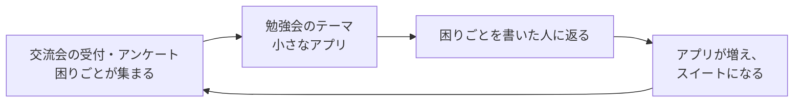
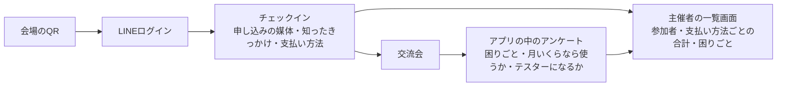

# プロダクトブリーフ：kanaeru-apps

作成：2026-11-19（材料はブレインストーミングで決まったことをまとめた[意図の文書](../brainstorm-kanaeru-apps-concept/brainstorm-kanaeru-apps-concept.md)と[構想メモ](../concept-memo.md)。調べものと、このあと要求をまとめる文書（PRD）づくりに使う細部は[補足](./addendum.md)）

## 1. ひとことで

**日常のめんどくさいことから、解放されてほしい。**

kanaeru（このしくみの名前）は、日常の困りごとを、それを解決する企画やアプリにつなげていくしくみ。最初は、IT交流会で出た仕事の困りごとから始める。交流会の受付とアンケートで困りごとを集め、AI活用勉強会のテーマにしたり、小さなアプリにしたりして返していく。行き着く先は、そうして生まれたアプリを一つのアカウントで使える、**日常のちょっとした課題を解決するスイート**。

最初の1本は、交流会の**受付アプリ**。主催者の受付と清算を楽にする。参加者は受付を済ませるだけで、自然に kanaeru に登録される。

## 2. 誰の、どんな問題か

| 誰 | どんな人か | 困っていること | うまくいった状態 |
|---|---|---|---|
| 参加者（主役） | 交流会に来る非エンジニアのビジネス層 | 仕事のめんどくさいこと（例：日々の事務作業を自動化したい、AIをうまく使えない）を、誰に・どこで話せば解決に近づくのか分からない。交流会で話しても、その場の会話で終わる | 困りごとが勉強会やアプリになり、仕事のめんどくさいことが減る |
| 主催者（最初のユーザー） | 交流会を開いている自分自身。個人開発者でもある | 受付と集金がめんどう。清算のときに、支払い方法ごとの金額を手で計算している。アプリを作っても初期ユーザーが集まらず、需要があるのかも分からない | 受付と清算が楽になり、参加者のリストが自然にたまる |

この想定は、交流会で自分から相談に来た年長のビジネス層の人がきっかけ（悩みは、非エンジニアがAIエージェントをうまく使えないこと、組織でAIをどう活用するか）。

## 3. 参加者への約束

「解決します」とは言い切らず、**「あなたの困りごとが、解決する企画やアプリにつながります」**くらいの温度感で伝える。

参加者が「書いてよかった」と感じるのは、自分の困りごとが **AI活用勉強会のテーマになったとき**、そして**アプリになったとき**。テスターに手を挙げた人には、主催者から公式LINEで1対1の連絡を送る（費用の面は[補足](./addendum.md) 1-3）。

## 4. 最初の版

- **登録は、受付の副産物として起きる**。チェックインは参加者全員が必ず通るので、「登録してください」とお願いしなくてよい。
- **入口は軽く**。名札は紙のまま。困りごとは入口では聞かず、交流会の終わりのアンケートで聞く（人と話したあとのほうが具体的に書ける）。
- **本気度を測る**。「いいね」の数ではなく、「実現したら月◯円なら使う」（答えるだけで、実際には払わない）と「テスターになる」で測る。

**入れる**

- QR → LINEログインで登録・チェックイン
- LINEを使わない参加者のための代わりの方法（主催者が一覧画面から手でチェックインする）
- チェックインでの記録：申し込みの媒体（connpass・Peatix・直接など、どこから申し込んだか）・知ったきっかけ・支払い方法（PayPay・現金）
- 支払い方法ごとの合計
- 交流会の終わりのアンケート（困りごと・月いくらなら使うか・テスターになるか）
- 主催者の一覧画面

**できれば入れる**：オープンチャットへの案内／同じ困りごとへの「私も」／困りごとの行方の表示（検討中 → 勉強会のテーマに決定、または 開発中 → 完成）

**余裕があれば**：台本・タイムテーブルをアプリで見る機能（台本の中身は、次の交流会の準備として別に固める）

**今回は入れない**：デジタルの名札（紙で十分）／アプリ内のオンライン決済／名刺交換・席替え／組織向けの版／完成時の連絡の自動化（公式LINEから手で送る）／有料化

## 5. ほかと何が違うか

- **需要を集めるサービス**（不満買取センターなど）は、匿名の不満をポイントと引き換えに集め、データを企業に売る形が中心。kanaeru は、**交流会で実際に会った人の困りごとを集め、その人に勉強会やアプリとして返す**。
- **イベントの受付ツール**（connpass・Peatix など）は、自分のサービスで申し込んだ人のチェックインはできる。ただ、媒体をまたいだ受付の一元化、当日の支払い方法ごとの集計、知ったきっかけの記録までは扱っていない（[補足](./addendum.md) 1-1）。
- 技術でまねされにくくする強みはない。強みは、**続いている交流会というオフラインの場**と、個人開発でもすばやく作れること。

## 6. うまくいったと、どう分かるか（次の交流会で）

| 目安 | 数字 |
|---|---|
| チェックインでLINEログインした参加者 | 9割 |
| アンケートで困りごとを書いた参加者 | 8割 |
| テスターに手を挙げた参加者 | 2割 |
| 清算のときの手計算 | なくなる |

【仮定】その先の目安：数回の交流会で集まった困りごとから、勉強会のテーマかアプリが1つ決まり、手を挙げた人が勉強会に参加する・アプリを試す。

## 7. 判断の基準

- 交流会では気軽さを最優先にする。先払いや予約課金のような、お金の約束は持ち込まない。
- まずは無料。運用費はクラウドサービスの無料枠でゼロに近づける（技術の制約は[補足](./addendum.md) 2）。
- 作るものは、多数決ではなく、本気度の高い一人の深い困りごとから選ぶ。
- 勉強会で何度も出る同じ質問が、アプリにする候補になる。
- 受付で作るアカウントは、最初からスイート共通のアカウントにする。登録日を残し、有料化するときに、早くから登録した人とテスターに特典で報いる。

## 8. 2〜3年後の姿

受付アプリはスイートの玄関になっていて、交流会に来た人は、初めて来た日からスイートの利用者になっている。スイートの中には、交流会と勉強会で集まった困りごとから生まれたアプリが並ぶ。はじめは仕事のもの（例：この作業をAIでできるかの診断、AIへの頼み方の型、日報や議事録の下書き）で、やがて暮らしのめんどくさいことにも広がる。収益はスイート全体のサブスクリプションで、交流会の外の利用者にも広がっている。

| 段階 | やること |
|---|---|
| 1 | 受付アプリで登録者と困りごとを集める（この版） |
| 2 | 困りごとを勉強会のテーマやアプリにし、手を挙げた人に試してもらう |
| 3 | アプリ群をスイートにまとめ、サブスクリプションにする |

## 9. まだ決めていないこと

- ~~**スイートの料金を誰が払うか**~~：2026-11-19 に主催者が「**使いたい人が払う**。組織か個人かは区別しない」と決めた（契約の持ち主は account。[構成の決めごと](../architecture-kanaeru/architecture-kanaeru.md) AD-16）。組織向けの版（社員の困りごとを集めてAI化の候補にする）の需要は、まだ聞けていない。
- **想定する利用者（ペルソナ）の仮説**：AI活用に悩む、年長で非エンジニアのビジネス層、で合っているか（管理職・経営層かもしれない）。次の交流会で確かめる。
- **名簿の取り込み**：いまどの申し込みの媒体を使っているか、取り込むか（[補足](./addendum.md) 1-4）。
- **暮らしへ広げる時期**：思いは暮らし全体（仕事も家のことも）だが、最初は交流会に来る人の仕事のめんどくさいに絞る。何がそろったら暮らしのアプリに広げるか。
- **主催者向けのスイート**：受付・アンケート・台本の型などを、ほかの交流会の主催者にも出すか。
