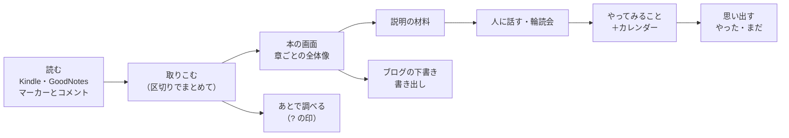

# PRD：読書記録（電子書籍のマーカーを1か所に集め、人に話す・書く・やってみる材料に変える）

## 0. この文書について

**要点**
- Kindle と GoodNotes などで引いたマーカーとコメントを1か所に集め、人に話す・書く・やってみる材料に変えるアプリ。利用者も持ち主もお金を得られる仕組みを持つ。
- 作る順は4段階（7.1。持ち主が決めた）。
  1. **自分で試す版**：4.1〜4.8。持ち主が4週間使う。
  2. **ほかの人に配る版**：公開の本棚・LINE で送る。
  3. **売り始める版**：有料プラン・紹介の特典。
  4. **集まりとチームの版**：輪読会・組織・読みたい本リスト。
- いちばん大きな危うさだった「GoodNotes の書き出しの PDF から、マーカーとコメントを文字として取り出せるか」は、2026-11-28 に確かめて**取り出せる**と分かった（FR-R7）。
- 【仮決め】は 2026-11-27 に持ち主が確かめて採用した（9章）。決めきれていないことは10章。

**この文書の前提**
- **読む人**：PaletKit の持ち主と、作る Claude Code のセッション。
- **もとにしたもの**：
  - 2026-11-27 の壁打ち（[.memlog.md](./.memlog.md)）
  - その前に構想を練った場（[練った構想](../forge-kanaeru-reading/forge-kanaeru-reading.md)）
  - 前の調べもの（[B3 読書記録](../research-app-ideas/b3-reading.md)）
  - 競合の稼ぎ方・アフィリエイトの規約・著作権の調べもの（[addendum.md](./addendum.md)）
  - レビュー（[質の点検](./review-rubric.md)・[構成との合い方](./review-fit.md)・[構想との突き合わせ](./reconcile-forge.md)・[調べものとの突き合わせ](./reconcile-research.md)）
- **構想・調べものから変えたこと**：構想の中心だった「読み終えるたびに LINE に一言」を外し、入力を、すでに引いているマーカーとコメントにした。経緯は11章。
- **印**：
  - 「持ち主が決めた」は、PaletKit の持ち主が決めたこと。
  - 【仮決め】は、壁打ちやレビューから推し量ったことで、持ち主の確かめを待つ。
  - 【段階N】は、7.1 の作る順の段階。
  - 【段階1の後半か段階2】は、段階1の中で後回しにしてよく、段階2に回してもよいもの。
  - AI の使い方の呼び名（貼る形・自分のキーの形）は3章。
  - 「構成」は、構成の決めごと（アーキテクチャの文書。`_bmad-output/architecture-kanaeru/`）のこと。

## 1. ねらい

仕事で「この技術の理解が足りない」と感じて読んだ本を、**人に説明できる・書ける・仕事でやってみる**ところまで持っていく。

利用者はすでに、Kindle と GoodNotes（固定レイアウトの本は PDF を買って GoodNotes で読む）でマーカーを引き、コメントを付けている。ところが、それが読む場所ごとに散らばり、マーカーのまま眠っている。

- Kindle のノートブックでは、本ごとのマーカーは見られる。しかし、説明の材料やブログの下書きにはできず、GoodNotes の PDF とも混ざらない。
- 英語圏の Readwise は、マーカーを集めて復習する形を持つ。しかし、日本の Kindle の自動の同期には対応しておらず、画面も英語。

このアプリは、**読んでいる最中の習慣を変えずに**、いろいろな電子書籍アプリのマーカーとコメントを1か所に集める。それを次の材料に変える。

- 前回の内容と全体像
- 人に話す・輪読会の材料
- 思い出す練習
- ブログの下書き

あわせて、**利用者も持ち主もお金を得られる**仕組みを持つ（持ち主の要望。4.11）。

- **利用者**：自分のブログや公開の本棚から本が買われたとき、紹介料を得る。
- **持ち主**：スイートの有料プランと、公開の本棚のリンクから得る。

本そのものの要約は作らない。本の要約は、汎用の AI や大手（Google Play ブックスなど）に置きかえられ、著作権の面でも危ういため（5章）。AI は、利用者が押したときだけ、利用者自身の AI で動く（調べものにあったブクログの「勝手に AI に食わせるな」への答え）。

## 2. 使う人

### 2.1 片づけたい用事

- **c 人に話せる・書ける**：読んだ本の内容を、同僚への説明・輪読会・ブログにしたい（主な用事。持ち主が決めた）。
- **b 仕事でやってみる**：話したあとに、やってみることを決め、実際にやりたい（主な用事。持ち主が決めた）。
- **a 覚えている**：数日〜数週間あとに思い出して、定着させたい（c を支える手段）。
- **全体像**：読むのが遅く、2〜5冊を並行して部分的に読むので、続きを読む前に前回の内容と全体像をつかみたい。
- **記録を1つに**：Kindle・GoodNotes などに散らばったマーカーを1か所にまとめたい。

### 2.2 この版で相手にしない人

- **紙の本が中心の人**：紙のページを撮って文字を読み取る形（調べものの「撮って索引」）は作らない。
- **本の要約を読みたいだけの人**：要約サービス（flier など）と汎用の AI の領分。
- **読書の SNS で交流したい人**：読書メーター・ブクログの領分。公開の本棚（4.9）は、交流ではなく紹介のページ。

### 2.3 利用の流れ

段階1の流れ：

主人公：**ゆうき**（仮の人。30代、IT の会社で働く）
- Kindle の本と、GoodNotes（5）の PDF で、2〜5冊を並行して部分的に読む。通勤中・昼休み・寝る前に読み、0時すぎには読まない。
- 大事だと思った所にマーカーを引き、コメント（GoodNotes はテキストボックス）を付ける。マーカーの色は使い分けない。
- 分からない所は、コメントの先頭に `?` を書く（持ち主が決めた）。
- 輪読会に出ていて、読んだ本をブログに書きたい。
- 本は主に iPhone で読む。取りこみは、iPhone・iPad・PC のどれでもできる（持ち主が決めた）。

- **UJ-0 仕事で足りないと気づき、読み始める**
  ゆうきは、仕事中に「この技術の理解が足りない」と思い、技術書を買う。読書記録に本を登録するとき、**分かりたいこと**（例：「チームに Kubernetes のネットワークの仕組みを説明できるようになる」）を一言残す（持ち主が決めた）。
- **UJ-1 マーカーを1か所に集める**
  通勤中は Kindle、昼休みは GoodNotes で読み、マーカーとコメントを残す。読んでいる最中は、ほかのアプリに移らない。区切りのよい所で、各アプリのマーカーとコメントを**まとめて取りこむ**。どのアプリで読んだ本も、1つの本棚に並ぶ。
- **UJ-2 続きを読む前に、前回の内容と全体像をつかむ**
  1週間ぶりに3冊目を開く前に、読書記録でその本を開く。マーカーとコメントが**章ごとに、本の中の位置の順**に並ぶ。どの章を読んだかが分かる。1分眺めて、続きを読む。
- **UJ-3 説明の材料を作って話し、やってみることを決める**（c → b）
  読み終えたころ、または輪読会の前に、分かりたいこと・マーカー・コメントから**説明の材料**を作る（AI の貼る形）。同僚や輪読会で話したあと、**やってみること**を1〜3個残し、「Google カレンダーに入れる」を押す。仕事の途中で「あの本にあった」と思ったときは、すべての本をまたいで探し、その本の画面の、その位置に移る。
- **UJ-4 カレンダーが鳴って、思い出し、やってみたかを残す**（a・b）
  数日〜数週間あと、カレンダーが鳴る。予定のリンクから開くと、その本の大事なマーカーとやってみることが出る。思い出して、「やった・まだ・やめた」を残す。
- **UJ-5 1冊が終わったころ、ブログを書く**（c）
  分かりたいこと・マーカー・コメント・説明の材料・やってみた結果を材料に、ブログの下書きを作る（AI の貼る形）。出典と、自分のアソシエイトの ID 付きのリンクが入った Markdown で書き出し、note や自分のブログに載せる。
- **UJ-6 分からない所を、あとで一発で調べる**
  取りこむと、`?` で始まるコメントが「あとで調べる」に並ぶ。1つ押すと、本の名前・章・その文・コメント・分かりたいことが入った状態で、自分の AI か検索が開く。分かったら、分かったことを一言残して閉じる。
- **UJ-7 公開の本棚から本が買われる**【段階2】
  ゆうきは、読み終えた本の感想（自分の言葉。マーカーは短い引用だけ）を公開の本棚に出し、URL を自分のブログや SNS に貼る。その URL は、Amazon アソシエイトに自分のサイトとして登録してある。読んだ人が、ページのリンクから本を買うと、ゆうきに紹介料が入る。

**受け入れた弱み**（構想で持ち主が決めた）：アプリをしばらく開かなくなった人を、LINE の知らせで呼び戻すことはしない（無課金のため）。思い出すきっかけは、利用者のカレンダーだけ。

## 3. ことば

| ことば | 意味 |
|---|---|
| 本 | 読書記録に登録した1冊。書誌（書名・著者・ISBN）か、手で書いた名前で登録する |
| 読む場所 | 本を読むアプリ（Kindle・GoodNotes・そのほか）。読書記録は読む場所を替えさせない |
| マーカー | 読む場所で引いた線と、その下の本の文。本の中の位置（Kindle の位置番号・ページ）を持つ |
| コメント | マーカーに付けた自分の文。GoodNotes ではテキストボックス |
| 章 | 本の中の区切り。Kindle は書き出しの章の見出し、GoodNotes は PDF のページの上の柱（章・節の名前）から取る。取れなければページで並べる |
| `?` の印 | コメントの先頭の `?`（全角の `？` も同じ）。「あとで調べる」に入れる印 |
| 取りこみ | 読む場所からマーカーとコメントを読書記録に入れること。利用者が区切りのよい所でまとめて行う |
| 分かりたいこと | 本を登録するときに残す、その本で分かりたいことの一言 |
| 説明の材料 | 人に話す・輪読会のための、自分の言葉が主の要点。本の文は出典つきの短い引用だけ（形は FR-R22） |
| やってみること | 話したあとに決める、仕事でやってみる1〜3個のこと。Google カレンダーの予定にできる |
| 貼る形・自分のキーの形 | AI の使い方（AD-20 の段階1・段階2。作る順の段階と区別するため、この文書ではこう呼ぶ）。貼る形は、頼む文をコピーして自分の AI に貼り、答えを貼り戻す。自分のキーの形は、自分の API キーを使う。PaletKit は AI の利用料を持たない |
| 公開の本棚 | だれでもログインなしで見られる、利用者の感想のページ【段階2】 |
| 自分の ID | 利用者自身のアフィリエイトの ID（Amazon アソシエイトのトラッキング ID・楽天アフィリエイトの ID）。秘密ではない |
| A・P | Amazon アソシエイトの運営規約（A）とプログラムポリシー（P）の条文。addendum.md の冒頭 |

## 4. 機能

### 4.1 本棚と本

- **FR-R1**：本を登録できる。書名か ISBN で、書誌の API から候補を出して選ぶ。見つからなければ、手で書いた名前・著者で登録する（技術書典の本・出版社から直接買った PDF・洋書など）。
  - 書誌の API は、PaletKit の API を通して呼び、持つのは選んだ本の書誌（書名・著者・ISBN・書影の URL）だけ【仮決め】。書名で探すのは国立国会図書館サーチ、ISBN で取るのは openBD（2026-11-28 に利用条件を調べて決めた。[補足](./addendum.md) 8章）。
  - 書影は openBD にあるときだけ出す。技術書の多くは書影がないので、書名を入れた仮の表紙を出す。
- **FR-R2**：登録するときに、**分かりたいこと**を一言残せる（任意。あとから直せる。持ち主が決めた）。
- **FR-R3**：本に、読む場所（Kindle・GoodNotes・そのほか）と、状態（読んでいる・読み終えた・やめた）を付けられる。1冊を2つの読む場所で読んでもよい。
- **FR-R4**：本棚は、読んでいる本を上に、最後に取りこんだ順に並べる【仮決め】。
- **FR-R5**：同じ本を2回登録してしまったら、1冊にまとめられる（マーカー・コメント・説明の材料などを寄せる）。本を消すときは、確かめてから消す。

### 4.2 マーカーとコメントの取りこみ

**取りこみの条件**【仮決め】
- 手間は、**1冊につき1分以内**を目安にする。読んでいる最中の習慣（マーカーとコメント）を変えさせない。
- 端末の中で読むファイルは、300MB まで。書きこみのある技術書の PDF は大きくなるため。
- 1回の取りこみは、マーカー5,000件まで。
- 読み取ったマーカーは、PaletKit の API に送る本文の上限（100KB）に収まるよう分けて送る。2回送っても重ならない（FR-R10）。

- **FR-R6**：**Kindle**のマーカーとコメントを取りこめる。主な入れ方は、次の2つ【仮決め】。どちらも利用者自身の操作で、Amazon の画面を自動で読む・ログインを預かることはしない。
  - Kindle のアプリのノートブックの「書き出し」で作ったファイル（メールで届く HTML）を読ませる
  - Web のノートブック（`read.amazon.co.jp/notebook`）の画面をコピーして貼る
  - ファイルは**端末の中で**読み、読み取ったマーカーとコメントだけを送る。書き出しに含まれる章の見出し・位置・ページを拾う。出版社の決めた書き出しの上限で切れているときは、そう知らせる。
- **FR-R7**：**GoodNotes**のマーカーとコメント（テキストボックス）を取りこめる。GoodNotes から書き出した PDF を**端末の中で**読み、マーカーの下の文・テキストボックスの文・ページ・章を拾う。
  - 2026-11-28 に持ち主の書き出した PDF で確かめた（細かい形は [補足](./addendum.md) 6章）。マーカーもテキストボックスも、PDF の注釈ではなくページに焼きこまれる。ただし絵ではなく、拾える形で残る。
    - マーカー：半透明の太い線。その下にある本の文を、マーカーの文として拾う。
    - テキストボックス：本と違う書体の文。同じページのいちばん近いマーカーのコメントにする（上にも下にも置かれる）。
    - 章：しおり（目次）は残らない。ページの上の柱（章・節の名前）とページ番号から取る。柱がないページ（章の扉など）は、前のページの章を引き継ぐ。
  - 間違えて結びつけることがあるので、FR-R9 の確かめの画面で、コメントの付け先と章を直せるようにする。
  - PDF そのものはサーバーに送らず、持たない【仮決め】。読み取れない形のときは、FR-R8 の貼り付けに切りかえる。
  - PDF を読む部品は、取りこみの画面を開いたときだけ読みこみ、画面の守り（CSP）を緩めない形を選ぶ。日本語の本を読むには、部品の文字の対応表（CMap）も自分のサーバーから出す。
- **FR-R8**：そのほかの読む場所は、マーカーの文とコメントを**貼り付け**で取りこめる（1行に1つ・ページは任意）。
- **FR-R9**：取りこむ前に、次のものを見せて確かめてから入れる。
  - 読み取った件数・章
  - **どの本に入れるか**：書名で候補を出し、合っていなければ選び直すか、新しく登録する
- **FR-R10**：同じ本を取りこみ直したときの扱い【仮決め】。
  - 前に取りこんだマーカーは重ならない（位置と文で同じものと見る）。
  - 読書記録の側で直したコメントと、付け外した `?` の印は、取りこみ直しで上書きしない。
  - 読む場所の側で直したコメントは、読書記録の側で直していなければ新しいほうにする。
  - 読む場所の側で消したマーカーは、読書記録からは消さない。
- **FR-R11**：`?` で始まるコメントを拾い、「あとで調べる」（4.5）に入れる。取りこんだあとに、画面でマーカーに `?` の印を付け外しもできる。
- **FR-R12**：読書記録の画面で、マーカーのコメントを直す・足す、マーカーを消すことができる。

### 4.3 本の画面（前回の内容と全体像）

- **FR-R13**：本の画面に、マーカーとコメントを**章ごとに、本の中の位置の順**（読んだ順ではない）に並べる。章が取れないときはページで並べる。
- **FR-R14**：章ごとに、マーカーのある章・ない章が分かるようにし、どの章を読んだかを示す【仮決め】。部分的に読む人のため、「いちばん後ろの位置」だけでは示さない。
- **FR-R15**：本の画面の上に、次のものを出す。
  - 分かりたいこと
  - 説明の材料（あれば）
  - まだ結果を残していないやってみること（あれば。カレンダーを待たずに「やった・まだ・やめた」を残せる）
- **FR-R16**：目次を貼ると、目次の上に読んだ章・読んでいない章と自分のマーカーを出す（任意。持ち主が決めた。AI に目次を作らせない）【段階1の後半か段階2】。

### 4.4 探す

- **FR-R17**：すべての本をまたいで、マーカー・コメント・分かりたいこと・説明の材料を言葉で探せる。結果は本ごとにまとめ、押すと本の画面のその位置へ移る。
- **FR-R18**：意味で探す（同じ言葉でなくても当たる）のは、AI の費用が要るので、この版では作らない。作るなら、自分のキーの形にする【仮決め】。

### 4.5 あとで調べる

- **FR-R19**：「あとで調べる」に、`?` の印のマーカーとコメントを、すべての本をまたいで並べる。
- **FR-R20**：1つを押すと、調べる文の入った状態で、利用者の選んだ AI か検索（ChatGPT・Claude・Google など）が新しいタブで開く【仮決め】。
  - 調べる文の中身：本の名前・章・マーカーの文・コメント・分かりたいこと。
  - 調べる文は、利用者のブラウザが開く URL に入る。PaletKit から外の AI には何も送らない（AD-20 の貼る形と同じ扱い）。
  - URL に入ることを画面で知らせる。長い文は、コピーに切りかえる。
- **FR-R21**：調べ終えたら、分かったことを一言残して「調べた」にできる。分かったことは、そのマーカーのコメントの下に並ぶ。

### 4.6 説明の材料とやってみること

- **FR-R22**：本ごとに**説明の材料**を作れる（AI の貼る形）。分かりたいこと・マーカー・コメント・調べて分かったことから、頼む文を組み立てる。
  - 貼り戻した答えは、決めた形かを PaletKit が確かめ、利用者に見せて確かめてもらってから残す（AD-20）。
  - **形**：
    - 見出し（分かりたいこと）
    - 要点3〜5個（それぞれ、自分の言葉の説明に、本の文の引用を0〜1つと、その位置）
    - 話すときの例
    - やってみることの候補1〜3個
  - 頼む文には、「自分の言葉が主で、本の文は出典つきの短い引用だけにする」「本の要約にしない」を入れる（5章）。
- **FR-R23**：説明の材料は、AI を使わずに自分で書く・直すこともできる。
- **FR-R24**：本ごとに**やってみること**を1〜3個残せる。それぞれに「Google カレンダーに入れる」のリンクを出す。
  - 予定の日は既定で2週間後、時刻は夜の停止（0時〜8時）の外の時刻で、既定は12時【仮決め】。
  - 予定の説明には、「思い出す」の画面（FR-R26）へのリンク（ミニアプリの URL）を入れる。
- **FR-R25**：説明の材料をコピーできる。LINE で送るのは 4.10【段階2】。

### 4.7 思い出す

- **FR-R26**：カレンダーの予定のリンクから開く「思い出す」の画面に、その本の大事なマーカーとコメントをいくつか出す。どれを出すかは、コメントのあるものを先にし、その中ではまだ見せていないものを先にする【仮決め】。
- **FR-R27**：同じ画面で、やってみることに「やった・まだ・やめた」と、結果の一言を残せる。「まだ」なら、次の予定を入れ直すリンクを出す。
- **FR-R28**：LINE の公式アカウントから知らせを送ることはしない（無課金。持ち主が決めた）。催促・連続の日数・ノルマは出さない。開かなかった日を責めない。

### 4.8 書き出しとブログの下書き

- **FR-R29**：本ごとに **Markdown** で書き出せる。中身は次のとおり。
  - 書名・著者・ISBN・分かりたいこと
  - マーカー（引用の形・位置）・コメント
  - 説明の材料・やってみることと結果
  - 出典
- **FR-R30**：ブログの下書きを、AI の貼る形で作れる。材料は FR-R29 と同じ。
  - **形**：題・はじめの段落・節（それぞれ、自分の実践と考えが主で、引用は0〜1つと出典）・やってみた結果・まとめ。
  - 頼む文には、「実践と自分の考えが主・本の要約にしない・引用は最小限で出典を書く」を入れる。
  - アソシエイトのリンクと開示の文は、答えを貼り戻したあとで PaletKit が足す（FR-R45）。
- **FR-R31**：設定に**自分の ID**（Amazon アソシエイト・楽天アフィリエイト）を入れると、書き出しとブログの下書きに、次の2つを入れる（持ち主が決めた）。
  - その ID の付いた本のリンク。Kindle 版の ASIN が分からないときは、ISBN で紙の本に向ける【仮決め】
  - 規約で決まった開示の文（「Amazon のアソシエイトとして…」。A5条）
- **FR-R32**：すべての本をまとめて書き出せる（Markdown の束と CSV）。データが消えない安心のため（調べもの 4章のレビューの不満）。**すべての書き出しは、有料プランができても無料に残す**【仮決め】。

### 4.9 公開の本棚【段階2】

作る前に済ませることは、6章の「段階2の前」と10章の「段階2の前に確かめる」。

- **FR-R33**：本ごとに、公開の本棚に**出す・出さない**を選べる。既定は出さない。
- **FR-R34**：公開のページに出すのは、次のものだけ。
  - 書名・著者・書影（書誌の API の条件で許されるとき）
  - **自分の感想**
  - 本の文の引用（最大3つ【仮決め】・出典つき）
  - 本のリンク（FR-R38・FR-R39・FR-R41）

  マーカーの一覧・説明の材料・やってみること・`?` の印・LINE の表示名は出さない。感想が短すぎると出せないようにする【仮決め】。ページの主を自分の言葉にするため（著作権の引用の要件と、Amazon の「重要な解説」の要件。addendum.md 4章・5章）。
- **FR-R35**：公開のページは、利用者が決めた**公開の名前**で、変わらない URL を持つ。
  - 名前には決まりを置く：一意・予約語・なりすましの防止・変えるときの扱い・退会のあとの再利用。中身は構成で決める。
  - URL の形も構成で決める（AD-15 の `/<key>/…` に従うか、例外にするか）。
  - 利用者がこの URL を Amazon アソシエイトに自分のサイトとして登録できるよう、登録の手順を案内する。
- **FR-R36**：公開のページは、ログインなしで、ふつうのブラウザで見られる（LINE のミニアプリの中では開かせない）。検索に出してよい（人を集める入口。持ち主が決めた）。ページごとの題と説明を持つ。
- **FR-R37**：利用者はいつでも、本ごと・本棚ごと公開をやめられる。持ち主は、規約や法に反するページを止められる（公開していない記録を読むことと、中身を直すことはしない。AD-19 に例外を足す）。
- **FR-R38**：公開の本棚のリンクには、利用者自身の ID を付ける。
  - 付けるのは、利用者が「このページの URL をアソシエイトに登録した」と確かめたときだけ。
  - 開示の文は、利用者が決めた名前（公開の名前）で、そのページに自動で出す（P 参加要件6条(b)・A 5条）。
- **FR-R39**：利用者が ID を設定していない（または登録を確かめていない）公開のページでは、持ち主の ID のリンクにし、持ち主の名前で開示の文を出す（note と同じ形。PaletKit のドメインを持ち主のサイトとして登録する）。
  - 作る前に、景品表示法のステマ規制の当てはめ（利用者の感想の横に持ち主の ID のリンクを置くこと）と、「広告」「PR」の表示の要否を確かめる（10章）。
- **FR-R40**：公開のページから、読書記録を始められる入口（「自分も本棚を作る」）を出す。
- **FR-R41**：本のリンクに、Amazon のほか、楽天ブックス・楽天 Kobo を出せる。楽天にも自分の ID を使える（楽天の規約で、登録した「ブログサービス」の上なら可）。

### 4.10 輪読会の仲間に LINE で送る【段階2】

- **FR-R46**：説明の材料を、利用者自身の LINE から、友だちやグループに送れる（LINE のシェアの画面）。
  - 公式アカウントから送らないので、費用はかからない。
  - 送る前に、「自分の言葉が主で、引用は出典つき」の形になっているかを見せる。
  - アソシエイトのリンクは入れない（FR-R45）。

### 4.11 利用者も持ち主もお金を得る仕組み

持ち主が決めた（2026-11-27。壁打ちで挙げた10の方法をすべて入れる。表は、その10に、あとで必ず作ると決めた「読みたい本リストの買うリンク」を足した11行）。どれも原則 I（お金を預からない）の中で作る。

| 方法 | 誰が得るか | 段階 | FR |
|---|---|---|---|
| ブログ・note の書き出しに、自分の ID のリンク | 利用者 | 1 | FR-R31 |
| 公開の本棚に、利用者自身の ID のリンク | 利用者 | 2 | FR-R38 |
| ID を設定していない人の公開のページに、持ち主の ID のリンク | 持ち主 | 2 | FR-R39 |
| 公開のページを、人を集める入口にする | 持ち主 | 2 | FR-R36・FR-R40 |
| 本屋を増やす（楽天ブックス・楽天 Kobo など） | 利用者 | 2 | FR-R41 |
| 有料の記事（実践の話が主）の書き方の案内 | 利用者 | 2 | FR-R42 |
| スイートの有料プランで、読書記録の機能を分ける | 持ち主 | 3 | FR-R43 |
| 紹介の特典（スイートの無料の月） | 利用者 | 3 | FR-R44 |
| 有料の輪読会・勉強会を開く | 利用者 | 4 | FR-R47 |
| チームや会社向け（社内の輪読会） | 持ち主 | 4 | FR-R48 |
| 読みたい本リストに、持ち主の「買う」リンク | 持ち主 | 4 | FR-R49 |

- **FR-R42**：note の有料記事に向けた書き出しの形と、書き方の案内を出す【段階2】。案内の中身は「自分の実践と考えが主。本の詳しい要約は売らない（翻案に当たりうる。addendum.md 5章）。引用は最小限で出典を書く」。
- **FR-R43**：スイートの有料プラン（AD-16 の契約）ができたら、読書記録の機能を無料と有料に分ける【段階3】。
  - すべての書き出し（FR-R32）・取りこみ・探すは、無料に残す【仮決め】。データの安心と、レビューにあった「課金しないと使えない」への答え。
  - ほかの線は、売り始めるときに決める（10章）。
- **FR-R44**：友だちを PaletKit に紹介した人に、スイートの無料の月を渡す【段階3】。
  - 現金は払わない（原則 I）。
  - リンクを使ったことに見返りを結びつけない（P 参加要件6条(g)）。
  - 仕組みはスイートの共通で作る（6章）。作る前に、景品表示法の景品の扱いを確かめる。
- **FR-R45**：アソシエイトのリンクの置き場所の決まり。この PRD のほかの所は、ここを指す。
  - 入れるのは、書き出し（FR-R31）と公開のページ（FR-R38・FR-R39）だけ。開示の文は自動で出す。
  - **LINE で送る説明の材料（4.10）には入れない**。Amazon は LINE の扱いが要確認で、楽天は LINE を名指しで禁止しているため。
  - AI の頼む文と答えの形には入れない。答えを貼り戻したあとで PaletKit が足す（Amazon は生成 AI での使用を禁じている）。
  - リンクを使ったことへの見返りは作らない（P 参加要件6条(g)）。

### 4.12 集まりとチーム【段階4】

- **FR-R47**：説明の材料を使った輪読会・勉強会を、受付アプリ（予約を含む）で募集し、受け付けられる（参加費は記録するだけ。原則 I）。
  - まず、利用者が受付アプリで交流会を作り、読書記録はそれを選んで説明の材料をつなぐだけの形を候補にする（AD-23 の今の向き：ほかのアプリは読むだけ）【仮決め】。
  - 読書記録から交流会を作るなら、先に受付アプリの予約の PRD と AD-23 を直す（原則 IV）。
- **FR-R48**：組織（AD-22）で、輪読会の本棚を分け合える。
  - 組織の人は、ほかの人の説明の材料と、公開を選んだ感想を見られる。マーカーとコメントは、本人が出すと決めたものだけ【仮決め】。
  - 組織で見えるほかの人の記録は、AI の頼む文と MCP に入れない（AD-20・原則 II）。
- **FR-R49**：読みたい本リストを持てる。交流会で紹介された本を、受付アプリから1タップで入れられる。
  - まだ買っていない本なので、持ち主の ID の「買う」リンクを置く（あとで必ず作ると持ち主が決めた。backlog の B3 の行）。
  - 作る前に、景品表示法のステマ規制と Amazon の規約を確かめる。

## 5. 守ること（非機能・Constitution との関係）

- **個人の情報（Constitution II）**
  - 持つものは、この PRD で決めたものだけ。
    - 本：書誌（書名・著者・ISBN・書影の URL）か手で書いた名前・読む場所・状態・分かりたいこと・貼った目次
    - マーカー（本の文・位置・章）・コメント・`?` の印・調べる先に選んだ AI か検索（FR-R20）・調べて分かったこと
    - 説明の材料・ブログの下書き・やってみること（予定日・結果・結果を残した日時）
    - 思い出す画面で見せた記録
    - 自分の ID・公開の名前・公開の感想・出す本と選んだ引用・「URL を登録した」の確かめ【段階2】
  - 読書の記録は、本人だけが見る。公開の本棚（4.9）と組織の本棚（4.12）に出すのは、本人が選んだものだけ。
  - 外の AI に渡すのは本人の記録だけで、AI は利用者が押したときだけ動く（AD-20）。貼る形では、PaletKit から外に何も送らない。
  - ログには、マーカー・コメント・感想・説明の材料の本文を出さない。
  - 段階2で利用者の数を数えるときは、名前を含まない形にする。
- **著作権**
  - 本のファイル（PDF・Kindle の書き出し）はサーバーに持たない。端末の中で読み、持つのは利用者が引いたマーカーの文と、自分のコメントだけ（FR-R6・FR-R7）。
  - 本の要約、AI が作る目次、本の文を並べただけの公開のページは作らない。
  - 外に出すもの（公開のページ・LINE で送る材料・書き出し・ブログの下書き）は、自分の言葉が主で、本の文は出典つきの短い引用にする。そうなるよう、頼む文と画面で後押しする（引用の要件。addendum.md 5章）。
- **アフィリエイトの規約**：置き場所・開示・見返りの決まりは FR-R45。利用者の違反を後押しすると持ち主の違反とみなされる（A12条）ので、案内と既定で防ぐ（FR-R35・FR-R38・FR-R45）。
- **費用（Constitution V・持ち主が決めた無課金）**
  - AI の利用料は0（貼る形・自分のキーの形）。LINE の公式アカウントから送らない。
  - ファイルは端末の中で読む。思い出すきっかけはカレンダーに任せる。
- **夜の停止（AD-10）**
  - 段階1（持ち主だけ）は、0時〜8時の停止を受け入れる。持ち主は0時すぎに読まない（構想）。
  - 画面はほかのアプリと同じ「夜間は止まっています」を出す。カレンダーの予定の時刻は、DB の動いている時間を既定にする（FR-R24）。
  - ほかの人に配る前に、夜の停止を見直す。交流会の日だけでなく毎日の暮らしで使うアプリは、構成の決めごとの「あとで決めること（Deferred）」で、出すときに AD-10 を見直すことになっている（10章）。公開のページの夜の扱いは、別に決める（6章）。
- **データの安心**
  - いつでもすべてを書き出せる（FR-R32）。本・マーカーは本人がいつでも消せ、消す前に確かめる。
  - DB は毎日バックアップを取り、7日分残す（AD-9）。
  - 退会したら、読書の記録を消す（AD-19）。
  - 取りこみ直しでは、前の記録と、読書記録の側で直したものを壊さない（FR-R10）。
  - 読書記録をやめるときは、前もって知らせ、書き出す期間を置く【仮決め】。
- **公開のページの守り**：ログインなしで開けるので、回数の制限をかける（core-016）。出すのは 4.9 で決めたものだけ。

## 6. 構成の決めごとと Constitution に要るもの

`/bmad-architecture` で決める。ここでは要るものを挙げる。詳しくは [構成との合い方](./review-fit.md)。人物メモ（B7）のセッションと並行して進めるので、DB の変更と共通の PR は [並行開発の決まり](../../docs/rules/parallel-development.md) のとおりに進める。

**段階1**
- **アプリの登録（AD-15）**：key は `reading`、名前は「読書」【仮決め】、`uses: []`。
  - `accountData` の文：「本・マーカーとコメント・説明の材料・やってみること・自分の ID」【仮決め】。
- **記録を持つ account（AD-19）**：本と読書の記録は、利用者の account が持つ。
  - 段階1〜3は組織に入れないので、退会の前の手順は持たない。account を消すと、記録も消える。
  - 段階4で組織に入れると、AD-19・AD-22 の引き継ぎが要る。
- **DB の変更（AD-17）**：読書記録の表は account だけを参照するので、表を作る並びのどこに置いてもよい。取りこみ直しで重ならないことは、DB の一意の制約で守る（FR-R10）。
- **AI（AD-20）**：AI の作業（説明の材料・ブログの下書き）と、調べる文の組み立ては、`packages/contracts/src/reading/` に置く。
  - MCP（AD-21）で本人のマーカーを読ませるツールは、利用者の声を見てから作るかを決める（範囲は `reading:read`）。
- **書誌の API**（新しい決めごとの候補）：reading が外の API を呼ぶ形（道具の差しかえ・鍵は Secret Manager・持つのは選んだ本の書誌だけ・書影は配信元の URL から出し、写しを持たない）。
- **ファイルを端末の中で読む部品**：画面の reading の領域に置き、取りこみの画面を開いたときだけ読みこむ。CSP を緩めない形を選ぶ。
- **ログインと LINE（AD-4・AD-14）**
  - カレンダーの予定のリンクは、ミニアプリの URL にする。
  - PC のブラウザで取りこむときの LINE ログイン（構成の Open Questions 3）と、LINE の中のブラウザでファイルを選べるかを確かめる（10章）。
- **共通の PR**：段階1でも要る見込み。順番は10章。
  - 画面の CSP：書影の画像の配信元・PDF を読む部品。
  - カレンダーの道具：`googleCalendarUrl` は予約の約束（`packages/contracts/src/booking/calendar.ts`）にあり、`uses: []` の reading からは読めない。写さずに共通へ移す（AD-18：2つ目の領域が要り、形が固まった）。

**段階2の前**
- **公開の本棚**（新しい決めごとの候補）
  - **独自のドメイン**：「変わらない URL」を Amazon に登録してもらうので、Cloud Run の既定の URL のまま出さない。独自のドメインを取ってから出す（backlog の C1）。⚠️ ドメインは年に約1,500円かかる（無課金の例外として持ち主の確かめが要る。10章）。
  - URL の形（AD-15 の `/<key>/…` に従うか、例外にするか）と公開の名前の決まり。
  - LIFF を立ち上げない URL に置く。
  - ページごとの題・説明・OGP・正しい状態コードを返す。
  - 検索に出す・回数の制限。
  - **夜の停止の間の出し方**：毎日8時間止まると、検索・Amazon の審査・買う人に響く（AD-10 に1行足す）。
- **AD-19 を直す**：持ち主（運営者）は、公開されている記録だけを止められる（公開していない記録を読むことと、中身を直すことはしない）。
- **Constitution の改訂（1.4.0）**：技術の制約の例外は、今は試合表の見るだけのページだけ（推測できない URL・その日で切れる・検索に出さない）。公開の本棚はその逆の条件で、しかも利用者の書いた文章をログインなしで出すのはこのリポジトリで初めて。改訂の叩き台の中身は次のとおり。
  - ふつうのブラウザ・ログインなしで開ける。
  - 出すのは、本人が出すと選んだ本の書誌・感想・出典つきの短い引用・本のリンクだけ。既定は出さない。
  - 本人はいつでもやめられる。持ち主は規約や法に反するものを止められる。
  - 独自のドメインの上の変わらない URL。回数の制限をかける。
- **利用規約・プライバシーポリシー**（スイートの共通）：読書記録の節を足す（持つもの・公開の本棚の投稿の決まり・アフィリエイトの開示）。自分のキーの形を入れるときは、今の「外の AI に何も送りません」の文と、外国の AI に送るときの個人情報保護法の論点を見直す。

**段階3の前**
- **スイートの共通**：契約（AD-16）・紹介の特典・特定商取引法の表記と最終の確かめの画面は、スイートの共通の PRD と共通の PR で作る。読書記録の PRD が決めるのは、有料にする読書記録の機能だけ。

**段階4の前**
- **AD-23 を直す**：ほかのアプリが交流会を作る・選ぶ（FR-R47 で、読書記録から作る形を選んだときだけ）。

## 7. 範囲

### 7.1 作る順（持ち主が決めた）

1. **段階1：自分で試す版**
   - 中身：4.1〜4.8（本棚と本・取りこみ・本の画面・探す・あとで調べる・説明の材料とやってみることとカレンダー・思い出す・書き出しとブログの下書き〈自分の ID を含む〉）。
   - 持ち主が自分で**4週間**使い、8章の基準で確かめる。2週間で結果がはっきりすれば、段階2に進むかを早めに決めてよい。
   - その前に、GoodNotes の書き出しの形を確かめ（10章）、共通の PR（6章）を入れる。
2. **段階2：ほかの人に配る版**（自分で試してよかったら）
   - 公開の本棚（4.9。利用者と持ち主の ID・入口・本屋を増やす）・LINE で送る（4.10）・有料の記事の案内（FR-R42）。
   - その前に、6章の「段階2の前」と、10章の「段階2の前に確かめる」を済ませる。
3. **段階3：売り始める版**（スイートの契約ができたら）
   - 有料にする機能の線引き（FR-R43）・紹介の特典（FR-R44）。
4. **段階4：集まりとチームの版**
   - 有料の輪読会（FR-R47）・組織の本棚（FR-R48）・読みたい本リストと持ち主の「買う」リンク（FR-R49）。

### 7.2 作らないもの

- 紙の本のページを撮って読み取る
- Amazon・GoodNotes の画面を自動で読む・ログインを預かる取りこみ
- 本そのものの要約・AI が作る目次・意味で探す（意味で探すのは、作るなら自分のキーの形）
- LINE の公式アカウントから送る知らせ・LINE で文を受ける仕組み
- 催促・連続の日数・ノルマ
- 読書の SNS（フォロー・いいね・コメントのやりとり）
- アプリの中での決済・利用者への現金の支払い（原則 I）

## 8. 成功の基準

**段階1**（持ち主が自分で4週間使う。持ち主が決めた）

| 見ること | よかった | 考え直す |
|---|---|---|
| 集まったか | 読んでいる本のマーカーを、2回以上取りこめた（Kindle と GoodNotes の両方） | 取りこみが面倒で1回でやめた → 取りこみの形を考え直す |
| 話せた・書けた（c） | 説明の材料を人に話すか輪読会で使った回が1回以上、またはブログを1本書いた | 材料を作っても使わない → 材料の形を考え直す |
| やってみた（b） | やってみることを残し、カレンダーで知らされて、1つ以上を実際にやった | 残さない・やらない → やってみることの決め方を考え直す |
| 全体像 | 続きを読む前に本の画面を開き、前の内容を思い出せた回がある | 開かない → 本の画面の見せ方を考え直す |

**逆の目印**
- 取りこみや整理に時間を取られて、読む時間が減っていないか。
- 説明の材料が、本の文の切り貼りばかりになっていないか。
- 夜に使おうとして止まっていた回（夜の停止を見直す材料）。

**段階2のあと**【仮決め】
- 公開の本棚を出した利用者の数。
- 公開のページから読書記録を始めた人の数。
- 自分の ID を設定した利用者の数。
- 逆の目印：感想が短く引用ばかりのページの割合と、持ち主が止めたページの数。

## 9. 仮決めの一覧

2026-11-27 に持ち主が確かめ、すべて採用した（取りこみの端末に iPhone を足した）。本文の【仮決め】の印は、推し量って決めたことの目印として残す。

- 取りこみの端末は iPhone・iPad・PC（2.3。持ち主が iPhone を足した）
- 書誌の API は PaletKit の API を通して呼び、持つのは選んだ本の書誌だけ（FR-R1）
- 本棚の並び（FR-R4）
- 取りこみの条件：手間は1冊1分以内が目安・ファイル300MB・マーカー5,000件（4.2）
- Kindle の主な入れ方は、書き出しのファイルか Web のノートブックの貼り付け（FR-R6）
- Kindle と GoodNotes のファイルは端末の中で読み、サーバーに送らない（FR-R6・FR-R7）
- 取りこみ直しの扱い（FR-R10）
- どの章を読んだかの示し方（FR-R14）
- 意味で探すのは、作るなら自分のキーの形で（FR-R18）
- 調べる先の AI と検索の選び方（FR-R20）
- カレンダーの予定は既定で2週間後の12時（FR-R24）
- 思い出す画面に出すマーカーの選び方（FR-R26）
- Kindle 版の ASIN が分からないときは ISBN で紙の本へ（FR-R31）
- すべての書き出し・取りこみ・探すは無料に残す（FR-R32・FR-R43）
- 公開のページの引用は最大3つ、感想が短すぎると出せない（FR-R34）
- まず受付アプリで交流会を作り、読書記録はそれを選ぶ形（FR-R47）
- 組織の本棚で見せる範囲（FR-R48）
- 読書記録をやめるときの予告（5章）
- アプリの key・名前と `accountData` の文（6章）
- 段階2の成功の目印（8章）

## 10. 決めきれていないこと

**段階1の前に確かめる**
- ~~GoodNotes の書き出しの PDF の中で、マーカーとテキストボックスがどう残るか~~ → 2026-11-28 に確かめた（FR-R7・[補足](./addendum.md) 6章）。残っていること：ほかの出版社の本で柱の位置と書体が違うときに章が取れるか（取れなければページで並べる）。iPhone で大きな PDF を読むときの記憶の量は、作るときに確かめる。
- Kindle の書き出しのファイルの形（章の見出し・位置が入るか）と、出版社の書き出しの上限の効き方。→ 2026-11-28 に調べた（[補足](./addendum.md) 7章）。形は分かったが、日本語のアプリで書き出した実物の言葉は未確認。持ち主が1冊書き出して確かめる。
- Kindle の利用規約で、マーカーの文を外のサービスに持つことに問題がないか。→ 規約は触れていない。本人のために持つのは範囲に収まると読める（補足 7章）。公開の本棚の前に、法律の確かめが要る。書き出しの機能が変わったときは、貼り付け（FR-R8）に切りかえる。
- ~~書誌の API の利用条件（書影の表示・保存・商用・帰属の表示）~~ → 2026-11-28 に調べた（FR-R1・[補足](./addendum.md) 8章）。国立国会図書館の書影の API は終わっていた。
- PC のブラウザでの LINE ログインと、LINE の中のブラウザでファイルを選べるか（6章）。
- iPhone で大きな PDF（数十〜数百MB）を端末の中で読めるか（メモリー）。読めなければ、iPhone では大きさの上限を下げるか、ページを選んで読む。
- **人物メモのセッションとの順番**（持ち主が決める）。
  - 段階1の共通の PR（CSP・カレンダーの道具）を作る前に持ち主に伝え、人物メモのセッションと順番を決める。
  - 構成の文書（どの表をどの領域が持つかの表・表を作る並び・予約語）・Constitution・`docs/README.md` の領域の地図は、1行に1つの一覧（`merge=union`）ではない。人物メモのセッションも、構成の文書に AD を足している。これらの直しを、人物メモの分と1本の共通の PR にまとめるか、先に入った方のあとに直すかを決める。

**段階2の前に確かめる**
- **独自のドメインを取るか**（年に約1,500円。無課金の例外。持ち主が決める）と、公開のページを夜も出す形（6章）。
- 毎日の暮らしで使うアプリとしての夜の停止の見直し（構成の決めごとの Deferred。AD-10）。
- 景品表示法のステマ規制の当てはめ（FR-R39：利用者の感想の横の持ち主の ID のリンク）。
- LINE のトークに Amazon のリンクを入れてよいか（今は入れない形にしている。FR-R45）。
- もしもアフィリエイト・バリューコマースで、運営のサービスの上の利用者のページを登録できるか。
- Kindle の利用規約で、公開の本棚に引用することに問題がないか。
- 公開の本棚の URL の形・公開の名前の決まり（6章）と、Constitution の改訂。

**段階3で決める**
- 読書記録の機能を、無料と有料のどこで分けるか（FR-R43。無料に残すものは仮決め）。
- 紹介の特典の景品表示法の扱い（FR-R44）。

**段階4の前に確かめる**
- 景品表示法のステマ規制の当てはめ（FR-R49：持ち主の ID の「買う」リンク・組織の本棚での紹介）。

## 11. 変えた記録

- 2026-11-27：叩き台を書いた（壁打ち・練った構想・調べものから）。
- 2026-11-27：**構想・調べものから変えたこと**（壁打ちの利用の流れで、持ち主が決めた）。
  1. 構想の中心だった「読み終えるたびに LINE に一言」を外した。理由は、見返す姿が浮かばないことと、アプリ間の移動が面倒なこと。入力を、すでに引いているマーカーとコメントに置きかえた。
  2. 主な用事を、b（仕事でやってみる。構想では「行動が変わる」と呼んでいた）だけから、c（人に話せる・書ける）と b に広げた。
  3. LINE の役目を、ログインと、利用者自身の LINE から送ること（4.10）だけにした。届いた文を振り分ける仕組みと、リッチメニューのモードは要らなくなった。そのため、構想の未決（予約の公式アカウントは PaletKit のものと同じか・LINE の料金）も、読書記録には関わらなくなった。人物メモ（B7）と LINE の受け方をそろえる約束も外した。
  4. 調べものは「交流会・LINE とつなげた形だけ早く作る」とした。この PRD は、段階1〜3を交流会とつながない形で作る。理由は2つある。
     - 持ち主が、まず自分で使って確かめると決めた（構想）。
     - 汎用の AI に置きかえられる危うさへの答えを、交流会ではなく「いろいろな読む場所のマーカーを集める・自分の記録がたまる・公開の本棚」に置いた。

     交流会とのつながりは、段階4（4.12）で足す。
- 2026-11-27：レビュー（質の点検・構成との合い方・構想と調べものとの突き合わせ）を受けて直した。主な直し：
  - 説明の材料とブログの下書きの形・取りこみ直しの扱い・取りこみの大きさと API の本文の上限・GoodNotes の章（しおり）と読んだ章の示し方を決めた。
  - AI の使い方を「貼る形・自分のキーの形」と呼び分けた。
  - 構想で決めた、数字でない条件（手間・責めない）と、受け入れた弱みを足した。
  - 景品表示法の確かめを段階2・3の前に前倒しした。
  - 共通の PR が段階1でも要ることと、公開の本棚の独自のドメイン・夜の扱い・Constitution の改訂の叩き台を足した。
- 2026-11-27：持ち主が仮決めを確かめ、すべて採用した。取りこみの端末に iPhone を足した（主に iPhone で読むため）。final にした。
- 2026-11-27：文書の組み立ての点検と、文の点検を受けて直した。
- 2026-11-28：書誌の API と Kindle の書き出しの形を調べた（補足 7章・8章）。書名は国立国会図書館サーチ、ISBN は openBD で取る。書影はあるときだけ出す（国立国会図書館の書影の API は終わっていた）。
- 2026-11-28：持ち主が書き出した GoodNotes の PDF で、マーカーとテキストボックスが取れることを確かめた。FR-R7 を直し、章は PDF のしおりではなく、ページの上の柱から取ることにした（しおりは書き出しで消えるため）。
  - 冒頭に要点を置いた。
  - 公開の本棚のリンクの機能（FR-R38〜R41）を 4.9 に寄せた。
  - LINE で送る節を 4.10 に、お金の節を 4.11 にした。FR の番号は変えていない。
  - 決まりの言い直しを、決まりの文書へのリンクにした。
