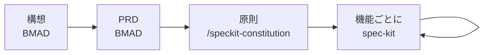

# AIスキルの使い方

このリポジトリには、BMAD-METHOD（構想・計画）とspec-kit（仕様駆動の実装）のスキルが入っている。Claude CodeとCodexの両方から同じファイルを読み込む。

## 1. スキルの置き場所

| スキル | 実体 | Claude Codeの読み込み先 | Codexの読み込み先 |
|---|---|---|---|
| BMAD（`bmad*`・`bmod-*`） | `.agents/skills/` | `.claude/skills/`の相対シンボリックリンク | `.agents/skills/`の実体 |
| spec-kit（`speckit-*`） | `.claude/skills/` | `.claude/skills/`の実体 | `.agents/skills/`の相対シンボリックリンク |
| セキュリティ監査（`security-audit`） | `.claude/skills/` | `.claude/skills/`の実体 | — |
| アプリのアイデアの調べもの（`app-idea-research`） | `.claude/skills/` | `.claude/skills/`の実体 | `.agents/skills/`の相対シンボリックリンク |
| 名前の調べもの（`brand-name-research`） | `.claude/skills/` | `.claude/skills/`の実体 | `.agents/skills/`の相対シンボリックリンク |

- リンクなので、更新は両方に反映され、コピーの同期は要らない。
- BMADの設定は`_bmad/config.toml`、出力先は`_bmad-output/`。spec-kitの設定とテンプレートは`.specify/`。
- 入れたスキルの出どころと版は`skills-lock.json`。
- Windowsでクローンするときは、シンボリックリンクを有効にする（`git config core.symlinks true`）。

## 2. 全体の流れ



- **構想・計画（BMAD）**：アイデアを練り、プロダクトブリーフ・PRDまでを作る。出力は`_bmad-output/`。
- **原則を決める**：PRDが固まったら`/speckit-constitution`で[Constitution](../.specify/memory/constitution.md)を書き入れる。技術の選び方もここか、最初の`/speckit-plan`で決める。
- **実装（spec-kit）**：機能ごとに仕様 → 計画 → タスク → 実装。同じ機能でBMADとspec-kitを並行して使わない。

## 3. 構想を練るときのスキル（BMAD）

| やりたいこと | スキル |
|---|---|
| どれを使えばよいか分からない・案内してほしい | `/bmad`（入口）・`/bmad-walkthrough` |
| アイデアを出す・広げる | `/bmad-brainstorming`・`/bmad-forge-idea` |
| 市場・競合・技術を調べる | `/bmad-deep-recon`・`/bmad-agent-analyst` |
| アプリのアイデアを渡して、記録・市場と似たアプリ・低い評価のレビュー・事業性（生成AIの代替・お金の計算・値付け・法律と商標）・判断までを一度に回す | `/app-idea-research`（kanaeru 用。アイデアを渡すだけで動く） |
| 名前の候補（アプリ・スイート・サービス）を渡して、ドメイン・Web・J-PlatPat の商標（第9・42類の称呼検索）・そのほかの確かめを一度に回し、使ってよいかを表で報告する | `/brand-name-research`（kanaeru 用。名前を渡すだけで動く。商標の検索には Claude in Chrome が要る） |
| 構想を1枚にまとめる | `/bmad-product-brief` |
| 発売の発表とFAQの形で、価値を確かめる | `/bmad-prfaq` |
| 要件をまとめる | `/bmad-prd`・`/bmad-agent-pm` |
| 画面・体験を考える | `/bmad-ux`・`/bmad-agent-ux-designer`（[UI デザインの既定](./design/README.md)を土台にするよう頼む） |
| 全体の構成を考える | `/bmad-architecture`・`/bmad-agent-architect` |
| 複数の役の視点で議論させる | `/bmad-party-mode` |
| 掘り下げて質問してもらう | `/bmad-advanced-elicitation` |
| 方針を途中で変える | `/bmad-correct-course` |

## 4. 1つの機能でスキルを使う順番（spec-kit）

AIは、各段階が終わるたびに次に使うスキルを案内する。

| # | やること | スキル | ユーザーがすること |
|---|---|---|---|
| 0 | developから`feature/<領域>-NNN-…`のブランチを作る。仕様の出し先`specs/<領域>/NNN-…`と番号の決め方は[仕様と名前の決まり](./rules/specs.md)。セッションを分けて同時に進めるときは[並行開発の決まりと手順](./rules/parallel-development.md) | なし | どの領域の仕様か伝える |
| 1 | やりたいことから仕様を書く | `/speckit-specify` | やりたいこと・決めていることを伝える |
| 2 | あいまいな点を決める（最大5問） | `/speckit-clarify` | 質問に答える |
| 3 | 技術の方針・データ・画面の取り決めを書く | `/speckit-plan` | なし |
| 4 | 作業の一覧を作る（テストを先に書く） | `/speckit-tasks` | なし |
| 5 | 仕様・方針・作業の一覧の食い違いを確かめて直す | `/speckit-analyze` | 直し方を選ぶ |
| 6 | 作業の一覧のとおりに作る | `/speckit-implement` | なし |
| 7 | PRを出し、セルフレビューして直す（[開発の流れの決まり](./rules/development-flow.md) 2・3） | `/code-review` | なし |
| 8 | マージする | なし | マージしてよいか答える |
| 9 | ステージングで手で確かめ、確かめる作業に`[X]`を付ける | なし | ステージングで確かめる |

状況によって使うもの：

- `/speckit-checklist`：セキュリティなど、決まった観点で仕様を点検したいとき（3の前後）
- `/speckit-converge`：途中で中断したなどで、仕様と実装がずれていそうなとき（6の途中・あと）
- `/speckit-taskstoissues`：作業の一覧をGitHub Issueにしたいとき
- `/security-audit`：公開の前など、まとまった単位でセキュリティを点検したいとき

## 5. Claude Codeが利用制限になったとき

1. Claude Codeの実行を止め、Codexで同じ作業ディレクトリとブランチを開く。
2. 対象の仕様、直前の作業、判明しているテスト結果、残っている問題をCodexに伝える。会話の履歴やエージェントのメモリーは自動では移らない。
3. Codexに仕様・計画・タスクと実際の変更を確認させて再開する。中断時にチェックが更新されていない可能性があるため、`tasks.md`のチェックだけで完了と判断しない。

```text
$speckit-implement
対象は specs/core/001-xxx です。Claude Codeが利用制限で中断しました。
spec.md、plan.md、tasks.md、git statusと差分を確認し、
途中の実装とテスト結果を確かめてから残りの作業を続けてください。
```

Codexでは、スキルを`/`の代わりに`$`で呼ぶ（例：`$speckit-implement`）。

## 6. 更新するとき

- spec-kitを再生成したら、共用のリンクと、`speckit-specify`の「このリポジトリの決まり」（仕様の出し先`specs/<領域>/NNN-…`）が残っているかを確かめる。
- BMADを入れ直したら、`.claude/skills/`のリンクが切れていないかを確かめる。
