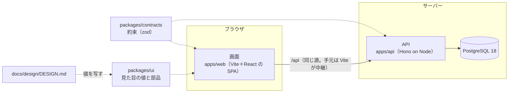
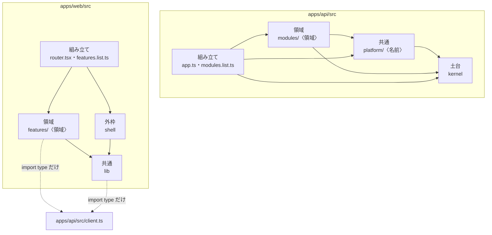
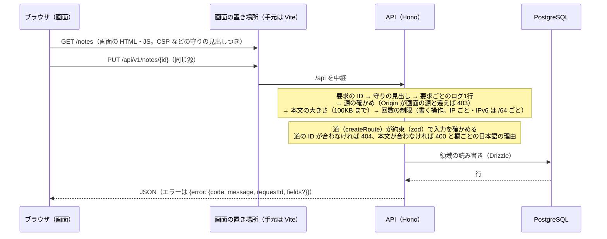

# 全体の形（アーキテクチャ）

2026-11-18 作成（TypeScript の骨組み。`typescript` ブランチ）。

今のシステムの形。選んだ技術の候補と目安は [技術選定の候補](./tech-selection.md)、守る決まりは [コードの書き方の決まり](./rules/coding.md) 6章。

## 1. 構成

| 場所 | 役目 |
|---|---|
| `apps/api` | API（Hono を Node の上で動かす）。DB の定義（`src/modules/<領域>/schema.ts`）・DB の変更（`drizzle/`）・見本のデータの手順（`scripts/`）もここに置く。DB を読み書きするのは API だけ |
| `apps/web` | 画面（Vite＋React の SPA。TanStack Router〈コードで書く形〉と TanStack Query）。API は `/api` を同じ源で呼ぶ |
| `packages/contracts` | API の約束（ふつうの zod）。入力の形・答えの形・エラーの code と日本語の文言。API の入力の確かめ・窓口の文書（OpenAPI。名前は API の側で付ける）・画面の入力の確かめが、同じ形を使う。領域ごとのフォルダ（`src/<領域>/`）に分ける |
| `packages/ui` | 見た目の値（`src/styles/tokens.css`。DESIGN.md から写したもの）と部品（shadcn/ui の Base UI の形を、値だけ直したもの） |
| `e2e` | Playwright の通しのテスト（流れ・キーボードだけ・アクセシビリティ〈axe〉・守りの見出しと CSP） |
| `tests` | lint の規則（境界・守りの規則・見た目の値）が働くかの確かめと、リポジトリのファイルを読む守りの確かめ（CI の設定・Dependabot・手元の口・秘密の値と依存の手順） |
| `scripts/security`・`security` | 秘密の値（gitleaks）と依存の脆弱性（`pnpm audit`）の確かめの手順と、依存の例外の一覧 |
| `.githooks`・`.github` | コミットの前の秘密の値の確かめ（`pre-commit`）・CI（`workflows/ci.yml`・`security-weekly.yml`）・Dependabot |

ログインと置き場所（インフラ）はまだない。ログインは仕様で足す（Better Auth を勧める）。置き場所と Terraform は、インフラの仕様で足す（[技術選定の候補](./tech-selection.md) 3-4・3-5）。

## 2. 依存の向き

依存は **組み立て → 領域 → 共通 → 土台** の一方向。領域どうし・共通どうしは、相手の `index.ts` からだけ読む。ルートの `eslint.config.js` の境界の規則が止める（`tests/lint/boundaries.test.ts` が確かめる）。

| アプリ | 土台 | 共通 | 領域 | 組み立て |
|---|---|---|---|---|
| API（`apps/api/src/`） | `kernel/`（設定・DB の接続・ログ・エラー・共通の列・道の型と手伝い・要求の ID・機能の印） | `platform/<名前>/`（`health`・`rate-limit`） | `modules/<領域>/` | `app.ts`・`index.ts`・`modules.list.ts`・`client.ts` |
| 画面（`apps/web/src/`） | — | `lib/`（API の呼び出し・道の根・ページの形・知らせ・フォームの誤り）・`shell/`（外枠） | `features/<領域>/` | `router.tsx`・`main.tsx`・`features.list.ts` |

- 画面から API は、`apps/api/src/client.ts` の型（`AppType`・`ModuleRoutes`）だけを `import type` で読む。API の動くコードは画面に入らない。
- 画面の道の型は、組み立て（`router.tsx`）が TanStack Router の `Register` に入れる。領域の `Link` の `to` と `params` は型で確かめられる。

## 3. 領域を足すときに触る所

| 触る所 | 中身 |
|---|---|
| `packages/contracts/src/<領域>/` | 入出力の形（zod）と、領域のエラーの code と文言 |
| `apps/api/src/modules/<領域>/` | 表（`schema.ts`）・読み書き（`repository.ts`）・道（`routes.ts`。`createRoute`）。入口は `index.ts` の `routes(deps)`。土台が渡すのは `db`・`logger`・`features`（機能の印）だけ |
| `apps/api/src/modules.list.ts` | 1行足す（`merge=union`。[並行開発の決まり](./rules/parallel-development.md) 3-1） |
| `apps/web/src/features/<領域>/` | 画面と道（`createRoute({ getParentRoute: () => rootRoute })`）。入口は `index.ts` の `feature`（`id`・`routes`・任意で `nav`） |
| `apps/web/src/features.list.ts` | 1行足す（`merge=union`） |
| `apps/api/drizzle/` | DB の変更（`pnpm db:generate` で作り、SQL を読んでからコミットする） |

組み立て（`app.ts`・`client.ts`・`router.tsx`）と外枠（`shell/`）と DB の変更の設定（`drizzle.config.ts`）は、領域を足しても直さない。手順は [コードの書き方の決まり](./rules/coding.md) 6-6。

## 4. 要求の流れ

- すべての応答に、要求の ID（`X-Request-Id`）・`Cache-Control: no-store`・守りの見出し（API の CSP はすべてを止める形。HSTS は `WEB_URL` が https のときだけ）がつく。
- エラーは、どの窓口でも同じ形（`packages/contracts/src/core/errors.ts` の `ErrorBody`）。予期しないエラーは中身を出さず `INTERNAL`（ログにはエラーの名前と積み重ねと要求の ID だけ）。
- `/api` の下の道は、すべて `createRoute` で書かれ、窓口の文書（`GET /api/openapi.json`。設定 `OPENAPI_DOC_ENABLED` のときだけ）に載る。文書に載らない道があると、API は起動しない。
- 画面は、エラーの本文を `ApiError`（code・文・欄ごとの理由）に、応答がないときを `NetworkError` に読みかえる（`apps/web/src/lib/api.ts`）。

## 5. データベースの全体

- PostgreSQL 18 の DB を1つ使い、読み書きするのは API だけ。つなぐ時間と1つの命令の時間に上限があり（設定）、DB が答えないときは待ち続けずに失敗する（動いているかの窓口は 503）。接続先と DB の名前は設定の `DATABASE_URL` で決める（手元は Docker の `postgres:18` を1つ共通に使い、作業場所ごとに DB の名前で分ける。[並行開発の決まり](./rules/parallel-development.md) 1）。
- アプリの表は `public` スキーマ、DB の変更の記録は `drizzle` スキーマにある。DB の変更は `apps/api/drizzle/` の1列の SQL で、`meta/_journal.json` の順に当てる。当てた記録が残り、もう一度当てても何もしない。
- 表の名前は単数の snake_case。主キーは `uuid`（既定値 `uuidv7()`）、時刻は `timestamptz`（[コードの書き方の決まり](./rules/coding.md) 6-4）。
- 今ある表は、見本の領域の `note` だけ（[メモの地図](./apps/notes.md)）。

## 6. 画面の骨格

- 外枠（`apps/web/src/shell/AppShell.tsx`）：上に帯（アプリの名前）、752px 以上は左にサイドバー、751px 以下は1列（ナビは帯の下に横に並べる）。先頭に「本文へ移る」。道が変わったら、新しい画面の h1 にフォーカスを移す。
- ページ（`lib/page.tsx` の `Page`）：題（h1）→ リード文 → 中身。ブラウザの題は「{ページの題}｜{APP_NAME}」。
- 状態と結果の出し方は EXPERIENCE.md の型：入力の誤りは欄のそば・送った結果はボタンの近く・画面が切り替わるときだけ画面の上の知らせの帯・消す前は確かめの枠・読みこみ中と空と失敗の状態。
- 見た目の値は `packages/ui/src/styles/tokens.css` だけ（Tailwind の初期の値は消してある）。組み立てた画面は CSP（`script-src 'self'`・`style-src 'self'`）で動き、Base UI の部品にも `<style>` を書き足させない（`UiProvider`）。
