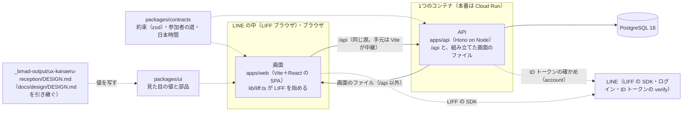
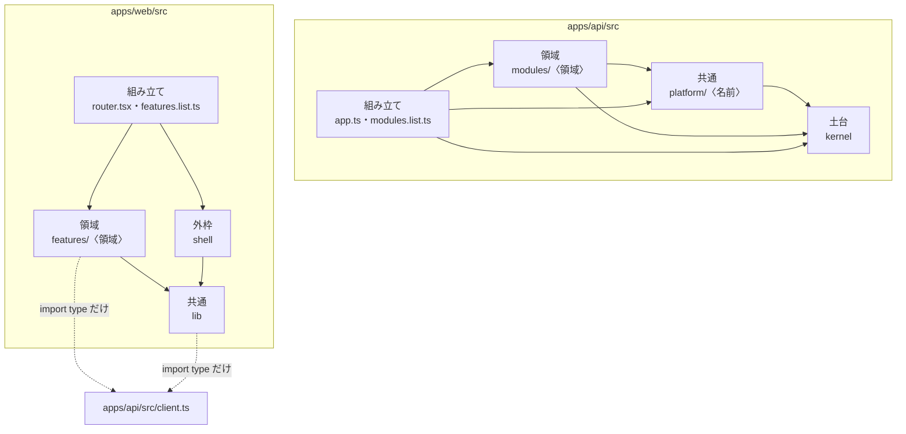
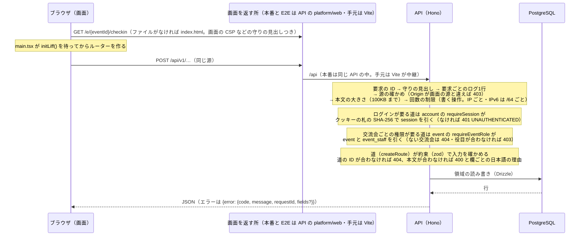

# 全体の形（アーキテクチャ）

2026-11-18 作成（TypeScript の骨組み。`typescript` ブランチ）。2026-11-19 直した（core-001：見本の領域を消し、画面を API から返す形・LIFF の始め方・DB の夜間停止の 503・参加者の道と日本時間の関数・プロダクトの見た目の値を足した。account-001：アカウントとセッション・LINE のログイン・今の利用者の受け取り方を足した。event-001：交流会・受付係・招待・交流会ごとの権限・管理の画面の道とナビを足した。reception-001：チェックイン・一覧画面・合計と内訳・参加者の CSV と、選択肢のチップの部品を足した。survey-001：アンケートの回答・困りごとの一覧と CSV と、reception の差しこみの場所への節を足した。reception-002：交流会ごとの割引〈event〉と、チェックインの割引の写し・紹介者の名前〈reception〉を足した）。

今のシステムの形。選んだ技術の候補と目安は [技術選定の候補](./tech-selection.md)、守る決まりは [コードの書き方の決まり](./rules/coding.md) 6章。

## 1. 構成

| 場所 | 役目 |
|---|---|
| `apps/api` | API（Hono を Node の上で動かす）。設定 `WEB_DIST_DIR` があれば、組み立てた画面のファイルも返す（`platform/web`。1つのコンテナで画面と `/api` を同じ源にする）。DB の定義（`src/modules/<領域>/schema.ts`）・DB の変更（`drizzle/`）・見本のデータの手順（`scripts/`）もここに置く。DB を読み書きするのは API だけ |
| `apps/web` | 画面（Vite＋React の SPA。TanStack Router〈コードで書く形〉と TanStack Query）。API は `/api` を同じ源で呼ぶ。LINE（`@line/liff` 2.32）は `lib/liff.ts` だけが始める |
| `packages/contracts` | API の約束（ふつうの zod）。入力の形・答えの形・エラーの code と日本語の文言。API の入力の確かめ・窓口の文書（OpenAPI。名前は API の側で付ける）・画面の入力の確かめが、同じ形を使う。領域ごとのフォルダ（`src/<領域>/`）に分ける。`src/core/` には、参加者が開く道とミニアプリの URL（`participantPaths`・`PARTICIPANT_ROUTE_PATTERNS`・`miniAppPermalink`）と日本時間の関数（`jstDate`・`endOfJstDate`）もある |
| `packages/ui` | 見た目の値（`src/styles/tokens.css`。プロダクトの DESIGN.md と、それが引き継ぐ土台から写したもの。プロダクトの色は墨）と部品（shadcn/ui の Base UI の形を、値だけ直したもの） |
| `e2e` | Playwright の通しのテスト（キーボードだけ・アクセシビリティ〈axe〉・守りの見出しと CSP）。本番と同じく、API が組み立てた画面を返す形で流す |
| `tests` | lint の規則（境界・守りの規則・見た目の値）が働くかの確かめと、リポジトリのファイルを読む守りの確かめ（CI の設定・Dependabot・手元の口・秘密の値と依存の手順） |
| `scripts/security`・`security` | 秘密の値（gitleaks）と依存の脆弱性（`pnpm audit`）の確かめの手順と、依存の例外の一覧 |
| `.githooks`・`.github` | コミットの前の秘密の値の確かめ（`pre-commit`）・CI（`workflows/ci.yml`・`security-weekly.yml`）・Dependabot |

ログインは account の領域が持つ（LINE の ID トークンを API が LINE の verify で確かめ、自前のセッション〈DB の `session` の表と `HttpOnly; SameSite=Lax` のクッキー〉を出す。構成の決めごと AD-4・AD-12。地図は [apps/account.md](./apps/account.md)）。交流会ごとの権限（主催者・受付係）と、参加者に見せてよい交流会の要約は event の領域が持ち、要求のたびに引く（AD-5。地図は [apps/event.md](./apps/event.md)）。チェックインと、そのときの名前と金額（AD-6）は reception の領域が持ち、survey は reception の入口から引く（地図は [apps/reception.md](./apps/reception.md)）。アンケートの回答はチェックインだけを指して survey の領域が持ち、開閉は書くたびに event の要約から読む（AD-13。地図は [apps/survey.md](./apps/survey.md)）。置き場所（Cloud Run と Cloud SQL・Terraform）は、インフラの仕様で足す（AD-8〜AD-11）。

### 設定（`apps/api/src/kernel/config.ts`）

環境の違いは設定の値で持つ（見本は `.env.example`）。kanaeru で足したもの：

| 設定 | 何か | staging・production |
|---|---|---|
| `LINE_CHANNEL_IDS` | LINE の ID トークンを確かめる `client_id`（チャネル ID の並び） | 要る |
| `ORGANIZER_LINE_USER_ID` | 主催者の LINE のユーザー ID（秘密ではない） | 要る |
| `OPEN_CHAT_URL` | コミュニティのオープンチャットの URL（https） | 任意 |
| `WEB_DIST_DIR` | 組み立てた画面のフォルダ。あれば API が画面を返す | 要る |
| `TEST_LOGIN_ENABLED` | 試験用のログイン（account の `POST /api/v1/auth/test-login`・画面の `/dev/login`）を使えるか。手元・テスト・E2E は true | true にできない（起動しない） |
| `VITE_LIFF_ID` | 画面の組み立てのときに埋める LIFF ID（空なら LINE につながない仮の形） | 本番の組み立てで入れる |

## 2. 依存の向き

依存は **組み立て → 領域 → 共通 → 土台** の一方向。領域どうし・共通どうしは、相手の `index.ts` からだけ読む。ルートの `eslint.config.js` の境界の規則が止める（`tests/lint/boundaries.test.ts` が確かめる）。

| アプリ | 土台 | 共通 | 領域 | 組み立て |
|---|---|---|---|---|
| API（`apps/api/src/`） | `kernel/`（設定・DB の接続・ログ・エラーと読みかえ・PostgreSQL のエラーの見分け・共通の列・道の型と手伝い・要求の ID・機能の印） | `platform/<名前>/`（`health`・`rate-limit`・`web`） | `modules/<領域>/` | `app.ts`・`index.ts`・`modules.list.ts`・`client.ts` |
| 画面（`apps/web/src/`） | — | `lib/`（API の呼び出し・LINE の始め方・道の根・ページの形・知らせ・フォームの誤り）・`shell/`（外枠・始められないときの画面） | `features/<領域>/` | `router.tsx`・`main.tsx`・`features.list.ts` |

- 画面から API は、`apps/api/src/client.ts` の型（`AppType`・`ModuleRoutes`）だけを `import type` で読む。API の動くコードは画面に入らない。
- 画面の道の型は、組み立て（`router.tsx`）が TanStack Router の `Register` に入れる。領域の `Link` の `to` と `params` は型で確かめられる。

## 3. 領域を足すときに触る所

| 触る所 | 中身 |
|---|---|
| `packages/contracts/src/<領域>/` | 入出力の形（zod）と、領域のエラーの code と文言 |
| `apps/api/src/modules/<領域>/` | 表（`schema.ts`）・読み書き（`repository.ts`）・道（`routes.ts`。`createRoute`）。入口は `index.ts` の `routes(deps)`。土台が渡すのは `db`・`logger`・`features`（機能の印）・`config`（秘密でない設定だけの `DomainConfig`）・`fetch`（外のサービスへの出口。テストでは差しかえる）だけ。ログインが要る道は account の `requireSession(deps)` を `createRoute` の `middleware` に付け、`currentAccount(c)` で今の利用者を読む |
| `apps/api/src/modules.list.ts` | 1行足す（`merge=union`。[並行開発の決まり](./rules/parallel-development.md) 3-1） |
| `apps/web/src/features/<領域>/` | 画面と道（`createRoute({ getParentRoute: () => rootRoute })`）。入口は `index.ts` の `feature`（`id`・`routes`・任意で `nav`） |
| `apps/web/src/features.list.ts` | 1行足す（`merge=union`） |
| `apps/api/drizzle/` | DB の変更（`pnpm db:generate` で作り、SQL を読んでからコミットする） |

組み立て（`app.ts`・`client.ts`・`router.tsx`）と外枠（`shell/`）と DB の変更の設定（`drizzle.config.ts`）は、領域を足しても直さない。手順は [コードの書き方の決まり](./rules/coding.md) 6-6。

## 4. 要求の流れ

- すべての応答に、要求の ID（`X-Request-Id`）と守りの見出し（HSTS は `WEB_URL` が https のときだけ）がつく。`/api`・`/api/…` は API の CSP（すべてを止める形）と `Cache-Control: no-store`。ほかの道は画面の CSP（自分の源と、LIFF の SDK が使う LINE の源だけ。`platform/web/web.ts` の `WEB_CSP_DIRECTIVES`）で、`/assets/` は長く持たせ、`index.html` は毎回確かめさせる。
- エラーは、どの窓口でも同じ形（`packages/contracts/src/core/errors.ts` の `ErrorBody`）。投げられたものの読みかえは `kernel/errors.ts` の `toAppError` の1か所：DB に届かない（拒否・時間切れ・止まっている。`kernel/pg-errors.ts` の `isDbUnavailable`）ときは、どの窓口でも `503`・`DB_UNAVAILABLE`（「夜間（0時〜8時）は止まっています。…」）。予期しないエラーは中身を出さず `INTERNAL`（ログにはエラーの名前と積み重ねと要求の ID だけ）。
- `/api` の下の道は、すべて `createRoute` で書かれ、窓口の文書（`GET /api/openapi.json`。設定 `OPENAPI_DOC_ENABLED` のときだけ）に載る。文書に載らない道があると、API は起動しない。
- 画面は、エラーの本文を `ApiError`（code・文・欄ごとの理由）に、応答がないときを `NetworkError` に読みかえる（`apps/web/src/lib/api.ts`）。401 は `onUnauthenticated` の受け手（account）に知らせ、account がセッションを読み直してログインし直す。

## 5. データベースの全体

- PostgreSQL 18 の DB を1つ使い、読み書きするのは API だけ。つなぐ時間と1つの命令の時間に上限があり（設定）、DB が答えないときは待ち続けずに `503 DB_UNAVAILABLE` で失敗する。本番の DB は夜間（0時〜8時）に止まる（AD-10）。動いているかの窓口（`GET /api/v1/health`）は DB に触るので、置き場所の起動の確かめ（probe）には使わない（Cloud Run の既定の TCP の確かめのまま）。接続先と DB の名前は設定の `DATABASE_URL` で決める（手元は Docker の `postgres:18` を1つ共通に使い、作業場所ごとに DB の名前で分ける。[並行開発の決まり](./rules/parallel-development.md) 1）。
- アプリの表は `public` スキーマ、DB の変更の記録は `drizzle` スキーマにある。DB の変更は `apps/api/drizzle/` の1列の SQL で、`meta/_journal.json` の順に当てる。当てた記録が残り、もう一度当てても何もしない。
- 表の名前は単数の snake_case。主キーは `uuid`（既定値 `uuidv7()`）、時刻は `timestamptz`（[コードの書き方の決まり](./rules/coding.md) 6-4）。
- 今あるアプリの表は account の `account`・`session`（[apps/account.md](./apps/account.md)）と、event の `event`・`event_staff`・`staff_invite`・`event_discount`（[apps/event.md](./apps/event.md)）と、reception の `checkin`（[apps/reception.md](./apps/reception.md)）と、survey の `survey_answer`（[apps/survey.md](./apps/survey.md)）。表は領域を足すときに、その領域の `schema.ts` で足す（見本の領域の `note` は core-001 の DB の変更で消した）。

## 6. 画面の骨格

- 外枠（`apps/web/src/shell/AppShell.tsx`）は、道ごとの形で描き分ける（core-003）。形は、持ち主の領域が道の静かな値 `staticData.layout`（`lib/router.ts`）に書き、外枠は今の道のいちばん深い当たりの値を読む。
  - **管理の形**（書かない道。`/admin/events/…` など）：上に帯（「メニュー」ボタンとアプリの名前）。752px 以上は左にサイドバー（「メニュー」ボタン〈`aria-expanded`・`aria-controls`〉で出す・隠す。見ている人のブラウザの localStorage に覚え、はじめは出す。読み書きが投げても出した状態で動く）。751px 以下は画面の下のタブバー（アイコンと名前・高さ 56px・端末の下の安全な余白。帯の下にナビの行はない）。このとき外枠は画面の高さで、帯と本文だけが1つの枠の中でスクロールする（本文がタブバーの下に潜らない。道が変わったら枠を上に戻す）。どちらも `<nav aria-label="メイン">` で、今の項目は `aria-current`（同じ道は `page`、下の道は一番長く当たる項目に `true`）と墨の印。
  - **ナビなしの形**（`"bare"`。チェックイン・アンケート・招待・手元のログイン）：上の帯はアプリの名前だけ（リンクにしない）。サイドバー・タブバー・メニューのボタンを出さない。
  - ナビの項目は、組み立て（`router.tsx`）が領域の `useNavItems`（なければ決まった `nav`）を `features.list.ts` の順に並べ、外枠に渡す。交流会の中では event が「交流会の一覧」「参加者・合計」「困りごと」（主催者だけ）「準備」（主催者だけ）を出す（役目は、画面が読んだ交流会から読み、ナビのために問い合わせない）。外では「交流会の一覧」だけ。
  - 先頭に「本文へ移る」。道が変わったら、新しい画面の h1 にフォーカスを移す（ログインの確かめなどで h1 があとから出る画面は、出たときに移す。その間に利用者がフォーカスを動かしたら動かさない）。
- ページ（`lib/page.tsx` の `Page`）：題（h1）→ リード文 → 中身。ブラウザの題は「{ページの題}｜{APP_NAME}」。
- 状態と結果の出し方は EXPERIENCE.md の型：入力の誤りは欄のそば・送った結果はボタンの近く・画面が切り替わるときだけ画面の上の知らせの帯・消す前は確かめの枠・読みこみ中と空と失敗の状態。
- 見た目の値は `packages/ui/src/styles/tokens.css` だけ（Tailwind の初期の値は消してある）。組み立てた画面は CSP（`script-src 'self' https://static.line-scdn.net`・`style-src 'self'`。`'unsafe-inline'`・`'unsafe-eval'` なし）で動き、Base UI の部品にも `<style>` を書き足させない（`UiProvider`）。
- 画面の入口（`main.tsx`）は、`lib/liff.ts` の `initLiff()` を待ってからルーターを作る（LIFF の init の前に URL を変えないため）。LIFF ID（組み立てのときの `VITE_LIFF_ID`）がなければ、LINE につながない仮の形（未ログイン・ID トークンなし）で動く。始められなければ「読みこめませんでした」の画面（`shell/StartupErrorPage.tsx`）を出す。
- はじめの画面（`/`）は、ナビの最初の項目へ移る（今は event の「交流会の一覧」〈`/admin/events`〉。受付係と主催者がミニアプリを開き直すと一覧に来る）。ナビを出す領域がなければ「ページが見つかりません」。
- 管理の画面（`/admin/events/…`）の道の形は `@workspace/contracts/event` の `ADMIN_ROUTE_PATTERNS` の1か所にあり、画面どうしの行き来は外枠のナビ（event の `useNavItems`。道が登録されている項目だけを出す。「書き出しと削除」はナビに出さず、A3 と困りごとのボタンから開く）。QR は画面で作る（`uqr` で点の並びを作り、React の SVG で描く。中身は `miniAppPermalink`）。
- 一覧画面（A3）と困りごとの画面は TanStack Query の読み直しを5秒おきにする（つなぎっぱなしの仕組みは使わない。夜間の停止では止める）。書いたあとは、その場で読み直す。参加者と困りごとの CSV は API が UTF-8 の BOM つきで作り、画面は受け取って保存する。
- ほかの領域の画面に節を足すときは、持ち主の「差しこみの場所」に登録する（今は reception の A5 の節と A3 の直す枠の節。`registerEventDataSection`・`registerCheckinPanelSection`。survey が困りごとの CSV と代わりの入力を登録している）。
- ログインが要るページは account の `SessionGate` で包む。LINE の中では、セッションがなければ `getIDToken()` を `POST /api/v1/auth/line` に1度だけ送ってログインする。LIFF ID のない手元・E2E は、手元のログイン（`/dev/login`。試験用のログイン）で入る。
