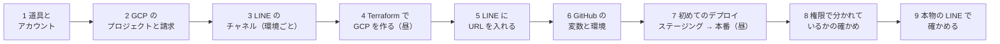

# 本番に初めて出す手順

- 作成日：2026-11-19
- 直した日：2026-11-22（ステージング・本番の前の承認・環境ごとの LINE のチャネル・権限で分かれているかの確かめを足した。交流会の日に合わせる書き方をやめた）
- 読む人：主催者（GCP・LINE・GitHub の画面を操作する人）
- 詳しい手順は、各手順のリンク先が正本。ここは**順番と、やり忘れを防ぐチェックの一覧**。値はここに書かない（公開リポジトリのため）。2回目からの出し方は[本番に出す手順](./release-guide.md)。

## 0. 全体の流れと時間の目安

- 合わせて**半日〜1日ほど**。4・7・8 は DB が動いている昼（日本時間 8時15分〜23時）に行う。
- 交流会で使うなら、**2〜3日前までに 9 を終える**。9 の結果しだいで直しが要る（11章）。
- **独自ドメイン**：一般に公開するときは独自ドメインを取り、Cloudflare を前に置く（[バックログ](./backlog.md) C1）。画面の URL は 4 の apply で決まり（tfvars の環境ごとの `web_url`）、5 で LINE に登録するので、取るなら 4 の前に決めて `web_url` に入れる。決めていなければ `run.app` のまま進め、取ったときに `web_url` を入れて apply し直し、LINE・Meta に登録し直す（[infra/README.md](../infra/README.md) 4章）。

### リンク集（使う画面と資料）

手順の番号は、下の章の番号。GCP の画面は、右上でプロジェクトを選んでから開く（URL の末尾に `?project=<プロジェクトID>` を付けると、そのプロジェクトで開く）。GitHub の設定の画面は、リポジトリの管理者でログインしているときだけ開ける（ログインしていないと 404 になる）。

| 章 | 何をするか | リンク |
|---|---|---|
| 1 | Terraform を入れる | [Terraform のインストール](https://developer.hashicorp.com/terraform/install) |
| 1 | gcloud を入れる | [Google Cloud CLI のインストール](https://cloud.google.com/sdk/docs/install) |
| 1 | GitHub の CLI（`gh`）を入れる | [GitHub CLI](https://cli.github.com/) |
| 2 | プロジェクトを作る | [プロジェクトの作成](https://console.cloud.google.com/projectcreate) |
| 2 | 請求先アカウントにつなぐ・通貨を確かめる | [お支払い](https://console.cloud.google.com/billing) |
| 2 | 最初の API を有効にする | [API ライブラリ](https://console.cloud.google.com/apis/library) |
| 2 | Terraform の状態用バケットを作る | [Cloud Storage のバケット](https://console.cloud.google.com/storage/browser) |
| 3 | LINE のプロバイダー・ミニアプリのチャネルを作る、チャネル ID と LIFF ID を見る | [LINE Developers コンソール](https://developers.line.biz/console/) |
| 3 | ミニアプリ・LIFF の説明を読む | [LINE ミニアプリのドキュメント](https://developers.line.biz/ja/docs/line-mini-app/)・[LIFF のドキュメント](https://developers.line.biz/ja/docs/liff/) |
| 3 | 公式LINE（Messaging API）を作る・友だち追加の相手にする | [LINE Official Account Manager](https://manager.line.biz/) |
| 4 | apply のあとで、できたものを見る（動いているか・料金が出ていないか） | [Cloud Run](https://console.cloud.google.com/run)・[Cloud SQL](https://console.cloud.google.com/sql)・[Cloud Scheduler](https://console.cloud.google.com/cloudscheduler)・[Secret Manager](https://console.cloud.google.com/security/secret-manager) |
| 6 | リポジトリの変数を入れる | [Variables（Actions）](https://github.com/takumi-okuya-dev/paletkit-apps/settings/variables/actions) |
| 6 | 環境 `production`・`staging` を作る・承認者を入れる | [Environments](https://github.com/takumi-okuya-dev/paletkit-apps/settings/environments) |
| 7 | 初めてのデプロイを流す・承認する | [deploy の流れ（Actions）](https://github.com/takumi-okuya-dev/paletkit-apps/actions/workflows/deploy.yml) |
| 0 | 独自ドメインを取る | [Cloudflare Registrar](https://www.cloudflare.com/products/registrar/) など |
| 0 | 名前の商標を確かめる（称呼検索） | [J-PlatPat](https://www.j-platpat.inpit.go.jp/)（確かめ方は、スキル `brand-name-research`） |

## 1. 道具とアカウント（初めての1回）

- [ ] Terraform（1.11 以上）と gcloud を入れ、`gcloud auth login`・`gcloud auth application-default login` を流す（[infra/README.md](../infra/README.md) 1章）
- [ ] `gh auth login`（GitHub の CLI。リポジトリの数字の ID を見るのに使う）
- [ ] LINE Developers に、ふだん使う LINE のアカウントでログインできる

## 2. GCP のプロジェクトと請求（手で作ってよいのは、ここだけ）

[infra/README.md](../infra/README.md) 2・3章のとおり。

- [ ] プロジェクトを作る（プロジェクトID はあとで変えられない）
- [ ] 請求先アカウントにつなぐ。通貨が円か確かめる
- [ ] 最初の2つの API を有効にする（`serviceusage`・`cloudresourcemanager`）
- [ ] Terraform の状態を置くバケットを作り、バージョニングを入れる

## 3. LINE のチャネル（すべて同じプロバイダーの下に・ミニアプリは環境ごと）

考え方は [LINEの学び](./study/line.md) 1・2章、値の入れ先は [infra/README.md](../infra/README.md) 4章。

- [ ] プロバイダーを1つ作る（ユーザーID はプロバイダーごとに変わるので、PaletKit のチャネルは全部ここに作る。AD-2）
- [ ] **LINE ミニアプリのチャネルを2つ**作る（本番用とステージング用。LIFF の URL は1つの LIFF アプリに1つのため。どちらも未認証のまま。審査は出さない）
  - それぞれのチャネルID → Terraform の `production`・`staging` の `line_channel_ids`
  - それぞれの LIFF ID → GitHub の環境 `production`・`staging` の変数 `LIFF_ID`（6章）。ミニアプリのチャネルの中は開発用・審査用・公開用に分かれ、LIFF ID もそれぞれ違う（[LINEの学び](./study/line.md) 2.3）。**本番は本番のチャネルの公開用（Published）の LIFF ID**にする（開発用だと、チャネルの管理者とテスターしか開けない）。ステージングは開発用でよい
  - 「あなたのユーザーID」（`U` で始まる。LINEログインのチャネルの「チャネル基本設定」にある）→ 両方の環境の `organizer_line_user_id`（同じプロバイダーなら同じ値）
- [ ] **公式LINE**（Messaging API のチャネル）を同じプロバイダーに作り、本番のミニアプリの「友だち追加の相手」にする（[LINEの学び](./study/line.md) 4章。FR-6）
- [ ] コミュニティのオープンチャットの URL を控える → 環境ごとの `open_chat_url`

## 4. Terraform で GCP を作る（昼に）

[infra/README.md](../infra/README.md) 4・5章のとおり。

- [ ] `develop` の最新を手元に取り、その `infra/` で流す（`main` にはまだ `infra/` がなく、古い手元ではステージングの身分を `main` から使う許可や `suite-db-waker` がない）
- [ ] リポジトリの数字の ID と持ち主の数字の ID を控える（`gh api repos/<owner>/<repo> --jq '.id, .owner.id'`）
- [ ] `infra/terraform.tfvars` を見本から作り、`production = { … }`・`staging = { … }` に値を入れる（コミットしない）。Threads と予約は、はじめは切のままでよい（[infra/README.md](../infra/README.md) 9・10章）
- [ ] `terraform init -backend-config="bucket=<バケット>"` → `terraform plan -out=tfplan`
- [ ] plan を読む：最後の行の destroy が 0。Cloud SQL に作り直し（`-/+`）がない
- [ ] `terraform apply tfplan`
- [ ] `terraform output github_repository_variables`・`terraform output production`・`terraform output staging` を控える（5・6章）

最初の apply では、Cloud Run と DB の変更を当てる job は仮のイメージで立ち上がる。本物は 7章のデプロイで出る。

- [ ] 夜間の停止と朝の起動を一度だけ手で動かして確かめる：`gcloud scheduler jobs run suite-db-start --location=asia-northeast1`（[infra/README.md](../infra/README.md) 7章）

## 5. LINE に URL を入れる

- [ ] それぞれのミニアプリのチャネルの**エンドポイントの URL**に、その環境の `web_url` に `/` を付けたものを入れる（本番のチャネルには `terraform output production` の `web_url`、ステージングのチャネルには `terraform output staging` の `web_url`）。ほかの URL にすると、書く操作が源の確かめで 403 になる
- [ ] 開発用・審査用・公開用の3つに分かれていれば、入れられる所すべてに同じ URL を入れる。参加者が開くのは公開用（[LINEの学び](./study/line.md) 2.3。画面の名前は変わることがある）
- [ ] 本番のチャネルで、未認証のまま「公開」にする操作があれば行う。開発中のままだと、チャネルの管理者とテスターしか開けない（ステージングは開発中のままでよい）

## 6. GitHub の変数と環境

[infra/README.md](../infra/README.md) 5章のとおり。どれも **Variables**（Secrets ではない）。

- [ ] リポジトリの変数：`GCP_PROJECT_ID`・`GCP_REGION`・`GCP_WIF_PROVIDER`・`SQL_INSTANCE`・`GCP_DB_WAKER_SA`（`github_repository_variables`）
- [ ] Settings → Environments で `production` を作り、`staging` を開いて（`develop` へのマージで、すでにできていることがある）、それぞれの変数を入れる：`GCP_DEPLOYER_SA`・`CLOUD_RUN_SERVICE`・`MIGRATE_JOB`・`IMAGE_REPOSITORY`・`APP_NAME`（各環境の `github_environment_variables`）と `LIFF_ID`（3章）
- [ ] `production`：**Required reviewers** に自分を入れる。**Deployment branches** は `main` だけ
- [ ] `staging`：**Deployment branches** は `main` と `develop`
- [ ] リポジトリの変数に `GCP_DEPLOYER_SA`・`LIFF_ID`・`APP_NAME`・`CLOUD_RUN_SERVICE`・`MIGRATE_JOB`・`IMAGE_REPOSITORY` が**ない**ことを確かめる（前の手順ではリポジトリに入れていた。環境に値がないとリポジトリの値が使われ、本番の LIFF ID がステージングに入るなど、気づかずに混ざる）

## 7. 初めてのデプロイ（昼に）

本番もステージングも、初めてのデプロイで DB が権限で分かれる（[infra/README.md](../infra/README.md) 11章）。両方を同じ日に済ませる。

- [ ] **ステージング**：Actions の `deploy` を `develop` で手で流す（Run workflow）。最後まで緑になり、`<ステージングの web_url>/api/v1/health` が答える
- [ ] **本番**：`develop` → `main` のリリースの PR を作り（タイトルは「リリース：…」・ラベル `run-ci`・本文に「初めての本番」）、AI のセキュリティの確かめの結果を PR の説明に貼る（[開発の流れの決まり](./rules/development-flow.md) 2）。CI が通ったら、日本時間の8時15分〜23時にマージする。時間の外にマージしてしまったら、8時15分を過ぎてから Actions の `deploy` を `main` で手で流す（Run workflow）
- [ ] `deploy` がステージングに出たあと承認を待つので、ステージングを開いて確かめ、**Review deployments → `production` → Approve and deploy** を押す（[本番に出す手順](./release-guide.md) 2章）
- [ ] `production / deploy` が緑になり、PC のブラウザで本番の `web_url` を開くと画面が出る。`<web_url>/api/v1/health` が答える

## 8. 権限で分かれているかの確かめ（7 のあとに一度）

[infra/README.md](../infra/README.md) 11章の「権限で分かれているかの確かめ」のとおり（core-018 tasks T009）。

- [ ] 手元から一時的に DB につなぎ（`ipv4_enabled` を一時的に `true` にして apply し、Cloud SQL Auth Proxy で。`suite_stg` のパスワードは Secret Manager の `suite-stg-database-url` の中。[infra/README.md](../infra/README.md) 6章）、ステージングの利用者で本番の DB につなげない・本番の利用者の権限を取れない・本番の利用者のパスワードを変えられないことを確かめる
- [ ] 見終わったら `ipv4_enabled` を `false` に戻して apply する（公開の IP の料金と守りのため）
- [ ] どれかが通ったら、ステージングを使う前に、直し方を Claude Code に相談する（構成 C に移すなど）

## 9. 本物の LINE で確かめる（交流会の2〜3日前までに）

先にステージングのミニアプリで一通り試し、そのあと本番で同じことを確かめる。結果を、構成の決めごとの Open Questions 1〜3 に書く。

- [ ] 管理の画面で、試しの交流会を作る（主催者として入れるか）
- [ ] 受付の QR をスマホの LINE で読み、**ミニアプリが開くか**（Open Question 1）
- [ ] チェックインのあと、**友だち追加の案内が出るか**（Open Question 2。本番だけ）
- [ ] アンケートを開いて答え、困りごとの画面に出るか。CSV を書き出せるか
- [ ] 受付係の招待のリンクを、別の人（家族など）のスマホで受けてもらえるか
- [ ] **PC のブラウザで管理の画面に LINE でログインできるか**（Open Question 3）
- [ ] 夜（0時すぎ）に開いて「夜間は止まっています」と出るか、朝8時すぎに戻るか（どちらか一方でもよい）
- [ ] 試しの交流会のチェックインを取り消す

## 10. 交流会の準備

- [ ] プライバシーポリシーと利用規約の 〈 〉 を埋めて公開する（[下書き](../_bmad-output/legal/privacy-policy-draft.md)・[利用規約の下書き](../_bmad-output/legal/terms-draft.md)。名前と連絡先はコミットせず、公開するページにだけ入れる）
- [ ] [台本](../_bmad-output/meetup-script/meetup-script-2026-11-25.md) の「前の日までにすること」と「当日の始まる前」をする（交流会を作る・LINE グループの招待リンク・QR の印刷・紙の名簿の予備）
- [ ] 交流会が 0時を越えそうなら、その日だけ夜間の停止を止める（`gcloud scheduler jobs pause`。[infra/README.md](../infra/README.md) 7章）

## 11. うまくいかなかったとき

| うまくいかないこと | 直し方（作業は Claude Code に頼む） |
|---|---|
| QR からミニアプリが開かない（Open Question 1） | QR に Cloud Run の画面の URL を入れ、そこからミニアプリを開く形にする（`packages/contracts/src/core` の QR の URL を作る関数の中だけを直す。AD-14） |
| 友だち追加の案内が出ない（Open Question 2） | チェックインのあとの画面に、公式LINE の友だち追加のリンクを出す |
| PC で LINE ログインできない（Open Question 3） | 受付係と主催者はスマホで使う（台本に書き足す） |
| デプロイが「GCP に入れない」で落ちる | 6章の変数（環境ごとの `GCP_DEPLOYER_SA` を含む）と、tfvars のリポジトリの数字の ID を確かめる（[infra/README.md](../infra/README.md) 4章）。`main` のマージでステージングの仕事が落ちるときは、Terraform を apply し直したか（ステージングの身分を `main` から使えるようにする）と、`staging` の Deployment branches に `main` があるかを確かめる |
| 承認のボタンが出ない | `production` の Required reviewers に自分が入っているか（6章） |
| 画面で書く操作が 403 になる | 5章のエンドポイントの URL が、その環境の `web_url` と同じか確かめる |
| ほかのデプロイの困りごと | [本番に出す手順](./release-guide.md) 7章 |
