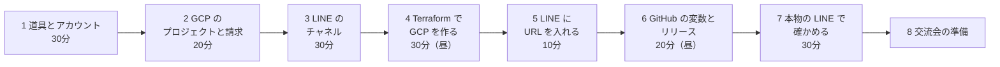

# 本番に初めて出す手順（2026-11-25 の交流会まで）

- 作成日：2026-11-19
- 読む人：主催者（GCP・LINE・GitHub の画面を操作する人）
- 詳しい手順は、各手順のリンク先が正本。ここは**順番と、やり忘れを防ぐチェックの一覧**。値はここに書かない（公開リポジトリのため）。

## 0. 全体の流れと時間の目安

- 合わせて**半日ほど**。4 と 6 は DB が動いている昼（日本時間 8時15分〜23時）に行う。
- **交流会の2〜3日前までに 7 を終える**。7 の結果しだいで直しが要る（9章）。
- `@line/liff` の古い版（2.31.0 以下）は 2026-11-24 ごろ LINE が使えなくする。kanaeru は 2.32 なので、何もしなくてよい。

## 1. 道具とアカウント（初めての1回）

- [ ] Terraform（1.11 以上）と gcloud を入れ、`gcloud auth login`・`gcloud auth application-default login` を流す（[infra/README.md](../infra/README.md) 1章）
- [ ] `gh auth login`（GitHub の CLI。リポジトリの数字の ID を見るのに使う）
- [ ] LINE Developers に、ふだん使う LINE のアカウントでログインできる

## 2. GCP のプロジェクトと請求（手で作ってよいのは、ここだけ）

[infra/README.md](../infra/README.md) 2・3章のとおり。

- [ ] プロジェクトを作る（プロジェクトID はあとで変えられない）
- [ ] 請求先アカウントにつなぐ。通貨が円か確かめる
- [ ] 最初の2つの API を有効にする（`serviceusage`・`cloudresourcemanager`）
- [ ] Terraform の状態を置くバケットを作り、バージョニングを入れる
- [ ] プロジェクトの**番号**を控える（`gcloud projects describe <プロジェクトID> --format='value(projectNumber)'`）。Cloud Run の URL は `https://kanaeru-<プロジェクトの番号>.asia-northeast1.run.app` になる（5章で使う）

## 3. LINE のチャネル（すべて同じプロバイダーの下に）

考え方は [LINEの学び](./study/line.md) 1・2章。

- [ ] プロバイダーを1つ作る（ユーザーID はプロバイダーごとに変わるので、kanaeru のチャネルは全部ここに作る。AD-2）
- [ ] **LINE ミニアプリのチャネル**を作る（未認証のまま。審査は出さない）
  - チャネルID を控える → Terraform の `line_channel_ids`
  - LIFF ID を控える → GitHub の変数 `LIFF_ID`（6章）
  - 「あなたのユーザーID」（`U` で始まる。チャネル基本設定にある。なければ同じプロバイダーの LINE ログインのチャネルで見る）を控える → Terraform の `organizer_line_user_id`
- [ ] **公式LINE**（Messaging API のチャネル）を同じプロバイダーに作り、ミニアプリの「友だち追加の相手」にする（[LINEの学び](./study/line.md) 4章。FR-6）
- [ ] コミュニティのオープンチャットの URL を控える → Terraform の `open_chat_url`

## 4. Terraform で GCP を作る（昼に）

[infra/README.md](../infra/README.md) 4・5章のとおり。

- [ ] リポジトリの数字の ID と持ち主の数字の ID を控える（`gh api repos/takumi-okuya-dev/kanaeru-apps --jq '.id, .owner.id'`）
- [ ] `infra/terraform.tfvars` を見本から作り、値を入れる（コミットしない）
- [ ] `terraform init -backend-config="bucket=<バケット>"` → `terraform plan -out=tfplan`
- [ ] plan を読む：最後の行の destroy が 0。Cloud SQL に作り直し（`-/+`）がない
- [ ] `terraform apply tfplan`
- [ ] `terraform output web_url` が、2章で控えた URL と同じか確かめる
- [ ] `terraform output github_variables` を控える（6章）

最初の apply では、Cloud Run は仮のイメージ（hello）で立ち上がる。本物は 6章のリリースで出る。

## 5. LINE に URL を入れる

- [ ] ミニアプリのチャネルの**エンドポイントの URL**に、`web_url` に `/` を付けたもの（`https://kanaeru-<番号>.asia-northeast1.run.app/`）を入れる。ほかの URL にすると、書く操作が源の確かめで 403 になる
- [ ] 開発用・審査用・公開用の3つに分かれていれば、入れられる所すべてに同じ URL を入れる。参加者が開くのは公開用（[LINEの学び](./study/line.md) 2.3。画面の名前は変わることがある）
- [ ] 未認証のまま「公開」にする操作があれば行う。開発中のままだと、チャネルの管理者とテスターしか開けない

## 6. GitHub の変数とリリース（昼に）

- [ ] リポジトリの **Variables**（Secrets ではない）に入れる：`GCP_PROJECT_ID`・`GCP_REGION`・`GCP_WIF_PROVIDER`・`GCP_DEPLOYER_SA`（4章の `github_variables`）と `LIFF_ID`（3章）。`APP_NAME` は既定の `kanaeru` なら要らない（[infra/README.md](../infra/README.md) 5章）
- [ ] `develop` → `main` のリリースの PR を作る（本文に「初めての本番」と書く）。中身の確かめは develop で済んでいる
- [ ] 日本時間の 8時15分〜23時に、リリースの PR をマージする（`main` のマージで本番に出る。[開発の流れの決まり](./rules/development-flow.md) 5）。時間の外にマージしてしまったら、8時15分を過ぎてから Actions の `deploy` を `main` で手で流す（Run workflow）
- [ ] GitHub の Actions で `deploy` が最後まで緑になったか確かめる。DB の変更（Cloud Run jobs）→ 新しい版の順に出る
- [ ] PC のブラウザで `web_url` を開き、画面が出る。`<web_url>/api/v1/health` が答える

## 7. 本物の LINE で確かめる（交流会の2〜3日前までに）

自分のスマホと PC で確かめる。結果を、構成の決めごとの Open Questions 1〜3 に書く。

- [ ] 管理の画面で、試しの交流会を作る（主催者として入れるか）
- [ ] 受付の QR をスマホの LINE で読み、**ミニアプリが開くか**（Open Question 1）
- [ ] チェックインのあと、**友だち追加の案内が出るか**（Open Question 2）
- [ ] アンケートを開いて答え、困りごとの画面に出るか。CSV を書き出せるか
- [ ] 受付係の招待のリンクを、別の人（家族など）のスマホで受けてもらえるか
- [ ] **PC のブラウザで管理の画面に LINE でログインできるか**（Open Question 3）
- [ ] 夜（0時すぎ）に開いて「夜間は止まっています」と出るか、朝8時すぎに戻るか（どちらか一方でもよい）
- [ ] 試しの交流会のチェックインを取り消す

## 8. 交流会の準備

- [ ] プライバシーポリシーと利用規約の 〈 〉 を埋めて公開する（[下書き](../_bmad-output/legal/privacy-policy-draft.md)・[利用規約の下書き](../_bmad-output/legal/terms-draft.md)。名前と連絡先はコミットせず、公開するページにだけ入れる）
- [ ] [台本](../_bmad-output/meetup-script/meetup-script-2026-11-25.md) の「前の日までにすること」と「当日の始まる前」をする（交流会を作る・LINE グループの招待リンク・QR の印刷・紙の名簿の予備）
- [ ] 交流会が 0時を越えそうなら、その日だけ夜間の停止を止める（`gcloud scheduler jobs pause`。[infra/README.md](../infra/README.md) 6章）

## 9. 7 でうまくいかなかったとき

| うまくいかないこと | 直し方（作業は Claude Code に頼む） |
|---|---|
| QR からミニアプリが開かない（Open Question 1） | QR に Cloud Run の画面の URL を入れ、そこからミニアプリを開く形にする（`packages/contracts/src/core` の QR の URL を作る関数の中だけを直す。AD-14） |
| 友だち追加の案内が出ない（Open Question 2） | チェックインのあとの画面に、公式LINE の友だち追加のリンクを出す |
| PC で LINE ログインできない（Open Question 3） | 受付係と主催者はスマホで使う（台本に書き足す） |
| デプロイが「GCP に入れない」で落ちる | 6章の変数と、tfvars のリポジトリの数字の ID を確かめる（[infra/README.md](../infra/README.md) 4章） |
| 画面で書く操作が 403 になる | 5章のエンドポイントの URL が `web_url` と同じか確かめる |
