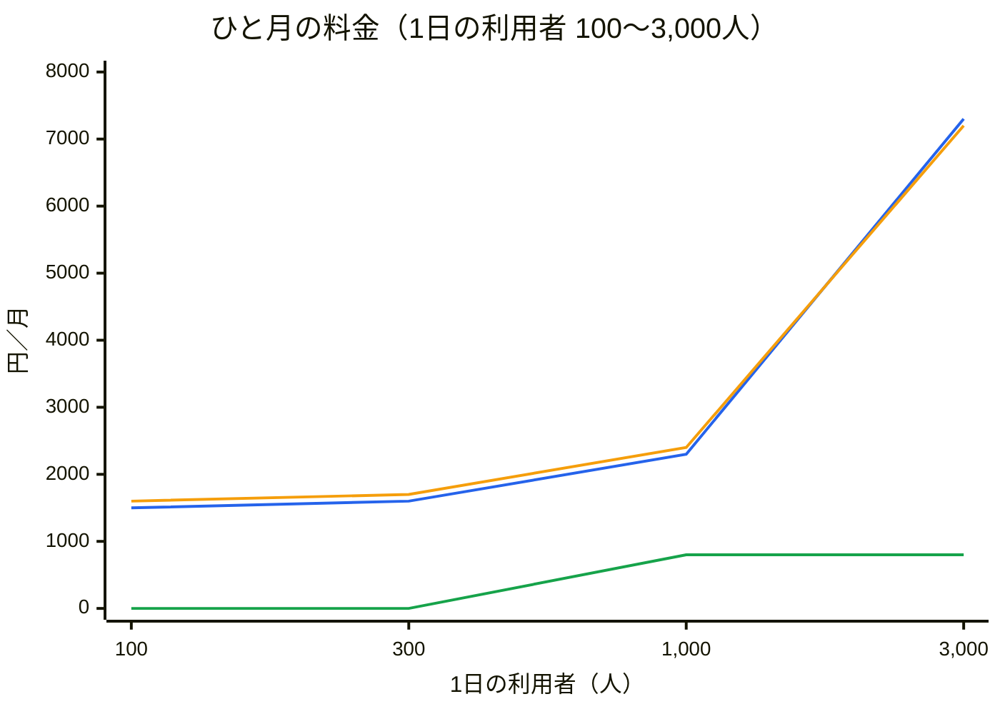
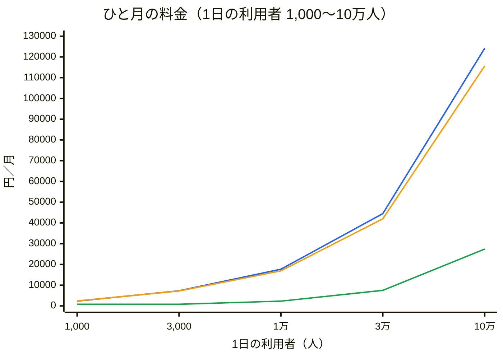

# 置き場所の料金の試算（Cloudflare だけ・Cloudflare＋GCP・GCP だけ）

- 作った日：2026-11-22
- 単価は 2026-11-19〜22 に、各社の公開の料金表で確かめた（[7章](#7-出典)）。1ドル＝150円で計算した。
- 今の置き場所（Cloud Run と Cloud SQL。[infra/README.md](../infra/README.md)）を、ほかの2つの構成と比べるための試算。どれにするかを決めた記録ではない（決めたことは[決めたことの記録](./decisions.md)）。

**結論：料金だけなら、どの利用者の数でも「Cloudflare だけ」が一番安い。** 1日の利用者が1万人で、GCP だけは月 約1.8万円、Cloudflare だけは月 約2,300円。差のほとんどは DB で、Cloud SQL は動かしている時間に払うのに対し、Cloudflare の DB（D1）は読み書きした行の数に払う。「Cloudflare＋GCP」は GCP だけとほぼ同じで、利用者が増えるほど、外への通信の分だけ少し安くなる。ただし Cloudflare だけにすると、DB を PostgreSQL から SQLite（D1）に作り直すことになり、データを東京に置けない（[6章](#6-料金のほかの違い)）。

## 1. 利用者の数と料金

線の色は、**青＝GCP だけ**、**橙＝Cloudflare＋GCP**、**緑＝Cloudflare だけ**。青と橙はほぼ重なる。

| 1日の利用者 | GCP だけ | Cloudflare＋GCP | Cloudflare だけ |
|---|---|---|---|
| 100人 | 1,500円 | 1,600円 | 0円（無料のプラン） |
| 300人 | 1,600円 | 1,700円 | 0円（無料のプラン） |
| 1,000人 | 2,300円 | 2,400円 | 800円 |
| 3,000人 | 7,300円 | 7,200円 | 800円 |
| 1万人 | 1万7,700円 | 1万6,900円 | 2,300円 |
| 3万人 | 4万4,500円 | 4万2,000円 | 7,500円 ※ |
| 10万人 | 12万4,200円 | 11万5,700円 | 2万7,400円 ※ |

※ D1 は1つの DB が 10GB までなので、この利用者の数ではデータ（22GB・73GB）が入りきらない。組織ごとなどに DB を分ける作りが要る。

## 2. 3つの構成

| 構成 | 画面 | API | DB | 定期の仕事 |
|---|---|---|---|---|
| GCP だけ（今の形） | Cloud Run（API と同じコンテナ） | Cloud Run（東京） | Cloud SQL for PostgreSQL（東京） | Cloud Scheduler → Cloud Run |
| Cloudflare＋GCP | Cloudflare の CDN が覚えて返す（無料のプラン）。もとは Cloud Run | Cloudflare を通って Cloud Run（東京） | Cloud SQL for PostgreSQL（東京） | Cloud Scheduler → Cloud Run |
| Cloudflare だけ | Workers の静的なファイル | Workers（利用者に近い拠点） | D1（SQLite） | Workers の Cron Triggers |

- Cloudflare＋GCP は、独自のドメインを取って Cloudflare に置く（年 約10ドルとした）。ほかの2つは、それぞれの決まった形の URL（`*.run.app`・`*.workers.dev`）でも動く。
- Cloudflare だけで PostgreSQL を続ける形（Hyperdrive で外の DB につなぐ）もあるが、DB の料金は外の DB の会社しだいなので、この試算には入れていない。

## 3. 前提（利用の見込み）

数字は見込み。実際の値が分かったら、ここを直して計算し直す。

| 項目 | 値 | 何に効くか |
|---|---|---|
| 1人が1日に呼ぶ API | 100回 | 要求の数・CPU・DB |
| 1人が1日に開く画面（`index.html`） | 3回 | 要求の数（`index.html` は毎回確かめに来る） |
| 画面一式（JS・CSS）を読み直す人 | 1日の利用者の1割（1回 1.5MB・15ファイル） | 外への通信。`/assets/` は1年覚えさせているので、新しい人と新しい版のときだけ |
| API の答えの大きさ | 平均 4KB | 外への通信 |
| Cloud Run の課金の時間 | 要求1回あたり 0.03秒（512MiB） | Cloud Run。平均 50ms から、同時の要求で台を分け合う分を引いた |
| Workers の CPU 時間 | 要求1回あたり 5ms | Workers。DB を待つ時間は数えない |
| D1 の読み書き | 要求1回あたり 30行を読み、0.2行を書く | D1 |
| DB のデータ | 1人あたり 0.5MB（余裕を見て1.5倍で見積もる。Cloud SQL は最小10GB） | DB の保存の料金 |
| 定期の仕事 | Threads（5分ごと・8〜24時）と booking（10分ごと・9〜24時）。月 約8,500回・1回2秒 | Cloud Run・Workers |

DB の大きさ（GCP の2つの構成）は、利用者が増えるたびに次のように上げる前提にした。

| 1日の利用者 | Cloud SQL の大きさ | 動かす時間 |
|---|---|---|
| 〜300人 | db-f1-micro（CPU を分け合う・0.6GB） | 夜0時〜8時は止める（今の形） |
| 1,000人 | db-f1-micro | 24時間 |
| 3,000人 | db-g1-small（CPU を分け合う・1.7GB） | 24時間 |
| 1万人 | db-standard-1（1 vCPU・3.75GB） | 24時間 |
| 3万人 | db-standard-2（2 vCPU・7.5GB） | 24時間 |
| 10万人 | db-standard-4（4 vCPU・15GB） | 24時間 |

## 4. 単価と無料の枠

### GCP（東京 asia-northeast1）

| サービス | 単価 | 無料の枠（月） |
|---|---|---|
| [Cloud Run](https://cloud.google.com/run/pricing)（要求の間だけ課金。東京は Tier 1） | CPU 0.000024ドル／vCPU秒・メモリ 0.0000025ドル／GiB秒・要求 0.40ドル／100万回。100ms 単位で切り上げ | CPU 18万 vCPU秒・メモリ 36万 GiB秒・要求 200万回（請求先アカウントごと） |
| [Cloud SQL](https://www.bytebase.com/dbcost/cloudsql-pricing/)（Enterprise・PostgreSQL・東京・24時間の月額） | db-f1-micro 10ドル・db-g1-small 34ドル・db-standard-1 64ドル・db-standard-2 128ドル・db-standard-4 256ドル | なし。止めている間は払わない |
| Cloud SQL の保存 | SSD 1GB・月 0.22ドル（要確認：[米国](https://cloud.google.com/sql/pricing)の 0.17ドルから東京を見積もった）・バックアップ 1GB・月 0.08ドル | なし |
| 外への通信（Premium Tier） | 1GB 0.12ドル（要確認：[SKU の一覧](https://github.com/Cyclenerd/google-cloud-pricing-cost-calculator)では東京は 0.085〜0.12ドル。高いほうで計算） | 北米の中だけ 1GB（東京には効かない） |
| [Cloud Scheduler](https://cloud.google.com/scheduler/pricing) | 1つの仕事 0.10ドル／月 | 3つ（請求先アカウントごと。今は4つなので1つ分払う） |
| [Secret Manager](https://cloud.google.com/secret-manager/pricing) | 秘密の版 0.06ドル／月 | 6つの版 |

- db-f1-micro と db-g1-small は [Cloud SQL の SLA](https://cloud.google.com/sql/pricing) の対象外。
- Scheduler・Secret Manager・Artifact Registry の分は、まとめて「そのほか」に月 1ドルとした。

### Cloudflare

| サービス | 無料のプラン | 有料のプラン（Workers Paid・月 5ドルから） |
|---|---|---|
| [Workers](https://developers.cloudflare.com/workers/platform/pricing/) | 1日 10万回・1回の CPU 10ms まで | 月 1,000万回と CPU 3,000万 ms を含む。超えたら 0.30ドル／100万回・0.02ドル／100万 CPU ms |
| 静的なファイル（画面） | 無料・回数の制限なし | 無料・回数の制限なし |
| 外への通信 | 料金なし | 料金なし |
| [D1](https://developers.cloudflare.com/d1/platform/pricing/) | 1日 500万行を読む・10万行を書く・保存 5GB（1つの DB は 500MB まで） | 月 250億行を読む・5,000万行を書く・保存 5GB を含む。超えたら 0.001ドル／100万行・1ドル／100万行・0.75ドル／GB・月。[1つの DB は 10GB まで](https://developers.cloudflare.com/d1/platform/limits/) |
| Cron Triggers | 要求として数える（別の料金なし） | 同じ |
| [CDN（Cloudflare＋GCP で使う）](https://www.cloudflare.com/plans/network-cdn.md) | 0ドル | Pro は月 20ドル（年払い） |
| [ドメイン](https://www.cloudflare.com/products/registrar/) | 原価（上乗せなし）。年 約10ドルとした | 同じ |

- Cloudflare だけの 100人・300人は無料のプランに収まる。ただし1回の CPU が 10ms までなので、重い処理（CSV の取り込みなど）は有料のプランでないと動かないことがある。
- 1,000人からは有料のプランとした（1日 10万回の上限に近づくため）。

## 5. 内訳（円／月）

| 1日の利用者 | GCP だけ：Cloud Run | GCP だけ：外への通信 | GCP だけ：DB | Cloudflare＋GCP：外への通信 | Cloudflare だけ：Workers | Cloudflare だけ：D1 |
|---|---|---|---|---|---|---|
| 100人 | 0 | 30 | 1,330 | 20 | 0 | 0 |
| 300人 | 0 | 90 | 1,330 | 60 | 0 | 0 |
| 1,000人 | 70 | 290 | 1,840 | 210 | 750 | 0 |
| 3,000人 | 870 | 860 | 5,470 | 620 | 800 | 0 |
| 1万人 | 4,610 | 2,850 | 1万50 | 2,060 | 2,010 | 260 |
| 3万人 | 1万5,490 | 8,550 | 2万280 | 6,180 | 5,610 | 1,910 |
| 10万人 | 5万3,590 | 2万8,510 | 4万1,990 | 2万600 | 1万8,210 | 9,180 |

- GCP の2つの構成には、ほかに「そのほか」が月 150円かかる。Cloudflare＋GCP は、これにドメインの 125円が足される。
- Cloudflare＋GCP の Cloud Run と DB は、GCP だけとほぼ同じ（画面のファイルの分だけ Cloud Run が少し減る）。
- 1,000人までの GCP は、ほとんどが DB。Cloud Run は無料の枠に収まる。
- 1万人を超えると、GCP は Cloud Run と外への通信も大きくなる。API の答えを圧縮すれば、外への通信は数分の1に減る（今は圧縮していない）。

## 6. 料金のほかの違い

| 観点 | GCP だけ | Cloudflare＋GCP | Cloudflare だけ |
|---|---|---|---|
| 今のコードからの作り直し | なし | DNS と CDN の設定を足すだけ | 大きい。DB を PostgreSQL から SQLite（D1）へ、Node.js 用の部品・定期の仕事・`infra/` を作り直す |
| データを置く場所 | 東京 | 東京 | D1 の場所は「アジア太平洋」の希望を出せるだけで、[保証はない](https://developers.cloudflare.com/d1/configuration/data-location/)。場所を縛れるのは EU と FedRAMP だけ |
| 処理する場所 | 東京 | 東京（画面は近くの拠点） | 利用者に近い拠点。[置き場所の希望](https://developers.cloudflare.com/workers/configuration/placement/)は出せるが、日本を指す形は書かれていない |
| 起動の待ち | 0台から立ち上がるとき数秒 | 画面はすぐ出る。API は数秒待つことがある | ほぼない |
| 大きくするとき | DB を1段ずつ上げる・読み取り用の複製を足す | 同じ | D1 は1つ 10GB までなので、データを分ける作りが要る |
| Terraform | 今の `infra/` のまま | Cloudflare のプロバイダーを足す | Cloudflare のプロバイダーで作り直す |

## 7. 出典

- Cloud Run の料金：<https://cloud.google.com/run/pricing>
- Cloud SQL の料金（米国の単価・SSD・SLA）：<https://cloud.google.com/sql/pricing>
- Cloud SQL の東京の月額（Bytebase がまとめた一覧）：<https://www.bytebase.com/dbcost/cloudsql-pricing/>
- 東京から外への通信（SKU の一覧。2026-11-19 版）：<https://github.com/Cyclenerd/google-cloud-pricing-cost-calculator>
- ネットワークの料金：<https://cloud.google.com/vpc/network-pricing>
- Cloud Scheduler の料金：<https://cloud.google.com/scheduler/pricing>
- Secret Manager の料金：<https://cloud.google.com/secret-manager/pricing>
- Workers の料金：<https://developers.cloudflare.com/workers/platform/pricing/>
- Workers の上限：<https://developers.cloudflare.com/workers/platform/limits/>
- Workers の置き場所：<https://developers.cloudflare.com/workers/configuration/placement/>
- D1 の料金：<https://developers.cloudflare.com/d1/platform/pricing/>
- D1 の上限：<https://developers.cloudflare.com/d1/platform/limits/>
- D1 のデータの場所：<https://developers.cloudflare.com/d1/configuration/data-location/>
- Cloudflare の CDN のプラン：<https://www.cloudflare.com/plans/network-cdn.md>
- Cloudflare のドメイン：<https://www.cloudflare.com/products/registrar/>

**この試算の限界**

- GCP の料金のページは、東京の値を後から読み込むため、Cloud SQL の東京の月額と通信の単価は、公式のページではなく上の一覧から取った。本番の前に、[Google Cloud の料金計算ツール](https://cloud.google.com/products/calculator)か請求の画面で確かめる。
- 利用の見込み（3章）しだいで、結果は数倍変わる。特に API の回数・答えの大きさ・DB の大きさを上げる時期。
- 税、為替の動き、新規の300ドルのクレジット、長期の割引（CUD）は入れていない。
- 10万人では Cloud Run の台数の上限（今は2台）も上げる必要がある。台数を増やしても、料金は使った時間で決まるので、この試算はほぼ変わらない。
