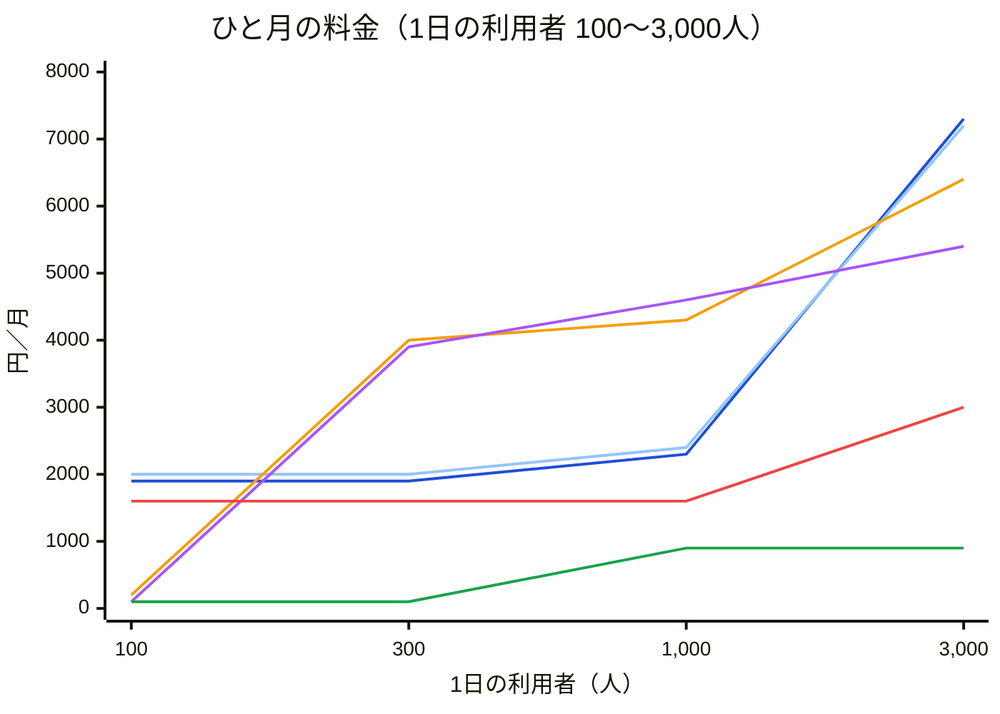
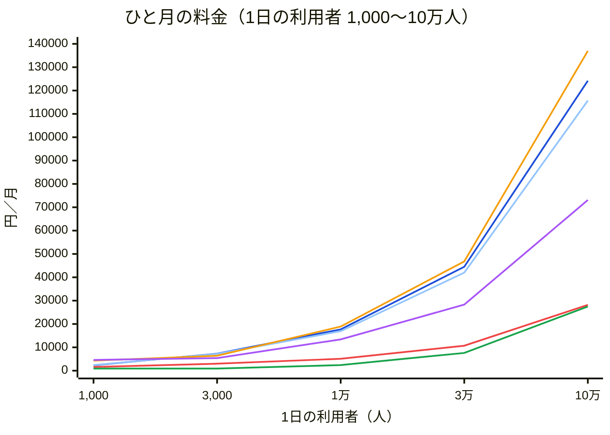

# 置き場所の比べと料金の試算（GCP・Cloudflare・Supabase・D1）

- 作った日：2026-11-22
- 直した日：2026-11-22（比べる構成を6つに増やし、決めたことと理由・外した案・DB が耐えられる負荷・見直す目安を足した。Cloudflare を使う構成には独自ドメインの代金を足した）
- 直した日：2026-11-22（DB を止めている間の IP アドレス代を足し、DB の通信・内部の IP・定期の仕事の料金を7章に書いた）
- 単価は 2026-11-19〜22 に、各社の公開の料金表と文書で確かめた（[11章](#11-出典と試算の限界)）。1ドル＝150円で計算した。
- 決めたことの記録は[決めたことの記録](./decisions.md)（2026-11-22）。この文書は、その材料（比べた結果と理由）と、これから迷ったときに見返すためのもの。

**結論：置き場所は GCP（Cloud Run と Cloud SQL・東京）のままにし、一般に公開するときに独自ドメインを取って Cloudflare の無料プランを前に置く。** 料金だけなら Cloudflare だけ（D1）が一番安い（1日の利用者が1万人で、GCP は月 約1.8万円、Cloudflare だけは月 約2,400円）。それでも GCP にしたのは、仕事で GCP を使うので学びになること、処理が速いこと、今のコードが頼る PostgreSQL の機能（トランザクション・行のロック）をそのまま使えること、の3つが料金の差より大きいと判断したため。

## 1. 決めたこと

| 層 | 選んだもの | 理由 |
|---|---|---|
| 画面と API | Cloud Run（東京）。画面と `/api` を同じコンテナ・同じドメインで返す | ログインのクッキーと OGP の差し込みがそのまま使える。1回の処理の時間の制限がゆるく、どの Node.js のライブラリも使える |
| DB | Cloud SQL for PostgreSQL（東京）。利用者が少ないうちは db-f1-micro で、夜0時〜8時は止める | 今の API はトランザクション（75か所）・行のロック（`FOR UPDATE`、32か所）・アドバイザリーロック（3か所）・SQL の直書き（256か所）で PostgreSQL に頼る。Cloud Run と同じ東京にあり、問い合わせの往復が速い |
| 前に置くもの | 公開するときに、独自ドメイン（`.com` で年 約10.5ドル）を取り、Cloudflare の無料プランを前に置く。使うのは CDN のキャッシュ・WAF・DDoS 対策・圧縮 | 無駄な要求や悪いアクセスを Cloud Run の手前で止められる。JS と CSS を近くの拠点から返せ、今していない圧縮も Cloudflare がする |
| キャッシュの範囲 | `/assets/*`（JS・CSS）と、誰が見ても同じ公開の API。`index.html` は毎回確かめさせ、源が 5xx を返したとき（落ちたとき・版の切り替えの一瞬）だけ前のものを出す（Cloudflare だけが読む見出しの `stale-if-error`。core-020）。ログインした人の答えは覚えさせない | 他人のデータを見せないため（`index.html` は誰が開いても同じ中身）。Cloud Run が落ちても画面と「ただいま使えません」の案内を出すため。`/assets/*` は今も1年覚えさせる指定（`immutable`）で返している |
| 公開までの間 | 今の `*.run.app` の URL のまま（0円） | 独自ドメインと Cloudflare は、一般の利用者に公開するときで間に合う |
| AI | 必要になったら GCP の AI（Vertex AI など）も使う | 同じプロジェクトと権限の中で使え、データを東京から出さずに済む |

## 2. 比べた構成と料金

線の色は、**濃い青＝GCP だけ（今の形）**、**薄い青＝GCP＋Cloudflare（前に置く・採用）**、**橙＝Cloud Run＋Supabase**、**紫＝Workers＋Supabase**、**赤＝Workers＋PlanetScale**、**緑＝Cloudflare だけ（D1）**。

| 1日の利用者 | GCP だけ | GCP＋Cloudflare（採用） | Cloud Run＋Supabase | Workers＋Supabase | Workers＋PlanetScale | Cloudflare だけ（D1） |
|---|---|---|---|---|---|---|
| 100人 | 1,900円 | 2,000円 | 200円 | 100円 | 1,600円 | 100円 |
| 300人 | 1,900円 | 2,000円 | 4,000円 ※1 | 3,900円 ※1 | 1,600円 | 100円 |
| 1,000人 | 2,300円 | 2,400円 | 4,300円 | 4,600円 | 1,600円 | 900円 |
| 3,000人 | 7,300円 | 7,200円 | 6,400円 | 5,400円 | 3,000円 | 900円 |
| 1万人 | 1万7,700円 | 1万6,900円 | 1万8,900円 | 1万3,400円 | 5,100円 ※2 | 2,400円 |
| 3万人 | 4万4,500円 | 4万2,000円 | 4万6,800円 | 2万8,300円 | 1万700円 ※2 | 7,600円 ※3 |
| 10万人 | 12万4,200円 | 11万5,700円 | 13万7,000円 | 7万3,100円 | 2万8,200円 ※2 | 2万7,500円 ※3 |

- ※1 Supabase の無料プランは、通信が月 5GB までなので、300人あたりで超える見込み（DB から返す量を API 1回 6KB とした）。超えたら Pro（月25ドル）にする前提で計算した。
- ※2 PlanetScale は、保存と通信の料金が料金ページに書かれていなかったので入れていない。10万人の大きさ（月66ドル）は、PS-40 の倍とした見積もり（要確認）。
- ※3 D1 は1つの DB が 10GB までなので、この利用者の数ではデータが入りきらない。DB を分ける作りが要る。
- GCP の2つの構成の 100人・300人には、夜に DB を止めている間の IP アドレス代（月 約360円。[7章](#7-gcp採用の料金の見通しと手の打ち方)）を入れた。
- Cloudflare を使う構成には、独自ドメインの代金（月 約125円）を入れた。Cloudflare は `workers.dev` を本番に使わないようすすめているため（[5章](#5-外した案と理由)）。

## 3. 6つの構成の中身

| 構成 | 画面 | API | DB | 定期の仕事 |
|---|---|---|---|---|
| GCP だけ（今の形） | Cloud Run（API と同じコンテナ） | Cloud Run（東京） | Cloud SQL（東京） | Cloud Scheduler → Cloud Run |
| GCP＋Cloudflare（採用） | Cloudflare の CDN が覚えて返す。もとは Cloud Run | Cloudflare を通って Cloud Run | Cloud SQL（東京） | Cloud Scheduler → Cloud Run |
| Cloud Run＋Supabase | Cloud Run | Cloud Run（東京） | Supabase（東京・PostgreSQL） | Cloud Scheduler → Cloud Run |
| Workers＋Supabase | Workers の静的なファイル | Workers | Supabase（東京）に Hyperdrive でつなぐ | Cron Triggers |
| Workers＋PlanetScale | Workers の静的なファイル | Workers | PlanetScale Postgres（東京）に Hyperdrive でつなぐ。Cloudflare の請求にまとめられる | Cron Triggers |
| Cloudflare だけ（D1） | Workers の静的なファイル | Workers | D1（SQLite）＋ Durable Objects | Cron Triggers |

## 4. 料金のほかの違い

| 観点 | GCP（＋Cloudflare） | Supabase を使う構成 | Workers＋PlanetScale | Cloudflare だけ（D1） |
|---|---|---|---|---|
| 今のコードからの変更 | なし（前に置く設定と、利用者の IP の取り方の修正だけ） | Cloud Run なら小さい（DB の接続先とつなぎ方）。Workers なら中くらい | 中くらい（API を Workers 用に直す） | 大きい（表の定義・SQL の直書き・トランザクションとロックの作り直し） |
| トランザクション・行のロック | そのまま | そのまま | そのまま | 途中で判断しながら書くトランザクションは不可（`batch` だけ）。Durable Objects で順に並べる形に作り直す |
| DB の大きさの上限 | 大きさを上げれば伸びる | 同じ | 同じ | 1つ 10GB（有料でも上げられない） |
| 処理の速さ | Cloud Run と DB が同じ東京で、往復は1ミリ秒前後 | Cloud Run なら GCP から AWS の東京へ数ミリ秒。Workers なら拠点しだい | 拠点しだい（置き場所の希望は出せる） | DB の近くの拠点で速い |
| 1回の処理の制限 | ゆるい（今の設定で60秒） | 同じ（Workers の構成は右と同じ） | Workers の無料プランは CPU 10ms／回、有料は最大5分 | 同じ |
| 0台からの起動の待ち | 数秒 | Cloud Run なら数秒 | ほぼない | ほぼない |
| データの場所 | 東京 | 東京 | 東京 | 「アジア太平洋」の希望だけで保証はない |
| バックアップ | Cloud SQL の自動のバックアップ | 無料プランはなし（自分で `pg_dump`）。Pro は毎日7日分 | 自動のバックアップあり（何日分かは要確認） | Time Travel で過去に戻せる（何日分かは要確認） |
| 管理する会社 | Google（公開後は Cloudflare も） | Google か Cloudflare と、Supabase | Cloudflare（PlanetScale も Cloudflare の請求） | Cloudflare だけ |
| Terraform | 今の `infra/` のまま。公開時に Cloudflare のプロバイダーを足す | Supabase を Terraform で持てるかは要確認 | PlanetScale を Terraform で持てるかは要確認 | Cloudflare のプロバイダーで持てる。コードと DB の変更は `wrangler` |
| 学び | 仕事で使う GCP・Terraform・PostgreSQL | — | — | — |

## 5. 外した案と理由

| 案 | 外した理由 |
|---|---|
| Cloudflare だけ（Workers・D1・Durable Objects・KV・R2） | 一番安いが、D1 は途中で判断しながら書くトランザクションができず、1つ 10GB の上限も上げられない。今の定員・空き待ち・二重投稿の守りを作り直すことになる。あとで GCP に移すと、PostgreSQL へもう一度作り直しになる |
| Workers＋Supabase（無料で始める案） | 0円で始められるが、Supabase の無料プランは自動のバックアップがなく、DB 500MB・通信 月5GB・1週間使われないと止まる・SLA なし。Workers の無料プランは1回の CPU が 10ms までで、Hyperdrive の無料の枠（1日10万回の問い合わせ）も300人ほどで尽きる。無料プランの商用利用を禁じる規約の文は見当たらなかったが、Supabase は無料プランを「趣味のプロジェクト向け」としている |
| Cloud Run＋Supabase | 100人までは安いが、300人あたりで Supabase の無料の枠を超え、Pro（月25ドル）にすると Cloud SQL より高い。GCP の外へつなぐので、往復が遅くなり、つなぎ方も変わる |
| Workers＋PlanetScale | 1,000人を超えると安い。DB は PostgreSQL のままで、Cloudflare の請求にまとめられる。ただし API を Workers 用に直す必要があり、保存と通信の料金も確かめきれていない。料金が気になる規模になったら、もう一度比べる候補 |
| Cloudflare KV で Cloud Run の要求を減らす | KV を読むには前に Worker が要り、すべての要求が Workers の回数（無料は1日10万回）に数えられる。書いた内容が最大60秒ほど古いまま見え、ログインした人ごとの答えを入れると他人のデータを見せる危険がある。料金のほとんどは DB の固定費なので、Cloud Run の要求を減らしても請求はほぼ変わらない |
| `workers.dev`（ドメインなし）で前に置く | Cloudflare は本番に使わないようすすめている（個人や趣味向け）。WAF の決まりを自分で足せず、ブラウザでないアクセス（LINE や Meta の Webhook など）を止める仕組みが強制で効く |
| Firebase Hosting で画面を配信する | GCP の中でそろい、無料の枠（保存 10GB・通信 1日 360MB）もあるが、設定できる WAF がない。Cloud Run に回すとき `__session` 以外のクッキーを捨てる（今のログインのクッキーは1つなので名前を変えれば使える） |
| 画面を静的ホスティング（Cloudflare など）に分け、API だけ Cloud Run | 今の形（Cloud Run が画面も返す）でも、夜は DB が止まるだけで画面は開く。Cloud Run は無料の枠の中なので、要求を減らしても請求はほぼ変わらない。`/assets/` は Cloudflare のキャッシュで近くから返せる。分けると、源が2つになり（クッキー・CORS・LIFF のエンドポイント）、デプロイの流れも2つになる。Cloud Run が落ちたときの案内は、前に置く Cloudflare の `stale-if-error` で出せる（core-020） |
| Cloud Storage＋ロードバランサー＋Cloud CDN＋Cloud Armor | GCP の本格的な形で WAF もあるが、ロードバランサーだけで月 約2,700円が固定でかかり、予算（月2,000円）を超える |
| Neon・Aiven・Xata・Koyeb・Prisma Postgres | 東京のリージョンがない（2026-11-22 に各社のページで確かめた） |

## 6. DB（Cloud SQL）が耐えられる負荷の目安

負荷試験はまだしていない。下の値は、大きさごとの接続の上限（公式の既定の値）と、「同時に使う1人が5秒に1回操作し、API 1回で3回問い合わせる」という前提から見積もった目安。

| Cloud SQL の大きさ | CPU・メモリ | 接続の上限（既定） | 同時に使う人の目安 | 1日の利用者の目安 | 月の料金（24時間） |
|---|---|---|---|---|---|
| db-f1-micro（今） | CPU を分け合う・0.6GB | 25 | 〜50人 | 〜1,000人 | 10ドル（夜止めると約6.7ドル＋止めている間の IP 代 約2.4ドル） |
| db-g1-small | CPU を分け合う・1.7GB | 50 | 〜150人 | 〜3,000人 | 34ドル |
| db-standard-1 | 1 vCPU・3.75GB | 100 | 〜500人 | 〜1万人 | 64ドル |
| db-standard-2 | 2 vCPU・7.5GB | 400 | 〜1,500人 | 〜3万人 | 128ドル |
| db-standard-4 | 4 vCPU・15GB | 500 | 〜5,000人 | 〜10万人 | 256ドル |

- **20〜30人が同時に使うとき（交流会の当日など）**：毎秒10回ほどの要求で、今の db-f1-micro と Cloud Run（最大2台・1台で同時に80件）で足りる見込み。全員が同じ瞬間に画面を開くと、DB の接続（2台で10本）が空くのを少し待つことがある。待ちが5秒を超えると `503` になる。
- **詰まりやすい所**：db-f1-micro は CPU を他の利用者と分け合うので、速さの保証がない（[SLA の対象外](https://cloud.google.com/sql/pricing)）。CSV の書き出しや Threads の定期の仕事と重なると、接続の取り合いが増える。しばらく使われていないと、Cloud Run の起動に数秒かかる。
- **当日の手当て**：交流会の当日だけ Cloud Run を最小1台にすると、起動の待ちがなくなる（その日だけ少し費用がかかる）。
- **確かめ方**：手元の Docker の DB を db-f1-micro に近く絞り（CPU 0.2・メモリ 600MB ほど）、30人分の同時アクセスを流して試す。本番では Cloud SQL の CPU の使用率と接続の数を見る。

## 7. GCP（採用）の料金の見通しと手の打ち方

| 1日の利用者 | 月の料金（GCP＋Cloudflare） | すること |
|---|---|---|
| 公開まで | 1,900円ほど（ドメインなし） | 今のまま。予算の知らせ（月2,000円の50%・100%）は設定済み。初めての GCP の登録で付く300ドルのクレジットの間は実質0円 |
| 〜300人 | 約2,000円 | 公開のときに独自ドメインを取り、Cloudflare を前に置く。利用者の IP の取り方（`CF-Connecting-IP`）と、LINE・OAuth の戻り先の URL を直す |
| 〜1,000人 | 約2,400円 | 夜に DB を止めるのをやめるか決める（夜も使われるなら24時間にする） |
| 〜3,000人 | 約7,200円 | DB を db-g1-small にする。API の答えの圧縮が効いているか確かめる |
| 〜1万人 | 約1.7万円 | DB を db-standard-1 にし、Cloud Run の台数の上限を、DB の接続の上限に合わせて上げる。Workers＋PlanetScale をもう一度比べる |
| 3万人〜 | 4万円〜 | DB を db-standard-2 以上にし、読み取り用の複製を考える。長期の割引（CUD）を考える |

### DB まわりの細かい料金

- **DB の通信は無料**：Cloud SQL から同じ大陸の Google の製品（Cloud Run）への通信は無料（[Cloud SQL の料金](https://cloud.google.com/sql/pricing)）。お金がかかるのは、利用者に返す Cloud Run の通信だけ。インターネットへ直接読む（手元の PC から本番の DB を読むなど）と 1GB 0.19ドル。
- **止めている間の IP アドレス代**：公開の IPv4 を使う DB を止めている間は、1時間 0.01ドルかかる。今は夜0時〜8時に止めるので、月 約2.4ドル。止めて浮く db-f1-micro の8時間分（月 約3.3ドル）から引くと、**夜に止めて実際に浮くのは月 約0.9ドル**。

内部の IP（プライベート IP）だけにすると IP 代はなくなる。つなぎ方は2つある（[Cloud Run と VPC](https://cloud.google.com/run/docs/configuring/connecting-vpc)）。

| つなぎ方 | 月の料金 | 注意 |
|---|---|---|
| Serverless VPC Access コネクタ（古い） | 裏のサーバー（既定は e2-micro）が最低2台。東京で2台 約15.7ドル | 今の請求全体より高い |
| Direct VPC egress（新しい） | サーバー代なし。通信代だけ（ほぼ0円） | 台が立ち上がるとき、つながるまで[1分以上かかることがある](https://cloud.google.com/run/docs/configuring/vpc-direct-vpc)。0台からの最初のアクセスで、待たされるか `503` になることがある。手で本番の DB を見るには、一時的に公開の IP を入にする |

- 内部の IP で守りも一段強くなる（DB がインターネットから見えない。企業に売るときに説明しやすい）。前の公開の IP の形も、承認済みのネットワークが空で、つなげるのは権限のある Cloud Run の接続だけ・暗号のない通信は断る形だったので、外から直接はつなげなかった。
- 2026-11-22 に、内部の IP（Direct VPC egress）にすると決めた（[決めたことの記録](./decisions.md)・core-018）。

### 定期の仕事の料金

- Threads（5分ごと・8〜24時）と booking（10分ごと・9〜24時）の定期の仕事は、月 約8,500回・CPU 約1.7万秒。Cloud Run の無料の枠（要求 月200万回・CPU 18万秒）の 0.4%・10% ほどで、0円。
- Cloud Scheduler は無料が3つまで。Threads と booking を1つの共通の仕事にまとめ（core-017）、DB の停止・起動と合わせて3つに収めた。ステージング（core-018）にも共通の仕事が1つ要るので、両方の環境で4つになり、4つ目の月0.10ドルがかかる。
- 定期の仕事は昼の間 Cloud Run の台を温める役目もする。今の Cloud Run は要求の間だけ課金する設定（`cpu_idle = true`）で、最小の台数として残す台でなければ[待っている台には課金しない](https://cloud.google.com/run/pricing)ので、温まっている間の料金は0円。最小1台にすると、待っている間も課金される（1台で月 約9.7ドル）。
- 呼ぶ回数を減らす（間隔を延ばす・時刻ちょうどに呼ぶ）と台が0台まで減り、起動の待ちに当たりやすくなる。呼ばれたあと中で早く切り上げるだけなら、起動の待ちは変わらない。利用者が増えたら軽くする（[バックログ](./backlog.md) C）。

## 8. 見直す目安

次のどれかに当たったら、この文書の比べをやり直す。

- 1日の利用者が1万人を超え、月の料金が負担になってきた（Workers＋PlanetScale がまず候補）
- Cloud SQL の CPU の使用率が、ふだんから70%を超える（DB の大きさを上げる）
- 交流会の当日に、起動の待ちや `503` が出た（Cloud Run の最小の台数と DB の大きさを見直す）
- 各社の料金や無料の枠が変わった（特に Cloud SQL・Supabase・Workers・D1）
- 1日の利用者が600人を超え、利用者の要求だけで Cloud Run の無料の枠（月200万回）を超えた（定期の仕事を軽くする。[バックログ](./backlog.md) C）

## 9. 前提（利用の見込み）

数字は見込み。実際の値が分かったら、ここを直して計算し直す。

| 項目 | 値 | 何に効くか |
|---|---|---|
| 1人が1日に呼ぶ API | 100回 | 要求の数・CPU・DB |
| API 1回の DB への問い合わせ | 3回・DB から返る量 6KB | Hyperdrive の回数・Supabase の通信 |
| 1人が1日に開く画面（`index.html`） | 3回 | 要求の数（`index.html` は毎回確かめに来る） |
| 画面一式（JS・CSS）を読み直す人 | 1日の利用者の1割（1回 1.5MB・15ファイル） | 外への通信。`/assets/` は1年覚えさせているので、新しい人と新しい版のときだけ |
| API の答えの大きさ | 平均 4KB | 外への通信 |
| Cloud Run の課金の時間 | 要求1回あたり 0.03秒（512MiB） | Cloud Run。平均 50ms から、同時の要求で台を分け合う分を引いた |
| Workers の CPU 時間 | 要求1回あたり 5ms | Workers。DB を待つ時間は数えない |
| D1 の読み書き | 要求1回あたり 30行を読み、0.2行を書く | D1 |
| DB のデータ | 1人あたり 0.5MB（余裕を見て1.5倍で見積もる。Cloud SQL は最小10GB） | DB の保存の料金 |
| 定期の仕事 | Threads（5分ごと・8〜24時）と booking（10分ごと・9〜24時）。月 約8,500回・1回2秒 | Cloud Run・Workers |
| DB の大きさを上げる時期 | GCP は6章の表のとおり。Supabase は 1,000人まで Micro、3,000人で Small、1万人で Medium、3万人で Large、10万人で XL。PlanetScale は 1,000人まで PS-5、3,000人で PS-10、1万人で PS-20、3万人で PS-40 | DB の料金 |

## 10. 単価と無料の枠

### GCP（東京 asia-northeast1）

| サービス | 単価 | 無料の枠（月） |
|---|---|---|
| [Cloud Run](https://cloud.google.com/run/pricing)（要求の間だけ課金。東京は Tier 1） | CPU 0.000024ドル／vCPU秒・メモリ 0.0000025ドル／GiB秒・要求 0.40ドル／100万回。100ms 単位で切り上げ | CPU 18万 vCPU秒・メモリ 36万 GiB秒・要求 200万回（請求先アカウントごと） |
| [Cloud SQL](https://www.bytebase.com/dbcost/cloudsql-pricing/)（Enterprise・PostgreSQL・東京・24時間の月額） | db-f1-micro 10ドル・db-g1-small 34ドル・db-standard-1 64ドル・db-standard-2 128ドル・db-standard-4 256ドル | なし。止めている間は払わない |
| Cloud SQL の保存 | SSD 1GB・月 0.22ドル（要確認：[米国](https://cloud.google.com/sql/pricing)の 0.17ドルから東京を見積もった）・バックアップ 1GB・月 0.08ドル | なし |
| 外への通信（Premium Tier） | 1GB 0.12ドル（要確認：[SKU の一覧](https://github.com/Cyclenerd/google-cloud-pricing-cost-calculator)では東京は 0.085〜0.12ドル。高いほうで計算） | 北米の中だけ 1GB（東京には効かない） |
| [Cloud Scheduler](https://cloud.google.com/scheduler/pricing) | 1つの仕事 0.10ドル／月 | 3つ（請求先アカウントごと。DB の停止・起動と、本番・ステージングの共通の仕事で4つなので、1つ分払う） |
| [Secret Manager](https://cloud.google.com/secret-manager/pricing) | 秘密の版 0.06ドル／月 | 6つの版 |
| [Firebase Hosting](https://firebase.google.com/pricing)（比べただけ） | 保存 1GB 0.026ドル・通信 1GB 0.15ドル | 保存 10GB・通信 1日 360MB |

- db-f1-micro と db-g1-small は [Cloud SQL の SLA](https://cloud.google.com/sql/pricing) の対象外。
- Scheduler・Secret Manager・Artifact Registry の分は、まとめて「そのほか」に月 1ドルとした。

### Cloudflare

| サービス | 無料のプラン | 有料のプラン（Workers Paid・月 5ドルから） |
|---|---|---|
| [Workers](https://developers.cloudflare.com/workers/platform/pricing/) | 1日 10万回・[1回の CPU 10ms まで](https://developers.cloudflare.com/workers/platform/limits/)（定期の仕事も同じ） | 月 1,000万回と CPU 3,000万 ms を含む。超えたら 0.30ドル／100万回・0.02ドル／100万 CPU ms |
| 静的なファイル（画面）・外への通信 | 無料・回数の制限なし | 同じ |
| [D1](https://developers.cloudflare.com/d1/platform/pricing/) | 1日 500万行を読む・10万行を書く・保存 5GB（1つの DB は 500MB まで） | 月 250億行を読む・5,000万行を書く・保存 5GB を含む。超えたら 0.001ドル／100万行・1ドル／100万行・0.75ドル／GB・月。[1つの DB は 10GB まで（上げられない）](https://developers.cloudflare.com/d1/platform/limits/) |
| [Durable Objects](https://developers.cloudflare.com/durable-objects/platform/pricing/)（SQLite） | 1日 10万回 | 月 100万回を含む。1つ 10GB まで。保存は 0.20ドル／GB・月 |
| [Hyperdrive](https://developers.cloudflare.com/hyperdrive/platform/pricing/) | 1日 10万回の問い合わせ | 回数の制限なし |
| [KV](https://developers.cloudflare.com/kv/concepts/how-kv-works/) | 読み 1日10万回・書き 1日1,000回・1GB | 読み 月1,000万回・書き 月100万回を含む。書いてから最大60秒ほど古い値が見える |
| [Queues](https://developers.cloudflare.com/queues/platform/pricing/) | 1日 1万回の操作 | 月 100万回を含む |
| [R2](https://developers.cloudflare.com/r2/pricing/) | 保存 10GB・通信は無料 | 1GB・月 0.015ドルから |
| [CDN](https://www.cloudflare.com/plans/network-cdn.md)（GCP＋Cloudflare で使う） | 0ドル | Pro は月 20ドル（年払い） |
| [ドメイン](https://www.cloudflare.com/products/registrar/) | 原価（上乗せなし）。`.com` は年 約10.44〜10.46ドル（比較サイトの値：[whtop](https://www.whtop.com/plans/cloudflare.com/135912)）。`.jp` を Cloudflare で買えるかは確かめられなかった | 同じ |
| [`workers.dev`](https://developers.cloudflare.com/workers/configuration/routing/workers-dev/) | 無料の住所。本番は独自ドメインをすすめる | — |

### DB の会社（東京に置けるもの）

| サービス | 無料のプラン | 有料のプラン |
|---|---|---|
| [Supabase](https://supabase.com/pricing)（[東京あり](https://supabase.com/docs/guides/platform/regions)） | DB 500MB（ディスク 2GB で固定・95%で読み取りだけになる）・共有の CPU とメモリ 0.5GB・同時の接続は直接60／まとめ役経由200・通信 月5GB・動いているプロジェクトは2つまで・1週間使われないと止まる・[自動のバックアップなし](https://supabase.com/docs/guides/platform/backups)・ログは1日分・SLA なし。超えると猶予のあと要求が断られる（請求はされない） | Pro 月25ドル（Micro の処理の力・ディスク 8GB・通信 250GB・毎日のバックアップ7日分）。Small 15ドル・Medium 60ドル・Large 110ドル（[処理の力](https://supabase.com/docs/guides/platform/compute-and-disk)。Pro は月10ドル分を含む） |
| [PlanetScale Postgres](https://planetscale.com/pricing)（[東京あり](https://planetscale.com/docs/plans/regions.md)・[Cloudflare の請求にまとめられる](https://developers.cloudflare.com/changelog/post/2026-06-18-planetscale-databases-cloudflare-billing/)） | なし | 東京・1台：PS-5 5ドル（512MiB）・PS-10 14ドル（1GiB）・PS-20 20ドル（2GiB）・PS-40 33ドル（4GiB）。保存と通信の料金は別（料金ページに記載なし） |

## 11. 出典と試算の限界

**出典**

- Cloud Run の料金：<https://cloud.google.com/run/pricing>
- Cloud SQL の料金（米国の単価・SSD・SLA）：<https://cloud.google.com/sql/pricing>
- Cloud SQL の接続の上限の既定：<https://cloud.google.com/sql/docs/postgres/flags>
- Cloud SQL の東京の月額（Bytebase がまとめた一覧）：<https://www.bytebase.com/dbcost/cloudsql-pricing/>
- 東京から外への通信（SKU の一覧。2026-11-19 版）：<https://github.com/Cyclenerd/google-cloud-pricing-cost-calculator>
- ネットワークの料金：<https://cloud.google.com/vpc/network-pricing>
- Cloud Scheduler の料金：<https://cloud.google.com/scheduler/pricing>
- Secret Manager の料金：<https://cloud.google.com/secret-manager/pricing>
- Firebase の料金：<https://firebase.google.com/pricing>
- Firebase Hosting と Cloud Run：<https://firebase.google.com/docs/hosting/cloud-run>・クッキー：<https://firebase.google.com/docs/hosting/manage-cache>
- Workers の料金：<https://developers.cloudflare.com/workers/platform/pricing/>・上限：<https://developers.cloudflare.com/workers/platform/limits/>・置き場所：<https://developers.cloudflare.com/workers/configuration/placement/>
- `workers.dev`：<https://developers.cloudflare.com/workers/configuration/routing/workers-dev/>
- D1 の料金：<https://developers.cloudflare.com/d1/platform/pricing/>・上限：<https://developers.cloudflare.com/d1/platform/limits/>・データの場所：<https://developers.cloudflare.com/d1/configuration/data-location/>
- Durable Objects の料金：<https://developers.cloudflare.com/durable-objects/platform/pricing/>・上限：<https://developers.cloudflare.com/durable-objects/platform/limits/>
- Hyperdrive：<https://developers.cloudflare.com/hyperdrive/>・料金：<https://developers.cloudflare.com/hyperdrive/platform/pricing/>
- KV の仕組み：<https://developers.cloudflare.com/kv/concepts/how-kv-works/>
- Queues の料金：<https://developers.cloudflare.com/queues/platform/pricing/>
- R2 の料金：<https://developers.cloudflare.com/r2/pricing/>
- Cloudflare の CDN のプラン：<https://www.cloudflare.com/plans/network-cdn.md>
- Cloudflare のドメイン：<https://www.cloudflare.com/products/registrar/>・`.com` の料金（比較サイト）：<https://www.whtop.com/plans/cloudflare.com/135912>
- PlanetScale を Cloudflare の請求にまとめる：<https://developers.cloudflare.com/changelog/post/2026-06-18-planetscale-databases-cloudflare-billing/>
- Supabase の料金：<https://supabase.com/pricing>・リージョン：<https://supabase.com/docs/guides/platform/regions>・処理の力：<https://supabase.com/docs/guides/platform/compute-and-disk>・DB の大きさ：<https://supabase.com/docs/guides/platform/database-size>・バックアップ：<https://supabase.com/docs/guides/platform/backups>・通信：<https://supabase.com/docs/guides/platform/manage-your-usage/egress>・規約：<https://supabase.com/terms>
- PlanetScale の料金：<https://planetscale.com/pricing>・リージョン：<https://planetscale.com/docs/plans/regions.md>
- Neon のリージョン：<https://neon.com/docs/introduction/regions>

**この試算の限界**

- GCP の料金のページは、東京の値を後から読み込むため、Cloud SQL の東京の月額と通信の単価は、公式のページではなく上の一覧から取った。本番の前に、[Google Cloud の料金計算ツール](https://cloud.google.com/products/calculator)か請求の画面で確かめる。
- 利用の見込み（9章）しだいで、結果は数倍変わる。特に API の回数・答えの大きさ・DB の大きさを上げる時期。DB が耐えられる負荷（6章）も、負荷試験をしていない見積もり。
- 税、為替の動き、新規の300ドルのクレジット、長期の割引（CUD）は入れていない。
- 無料プランを商用に使ってよいかは、Supabase の規約で禁じる文が見当たらなかったことだけを確かめた。Cloudflare の無料プランは確かめていない。
