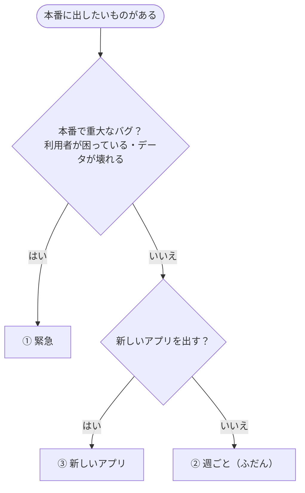
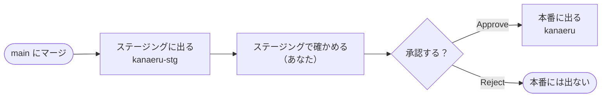

# 本番に出す手順（3つのモード）

作った日：2026-11-22（core-019）

本番に出すときに、どのモードを使い、何をすればよいかの手順書。決まり（ブランチ・承認・時間帯）の正本は[開発の流れの決まり](./rules/development-flow.md) 5章で、ここには、その決まりの中での**やり方**だけを書く。置き場所を初めて作る手順は [infra/README.md](../infra/README.md)、本番に初めて出すときの順番は[本番に初めて出す手順](./first-release.md)。

## 1. どのモードを使うか



| モード | いつ | 何を出すか | どのブランチから |
|---|---|---|---|
| ① 緊急 | 本番に重大なバグがあるとき（夜でもよい） | その直しだけ | `main` から切った `hotfix/<領域>-…` → `main` |
| ② 週ごと | 毎週水曜の昼（ふだんの直し・軽いバグ） | `develop` にたまった1週間分 | `develop` → `main` |
| ③ 新しいアプリ | 新しいアプリを出すとき | ②と同じ（コードは週ごとに入る）。公開は台帳で切り替える | `develop` → `main`（②に乗る） |

迷ったら②にする。①は「次の水曜まで待てない」ときだけ。

## 2. どのモードでも同じこと：`main` にマージしたあと

`main` にマージすると、Actions の `deploy` が次の順に進む（[.github/workflows/deploy.yml](../.github/workflows/deploy.yml)）。



1. GitHub の **Actions** → いちばん上の `deploy` の流れを開く。`staging / deploy` が緑になるのを待つ（5〜10分）。
2. ステージングの画面で、直したところと、ログインできることを確かめる（3章の一覧）。
3. 流れの画面の上に出る **Review deployments** → `production` に印を付ける → **Approve and deploy**。
   - 出したくないときは、必ず **Reject** を押す。放っておくと、承認を待ったまま最長30日残り、その間、同じブランチの次のデプロイが始まらない（順番を待つ流れが2つになると、先に並んでいた方が取り消される）。
4. `production / deploy` が緑になったら、本番の画面で同じところを確かめる。

- 承認が遅れて、本番の仕事が始まる時刻が23時15分を過ぎた（夜の緊急デプロイなら、DB を止め直すまで20分を切った）ときは、本番の仕事は何もせずに止まる（DB が止まる時刻に DB の変更が重ならないように）。8時15分を過ぎてから、Actions の `deploy` を `main` で手で流し直す。
- 承認を待っている間に `develop` へマージすると、ステージングは `develop` の中身に変わる。確かめと承認が済むまで、`develop` へのマージは待つ。
- 本番のイメージは、ステージングで確かめたのと同じコミットから作り直す（画面に環境ごとの LIFF ID を埋めるため）。中身のコードは同じ。

> 承認のボタンが出ないとき：Settings → Environments → `production` に自分が承認者（Required reviewers）として入っているかを見る（[infra/README.md](../infra/README.md) 5）。

## 3. 確かめる一覧（ステージングと本番で同じ）

- [ ] `<画面の URL>/api/v1/health` が答える（流れの最後でも自動で確かめている）
- [ ] LINE でログインできる
- [ ] 直したところ・足したところが、思ったとおりに動く
- [ ] 前から使っている画面（受付・チェックイン）が開ける

## 4. ① 緊急

### 4-1. 直して `main` にマージする

```bash
git fetch origin
git switch -c hotfix/<領域>-<短い名前> origin/main   # main から切る（develop からではない）
# 直す → 手元で確かめる
pnpm check
git push -u origin HEAD
gh pr create --base main --title "緊急の直し：…" --label run-ci
```

CI が通ったらマージする（`gh pr merge <番号> --merge`）。

### 4-2. 昼（日本時間の8時15分〜23時）なら

マージで `deploy` が自動で始まる。あとは2章のとおり（ステージングで確かめて承認）。

### 4-3. 夜（日本時間の0時10分〜7時45分）なら：DB を一時的に起こして出す

夜は DB を止めているので、マージで自動に始まった `deploy` は「時間帯の確かめ」で止まる（これは正しい動き）。手で流し直す：

- 画面から：Actions → `deploy` → **Run workflow** → Branch は `main` → **`wake_db` に印** → `keep_awake_minutes`（DB を起こしておく分。既定60）→ **Run workflow**
- 手元から：

  ```bash
  gh workflow run deploy.yml --ref main -f wake_db=true -f keep_awake_minutes=60
  ```

流れは「DB を起こす（数分）→ ステージングに出る → 承認を待つ → 本番に出る」と進み、DB が動き出してから `keep_awake_minutes` たつと、**成功しても失敗しても DB を止め直す**。流れを取り消したときは、すぐに止め直す。その時間の中で、2章の確かめと承認を済ませる。

- `keep_awake_minutes` は15〜90分。ステージングに出るまで10分ほどかかり、本番の仕事は止め直すまで20分より短いと始まらないので、60分なら、ステージングでの確かめと承認に使えるのは30分ほど。急がないなら90分にする。
- 止め直す時刻に近すぎてから承認すると、本番の仕事は何もせずに止まり、本番には出ない（壊れない）。もう一度 `wake_db` で流すか、翌朝8時15分を過ぎてから `deploy` を `main` で流し直す。
- 交流会で夜間の停止を止めていて DB が前から動いているときは、`wake_db` は DB を起こさず、止め直しもしない（そのままにする）。
- 7時45分を過ぎてから止め直す時刻になったときは、止めない（8時に Cloud Scheduler が起こすため）。
- 使えるのは `main` だけ。DB を起こす・止めるのは、`main` からだけ使える専用の身分（`kanaeru-db-waker`）。
- 23時〜0時10分は使えない（0時の停止と重なるため）。0時10分を過ぎてから流す。`skip_hour_check` を一緒に入にしても、止め直す時刻までの残りの確かめは飛ばさない。

### 4-4. 直したあと：`main` を `develop` に戻す

同じ直しを `develop` にも入れる（次の週ごとのリリースで、直しが消えないように）。

```bash
gh pr create --base develop --head main --title "main の緊急の直しを develop に戻す"
# マージしたあと、空になること
git fetch origin && git log --oneline origin/main ^origin/develop
```

## 5. ② 週ごと（毎週水曜の昼）

```bash
git fetch origin
git log --oneline origin/develop ^origin/main     # 今回出すもの。空なら出すものはない
gh pr create --base main --head develop --title "リリース：$(date +%Y-%m-%d)" --label run-ci
```

1. リリースの PR の前に、AI のセキュリティの確かめを流し、結果を PR の説明に貼る（[開発の流れの決まり](./rules/development-flow.md) 2）。
2. PR の説明に、今回出すもの（上の `git log` の一覧）を書く。
3. CI が通ったらマージ → 2章のとおり（ステージングで確かめて承認）。

水曜に出せなかった週は、翌日以降の昼に出してよい。出すものが少なければ、飛ばして翌週にまとめてよい。

## 6. ③ 新しいアプリ

出す（デプロイ）と公開を分ける。コードは②の週ごとのリリースで本番にも入るが、公開するまで利用者には見えない。

1. **入れる**：新しいアプリのコードを `develop` にマージする（ステージングに出る）。次の水曜の②で本番にも入る。
   - アプリの台帳に行がないアプリは、既定で「運営者だけ」（あなたにだけ見える）。本番に入っても、利用者には見えない。
   - Terraform のスイッチがあるアプリ（`threads_enabled`・`booking_enabled` など）は、`infra/terraform.tfvars` の `staging` の側だけ入にして apply する。
2. **試す（1週間ほど）**：ステージングの台帳（設定 → アプリの台帳）で、試したい形（運営者だけ・公開）にして使ってみる。直しは①か②で出す。
3. **公開する**：問題がなければ、**本番**の台帳で「公開」に切り替える。すぐ効き、デプロイは要らない。
   - Terraform のスイッチがあるアプリは、先に `production` の側も入にして apply する。
4. **やめる**：公開のあとで問題が出たら、本番の台帳で「運営者だけ」か「切」に戻す（すぐ効く）。

## 7. うまくいかないとき

| 困りごと | どうするか |
|---|---|
| ステージングで問題が見つかった | 承認しない（Reject）。直して、もう一度 `main` にマージする（①の形で）。ステージングは `main` の中身のままになるので、次の `develop` のマージで develop の中身に戻る |
| 本番に出したあとで壊れていると分かった | すぐ前の版に戻す：`gcloud run services update-traffic kanaeru --region=asia-northeast1 --to-revisions=<前の版の名前>=100`（版の名前は `gcloud run revisions list --service=kanaeru --region=asia-northeast1`）。DB の変更は戻さない（前の版でも壊れない形にしている）。そのあと①で直す |
| 夜に起こした DB が止まっていない（`stop-db` が失敗した・流れを強く取り消した〈Force cancel〉） | `gcloud sql instances patch kanaeru-db --activation-policy=NEVER`（8時より前のときだけ。8時を過ぎていたらそのままでよい） |
| 承認を待ったまま止まっている | 承認するか、Reject する。待っている間、同じブランチの次のデプロイは始まらない。新しく流し直す前に、待っている方を Reject する |
