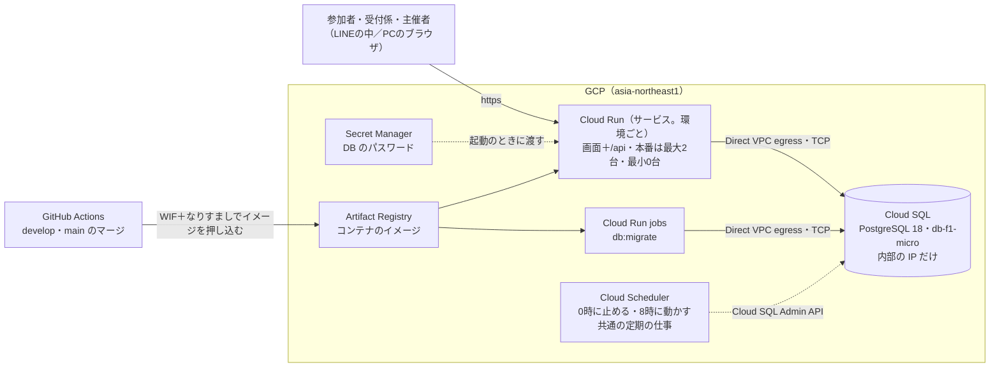
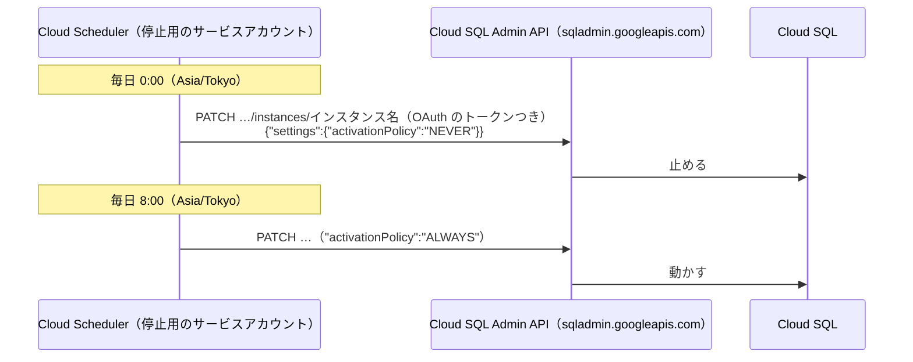
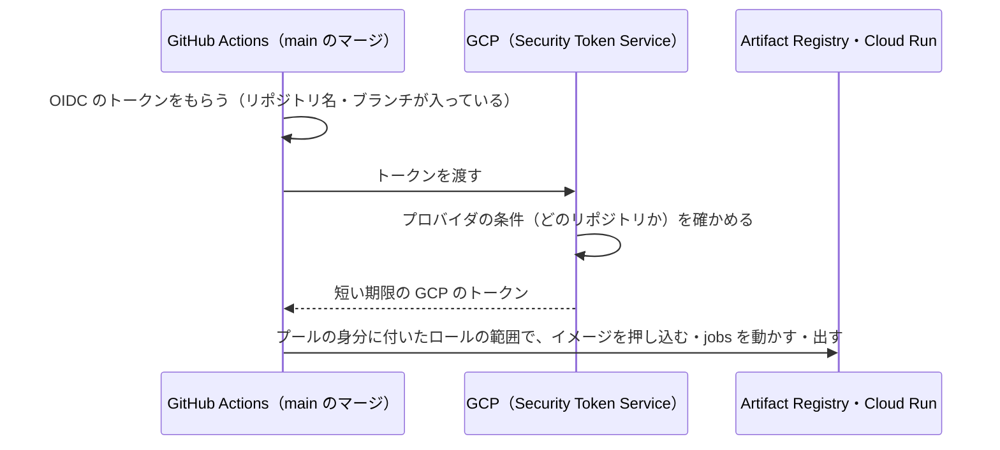

# GCPの学び（kanaeru で使うところだけ）

- 作成日：2026-11-19
- 直した日：2026-11-22（core-018：Cloud SQL を内部の IP だけにした注記を足した）
- 読む人：TypeScript で Web を作ってきて、GCP は初めての人（kanaeru の開発者）。
- この文書は「学び」の文書。考え方と使い方の説明で、**今のシステムの正本でも、決まりの正本でもない**。
  - 置き場所の決めごと（台の型・台数・夜間の停止・バックアップ・予算）は[構成の決めごと](../../_bmad-output/architecture-kanaeru/architecture-kanaeru.md)の AD-8〜AD-11 が正本。
  - デプロイの決まり（`develop` のマージでステージング・`main` のマージで本番に出す・8時15分〜23時に始める）は[開発の流れの決まり](../rules/development-flow.md) 5章が正本。
  - 資源の名前・権限の細部は `infra/` の Terraform（[infra/README.md](../../infra/README.md)）が正本。
- 料金は2026-11-19に公式の文書で確かめた値。1ドル＝150円で円にした（税なし・為替は仮）。確かめられなかったものは（要確認）と書いた。
- Terraform そのものの考え方は[Terraformの学び](./terraform.md)、LINE の側は[LINEの学び](./line.md)に分けた。

---

## 0. 3行でいうと

1. kanaeru は、GCP の東京（`asia-northeast1`）で、**環境ごとに Cloud Run を1つ**（画面と `/api` を同じコンテナで返す。本番 `kanaeru`・ステージング `kanaeru-stg`）と、両方で共にする **Cloud SQL を1つ**（PostgreSQL 18・いちばん小さい台。中に環境ごとの DB）だけ使う。脇役は Artifact Registry・Secret Manager・Cloud Scheduler。
2. お金の大半は Cloud SQL。だから **DB を夜間（0時〜8時）止める**。それでも保存の量と IP の料金は続くので、見込みは**月1,200〜1,800円ほど**。予算の知らせは月2,000円。
3. デプロイは、`develop`（ステージング）・`main`（本番）へのマージで GitHub Actions が**鍵を置かずに**（WIF で入り、デプロイ用のサービスアカウントになりすます）入り、**DB の変更（Cloud Run jobs）→ 新しい版**の順に出す。

---

## 1. 全体の考え方（地図）

### 1.1 プロジェクト・請求先アカウント・リージョン

- **プロジェクト**：資源を入れるいちばん大事な箱。権限・APIの有効化・請求は、まずこの単位で考える。kanaeru は1つのプロジェクトに本番とステージングを置く（構成 B。利用者が増えたら別のプロジェクトに分ける。core-018）。「プロジェクトID」は世界で1つで、**あとから変えられない**。AWS の「AWS アカウント1つ」にあたる。
- **請求先アカウント**：クレジットカードと結びつく財布。複数のプロジェクトが1つの財布を使える。**無料の枠やクレジットの多くは、この単位で数える**。
- **リージョン**：データセンターのある地域。kanaeru は**`asia-northeast1`（東京）**（AD-8）。中に「ゾーン」（建物の単位）があり、Cloud SQL は1つのゾーンだけに置く（高可用〈HA〉にしない）。AWS の `ap-northeast-1` と AZ にあたる。

### 1.2 IAM（誰が・何を・どこで できるか）

IAM は「誰に、何をしてよいか」を決める仕組み。**プリンシパル**（誰：人・サービスアカウント・GitHub Actions など）に、**ロール**（何をしてよいかの束。例：`roles/cloudsql.client`＝Cloud SQL につないでよい）を、**資源ごとに**結びつける（この結びつけが**ポリシー**）。

- **サービスアカウント**は、人ではなく**プログラムのためのアカウント**。Cloud Run のコンテナは決めたサービスアカウントとして動き、付いたロールの範囲でだけほかのサービスを使える。AWS の IAM ロール（ECS のタスクロール）に近い。
- 要るロールだけを、要る資源にだけ付ける。Cloud Run は何も決めないと権限の広い「Compute Engine の既定のサービスアカウント」で動くので、**専用のサービスアカウントを作って指定する**。

kanaeru のサービスアカウント（core-002 で作り始め、core-018 で環境ごとにした。正本は `infra/`）：

| 誰の | 使う場面 | 付けるロールの例 |
|---|---|---|
| 実行用（環境ごと：`kanaeru-run`・`kanaeru-stg-run`） | Cloud Run のサービスと、`db:migrate` の jobs | 使う秘密の値だけの読み取り（`roles/secretmanager.secretAccessor`）。DB へは内部の IP とパスワードでつなぐので、Cloud SQL クライアント（`roles/cloudsql.client`）は付けない |
| 夜間の停止用 | Cloud Scheduler が Cloud SQL を止める・動かす | `cloudsql.instances.update` を持つロール（例：`roles/cloudsql.editor`）。3.4 |
| デプロイ（GitHub Actions。環境ごと：`kanaeru-deployer`・`kanaeru-stg-deployer`） | GitHub のプールの身分に「その環境のブランチ（`main`・`develop`）からならなりすましてよい」（`roles/iam.workloadIdentityUser`）だけを付け、ロールはデプロイの身分に付ける | Artifact Registry への書き込み・その環境のサービスと job だけの Cloud Run 開発者（`roles/run.developer`）・Cloud Run の閲覧（`roles/run.viewer`）・実行用のサービスアカウントとして振る舞う（`roles/iam.serviceAccountUser`）。4章 |

### 1.3 API を有効にする

- GCP では、サービスごとに「API」を**プロジェクトで有効にしないと使えない**（有効にするだけならお金はかからない）。AWS には無い手順で、忘れると「API has not been used in project…」のエラーになる。
- kanaeru で要るものの例：`run`・`artifactregistry`・`sqladmin`（夜間の停止でも呼ぶ）・`cloudscheduler`・`secretmanager`・`iam`・`sts`（WIF）・`billingbudgets`・`cloudresourcemanager`・`serviceusage`（どれも `….googleapis.com`）。
- ほとんどは Terraform で有効にする（[Terraformの学び](./terraform.md)）。

---

## 2. kanaeru の絵

### 2.1 リクエストとデプロイの流れ



- **画面と API が同じ源**（同じ URL）なので、ログインのクッキーがそのまま使える（AD-8）。ロードバランサは使わない（月に固定のお金がかかるため）。ログインの流れは[LINEの学び](./line.md)。

### 2.2 1日の動き（日本時間）

```mermaid
gantt
  title Cloud SQL の1日（日本時間）
  dateFormat HH:mm
  axisFormat %H時
  section Cloud SQL
  止まっている（台の料金はかからない） :crit, 00:00, 8h
  動いている                           :active, 08:00, 16h
  section できること
  自動のバックアップ（12時から始まる枠） :12:00, 4h
  デプロイを始めてよい時間（8時15分〜23時） :08:15, 23:00
```



- 止まっている間に画面を開くと、API は `503`・code `DB_UNAVAILABLE` を返し、画面は「夜間（0時〜8時）は止まっています」と出す（AD-10）。

---

## 3. 使うサービス

各サービスの「何か・お金・気をつけること」と、AWS で近いものを書く。

### 3.1 Cloud Run（画面と API を動かす場所）

コンテナ（アプリと必要なものを1つにまとめた箱）を渡すと、HTTPS の URL を付けて動かしてくれるサービス。中身はふつうの Node.js なので、Hono をそのまま動かせる。手元と同じコンテナが本番で動き、使っていないときは0台まで減るので安い。

| 言葉 | 意味 |
|---|---|
| サービス・リビジョン | サービスは URL が1つ付くアプリの単位（kanaeru は1つ）。リビジョンはデプロイのたびにできる「版」で、前の版に戻せる |
| インスタンス数 | 動いているコンテナの台数。kanaeru は**最小0・最大2**（AD-8）。0台なら待っている間はお金がかからない |
| 冷えた起動（cold start） | 0台から1台目を起こす待ち時間（数秒のことがある）。最初は「受付の前に主催者が一度開いて起こす」（spine の Deferred） |
| jobs（Cloud Run jobs） | リクエストを待たず、**終わるまで動いて止まる**コンテナ。kanaeru は `db:migrate` に使う |
| 起動の確かめ（probe） | コンテナが起きたかを確かめる仕組み。何も書かないと **TCP の起動の確かめ**（ポートが開いたか）だけが付く |

**課金とお金**：既定の「リクエストに応じた課金」では、**リクエストを処理している間だけ CPU が使え、その間だけお金がかかる**（応答のあとに処理を続けると止まる）。無料の枠は請求先アカウントごと・毎月で CPU 18万vCPU秒・メモリ 36万GiB秒・リクエスト 200万回。東京は安いほうの段（段1）。月1回の交流会なら枠に収まる見込み。

**気をつけること**：

- **起動の確かめを DB に触る窓口に向けない**（AD-10）。夜間は DB が止まっているので、コンテナが「起きられない」と判断され、画面まで開かなくなる。DB を定期的に叩いて起こす処理も作らない。
- 環境変数 `PORT` のポートで待ち、止める合図（SIGTERM）で早めに終える。ファイルシステムに書いたものは消える。
- 参加者が開く画面なので「認証なしの呼び出しを許す」設定にする（ログインはアプリの中で行う）。
- 台数が増えると DB への接続も増える。だから最大2台に絞る（3.3）。

**AWS では**：ECS on Fargate（＋ALB）か App Runner。jobs は ECS のタスクを1回だけ動かすのに近い。

### 3.2 Artifact Registry（コンテナのイメージの置き場所）

コンテナのイメージの保管場所（Docker Hub の GCP 版、AWS の ECR）。GitHub Actions が作ったイメージをここに押し込み、Cloud Run のサービスと jobs が**同じイメージ**を取ってきて動かす。

- 保管は毎月0.5GBまで無料（請求先アカウントごと）。超えると1GBあたり月約0.10ドル。デプロイのたびにイメージが増えるので、**古いイメージを消す決まり（cleanup policy）**を付ける。
- リポジトリは東京に作る。古い「Container Registry（gcr.io）」は終わったサービスなので使わない。

### 3.3 Cloud SQL for PostgreSQL（データベース）

Google が PostgreSQL を動かし、更新・バックアップを受け持つサービス。中身はふつうの PostgreSQL なので、Drizzle と `pg` でそのまま使える。**動いている間ずっとお金がかかる**（固定費）ので、kanaeru は夜間に止める（3.4）。

| kanaeru の設定（AD-8・AD-9） | 値 |
|---|---|
| エディション・型・版 | `ENTERPRISE`・`db-f1-micro`（共有コア・メモリ約0.6GB。いちばん安い）・`POSTGRES_18`（主キーの `uuidv7()` に要る） |
| つなぎ方 | 公開 IP あり・承認済みネットワークなし・Cloud Run の組み込みの接続だけ |
| バックアップ・消すのを防ぐ | 自動・日本時間12時台・7日分／`deletion_protection` |

**エディションの罠（いちばん大事）**：PostgreSQL 16 以上は、エディションを書かないと **Enterprise Plus** が既定になる（Terraform の google provider も今は API の既定に従う）。Enterprise Plus では共有コアの型が選べないので、`tier = "db-f1-micro"` だけ書くと **apply が 400 で落ちる**（`Invalid Tier … for (ENTERPRISE_PLUS) Edition`）。だから **`edition = "ENTERPRISE"` を必ず書く**（書き方は[Terraformの学び](./terraform.md)）。なお共有コアの型は SLA（稼働の約束）の対象外。

**つなぎ方（Cloud Run の組み込みの接続）**：

- **2026-11-22 から（core-018）、kanaeru は Cloud SQL を内部の IP だけにし、Cloud Run は Direct VPC egress で VPC に出て TCP でつなぐ形に変えた**（下の Unix ソケットの形は、公開の IP のときの道。今の形は [infra/README.md](../../infra/README.md) と [specs/core/018-staging-private-db/research.md](../../specs/core/018-staging-private-db/research.md) R2）。
- Cloud Run の設定で Cloud SQL を指定すると、コンテナの中に `/cloudsql/<プロジェクト>:<リージョン>:<インスタンス>` という **Unix ソケット**（ファイルの形の入口）ができる。通信は自動で暗号化され、実行用のサービスアカウントの **Cloud SQL クライアント**のロールで守られる。
- この仕組みは **Cloud SQL に公開 IP があることが前提**（私的な IP だけにすると VPC のつなぎ口が要る）。承認済みネットワーク（つないでよい IP の一覧）を空にしておけば、外から直接はつなげない。
- `pg` は `host` にソケットのフォルダを渡すとつながる。`DATABASE_URL` 1本の形（`?host=/cloudsql/...`）が通るかは作り始めに試す（要確認）。

**接続の数**：`db-f1-micro` の `max_connections` の既定は25（第三者の記事の値。作ったあと `SHOW max_connections;` で確かめる。要確認）。`pg` のプールの既定は10なので、kanaeru は「最大2台 × 1台あたり5本 ＝ 10本」に絞る（AD-8）。jobs の分も足して考える。

**バックアップ**：自動のバックアップは「始まる時刻」から**4時間の枠**のどこかで取られ、既定で7つ残る。**始まる時刻は協定世界時（UTC）で書く**ので、日本時間12時は `03:00`。公式に「インスタンスが動いている間に取る」とあるので、DB が止まる夜ではなく昼に置く。

**止める・動かす**：止めると**台の料金は止まり、データはそのまま**。ただし**保存の量と IP の料金は続く**。止めるのは `activationPolicy` を `NEVER`、動かすのは `ALWAYS` にすること。起動にかかる時間は公式に書かれていない（数分の見込み。要確認）。

**AWS では**：RDS for PostgreSQL（Stop/Start に近いが、RDS は7日で自動で起きる）。

### 3.4 Cloud Scheduler（夜間に DB を止める・朝に動かす）

cron の書き方（例：`0 0 * * *`）で、決まった時刻に URL を呼ぶサービス（AWS の EventBridge Scheduler）。kanaeru は毎日0時に Cloud SQL を止め、8時に動かすために使う（AD-10）。間に関数などを挟まず、**Scheduler が Cloud SQL Admin API を直接呼ぶ**。



- Google の API（`*.googleapis.com`）を呼ぶときは **OAuth のトークン**を付ける（Cloud Run を呼ぶときの OIDC のトークンとは違う）。停止用のサービスアカウントには `cloudsql.instances.update` を持つロールが要る。
- **請求先アカウントごとに、毎月3つの仕事（job）まで無料**。kanaeru は2つなので枠の中。
- **タイムゾーン**（`time_zone = "Asia/Tokyo"`）を書く。書かないと協定世界時になり、9時間ずれる。
- **Terraform とぶつかる**：Scheduler が `activationPolicy` を変えると、Terraform の書いた形（`ALWAYS`）とずれ、夜に `terraform apply` すると DB が起きる。だから Cloud SQL の `activation_policy` と Scheduler の `paused` の変更を**無視する**（`lifecycle { ignore_changes }`。[Terraformの学び](./terraform.md)）。
- **交流会が0時を越えるとき**は、主催者がその日の停止の仕事を `gcloud scheduler jobs pause` で止め、終わったら `resume` で戻す（AD-10）。

### 3.5 Secret Manager（秘密の値の置き場所）

秘密の値（DB のパスワードなど）を版（version）つきで保管するサービス（AWS の Secrets Manager）。秘密の値をコード・Git・Terraform のコードに書かないために使う（AD-9）。

- Cloud Run の設定で、秘密の値を環境変数としてコンテナに渡す。実行用のサービスアカウントには、**その秘密の値だけ**を読むロールを付ける。秘密ではない設定（`ORGANIZER_LINE_USER_ID` など）はふつうの環境変数で渡す。
- 無料の枠は請求先アカウントごと・毎月で、生きている版が6つ・読む操作が1万回。古い版は消す（消した版は数えない）。
- 値は**コンテナが起動したときに読まれる**。値を変えたら、新しいリビジョンを出し直す。
- 値を Terraform のコードに書くと、Terraform の状態のファイル（state）にも残る。値は手で入れる（[Terraformの学び](./terraform.md)）。

### 3.6 Cloud Logging（ログ）

Cloud Run のコンテナが標準出力に書いた pino の JSON は、自動で Cloud Logging に集まり、欄も読み取られる。取り込みは**プロジェクトごとに毎月50GiBまで無料**で、まず超えない。何をログに書かないかは spine の Consistency Conventions の「ログ」が正本。AWS の CloudWatch Logs にあたる。

### 3.7 予算と請求の知らせ

**何か**：請求先アカウントに「月にいくらまで」の予算を作り、決めた割合を超えたらメールで知らせる仕組み。kanaeru は**月2,000円で、50%と100%で知らせる**（AD-9）。Terraform で作る。

- **知らせるだけの予算は、お金を止めない**。知らせを見て手で止める。サービスを止める予算（spend cap）を付けられるサービスもあるが、kanaeru の資源が対象かは調べていない（要確認）。
- 費用のデータは**遅れて**届く（最初の知らせまで数時間かかることもある）。だから予算は出せる額より少なめにする。
- 既定では、請求先アカウントの管理者と利用者にメールが届く。AWS の AWS Budgets にあたる。

---

## 4. GitHub Actions からデプロイする（鍵を置かない）

### 4.1 Workload Identity Federation（WIF）と、サービスアカウントのなりすまし

- 昔のやり方は、サービスアカウントの**鍵（JSON のファイル）**を GitHub の Secrets に置くこと。期限がなく、漏れると誰でも GCP を触れるので**使わない**。
- WIF は「GitHub Actions が発行する短い身分証（OIDC のトークン）を GCP が信じて、短い時間だけ使える権限に交換する」仕組み。AWS の「OIDC プロバイダ＋`AssumeRoleWithWebIdentity`」と同じ考え方。
- WIF には2つの形がある。**Direct WIF** は、GitHub のプールの身分（`principalSet://…`）に直接ロールを付ける形で、`google-github-actions/auth@v3` のおすすめ。ただし **Cloud Run は Direct WIF に対応していない**（公式の「Cloud Run doesn't support Workload Identity Federation direct resource access」）。
- そこで kanaeru は、**WIF で入ったあと、デプロイ用のサービスアカウント `kanaeru-deployer` になりすます**形にした（core-002 R-1）。プールの身分には「なりすましてよい」だけを付け、実際の権限は `kanaeru-deployer` が持つ。鍵（JSON）は作らない。action では `service_account` に `kanaeru-deployer` を書く。



### 4.2 用意するもの（Terraform で作る）

1. **Workload Identity のプール**と、GitHub を信じる**プロバイダ**（発行元は `https://token.actions.githubusercontent.com`）。
2. プロバイダの**条件（attribute condition）**。例：「このリポジトリだけ」。付けないと、ほかの人のリポジトリからも入れるおそれがある（action の説明も「いつも付ける」としている）。
3. プールの身分に付けるロール（1.2 の表。Cloud Run に出すには実行用のサービスアカウントの Service Account User も要る）と、ワークフローの `permissions` に `id-token: write` を書く。

### 4.3 デプロイの流れ（例）

順番は「コンテナを作る → 同じコンテナで `db:migrate` → 成功したときだけ新しい版を出す」（AD-11）。決まりの正本は[開発の流れの決まり](../rules/development-flow.md) 5章。

```yaml
# 学びのための例。実際のワークフロー（.github/workflows/deploy.yml）は infra と一緒に作る。
name: deploy
on:
  push:
    branches: [main]
    paths-ignore: ['docs/**', 'specs/**', '_bmad-output/**']   # 文書・仕様だけなら動かさない
permissions:
  contents: read
  id-token: write   # OIDC のトークンをもらうために要る
jobs:
  deploy:
    runs-on: ubuntu-latest
    steps:
      - uses: actions/checkout@v7
      - uses: google-github-actions/auth@v3
        with:
          workload_identity_provider: ${{ vars.GCP_WIF_PROVIDER }}
          service_account: ${{ vars.GCP_DEPLOYER_SA }}   # kanaeru-deployer になりすます（Cloud Run は Direct WIF 非対応）
      - uses: google-github-actions/setup-gcloud@v3
      - run: gcloud auth configure-docker asia-northeast1-docker.pkg.dev --quiet
      - name: コンテナを作って押し込む
        run: |
          IMAGE="asia-northeast1-docker.pkg.dev/${{ vars.PROJECT_ID }}/${{ vars.REPO }}/app:${{ github.sha }}"
          echo "IMAGE=$IMAGE" >> "$GITHUB_ENV"
          docker build -t "$IMAGE" . && docker push "$IMAGE"
      - name: DB の変更を当てる（Cloud Run jobs）
        run: |
          gcloud run jobs update "${{ vars.MIGRATE_JOB }}" --image "$IMAGE" --region asia-northeast1
          gcloud run jobs execute "${{ vars.MIGRATE_JOB }}" --region asia-northeast1 --wait
      - name: 新しい版を出す（上が失敗したらここに来ない）
        run: gcloud run deploy "${{ vars.SERVICE }}" --image "$IMAGE" --region asia-northeast1
```

- jobs そのもの（Cloud SQL の指定・実行用のサービスアカウント・`db:migrate` のコマンド）は Terraform で作り、ワークフローはイメージだけを差し替える。jobs は既定で失敗すると3回までやり直すので、やり直しを少なくする案がある。
- **夜間（0時〜8時）は DB が止まっているので、`db:migrate` が落ちる**。だからデプロイは昼に出す（AD-10）。kanaeru の deploy.yml は、DB が起きるまでの数分と0時までに終わる余裕を見て、8時15分〜23時に始まったときだけ進む。
- ID や名前は GitHub の「Variables」に置く（秘密ではない）。タグにコミットのハッシュを使うと、どのコードが動いているか分かる。アクションの版は使うときに確かめる。

---

## 5. 費用

### 5.1 見込み

固定費（Cloud SQL）と、使った分だけ（それ以外。ほぼ無料の枠の中）に分けて考える。

| 項目 | 月の額（見込み） |
|---|---|
| Cloud SQL の台（`db-f1-micro`・東京・1日16時間） | 約6.7ドル（約1,000円）。東京でつけっぱなしなら約10ドル（第三者の表。要確認） |
| Cloud SQL の保存の量（SSD・最小の10GB と仮定） | 約2ドル前後（約300円。要確認） |
| Cloud SQL の IP（止まっている間も続く） | 0〜2ドルほど（どれだけかかるかは要確認） |
| バックアップ（7日分） | 少し（要確認） |
| Cloud Run・Artifact Registry・Scheduler・Secret Manager・Logging | 0円（無料の枠の中） |
| **合計** | **約1,200〜1,800円** |

- 止めても台の料金しか止まらない（3.3）。「夜止めれば3分の1」にはならない。
- Terraform を当てる前に、[料金の計算ツール](https://cloud.google.com/products/calculator)で**東京**を選んで確かめる。1か月動かしたら、請求の画面でサービスごとの額を見て直す。

### 5.2 新しいアカウントのクレジット

- 新しい顧客には **300ドル分のクレジット**が付く。**90日**か使い切るか、早いほうで終わる。延ばせない。
- 期限の前に有料のアカウントに切り替えないと、請求先アカウントが閉じられ、**資源が止まる**。止めたくない資源を置く前に切り替える。
- 対象は、Google Cloud・Maps・Firebase で支払ったことがない人。主催者のアカウントが対象かは確かめていない（要確認）。
- クレジットがあっても、**予算の知らせは先に作る**。

---

## 6. はじめての準備

手で作るのは、最初のプロジェクトと Terraform の状態を置くバケットだけ。ほかの資源（API の有効化・IAM・Artifact Registry・Cloud SQL・Cloud Run・Scheduler・WIF・予算）は `infra/` の Terraform で作る（一覧の正本は AD-9）。

- [ ] **2段階認証**をオンにする（オーナーのアカウントは乗っ取られると被害が大きい）。
- [ ] [コンソール](https://console.cloud.google.com/)で請求先アカウントを作り、支払いの方法を登録する（無料のお試しが始まる）。期限の前に有料に切り替える（5.2）。
- [ ] プロジェクトを作る（ID はあとから変えられない）。
- [ ] 手元に `gcloud` を入れ、`gcloud auth login` と `gcloud auth application-default login` をする（後者は Terraform が手元で使う資格）。
- [ ] Terraform の状態を置く GCS のバケットを作る（バージョニングあり）。
- [ ] DB のパスワードなどの秘密の値を、Secret Manager に手で入れる（入れ物だけ Terraform で作る案は[Terraformの学び](./terraform.md)）。

---

## 7. よくある間違い

| 間違い | 何が起きるか | 避け方 |
|---|---|---|
| Cloud SQL のエディションを書かずに作る | apply が落ちる・高い Enterprise Plus になる | `edition = "ENTERPRISE"`（3.3） |
| Terraform で `activation_policy` を無視しない | 夜の apply で DB が起きる・昼の apply で止めた設定が戻る | `lifecycle { ignore_changes }`（3.4） |
| Scheduler のタイムゾーンを書かない | 9時間ずれて、昼に DB が止まる | `Asia/Tokyo`（3.4） |
| バックアップの時刻を日本時間のつもりで書く | `12:00` が日本時間21時になり、4時間の枠が0時の停止とかさなる | UTC で書く。日本時間12時＝`03:00`（3.3） |
| 起動の確かめで DB を見る | 夜間に画面まで開かなくなる | 既定の TCP のまま（3.1） |
| 夜間に `main` にマージする | `db:migrate` が落ちる | 8時15分〜23時に始める（4.3） |
| 接続のプールを大きくしたまま台数が増える | `too many connections` | 最大2台 × 5本（3.3） |
| 鍵（JSON）を GitHub に置く・WIF に条件を付けない | 漏れる・ほかのリポジトリから入られる | WIF＋なりすましと、リポジトリの条件（4章） |
| コンソールで手で直す | Terraform の書いた形とずれる | 直すのは Terraform で（[Terraformの学び](./terraform.md)） |

---

## 8. 出典（2026-11-19に確かめた）

- Cloud Run の料金（無料の枠・東京の段）：https://cloud.google.com/run/pricing
- Cloud Run の課金の設定：https://docs.cloud.google.com/run/docs/configuring/billing-settings
- Cloud Run の起動の確かめ（既定は TCP の起動の確かめ）：https://docs.cloud.google.com/run/docs/configuring/healthchecks
- Cloud Run に出すのに要るロール（Cloud Run 開発者・Service Account User・Artifact Registry 読み取り）：https://docs.cloud.google.com/run/docs/deploying
- Cloud Run jobs（`--wait`・既定のやり直し）：https://docs.cloud.google.com/sdk/gcloud/reference/run/jobs/deploy ／ https://docs.cloud.google.com/run/docs/create-jobs
- Cloud Run から Cloud SQL へのつなぎ方（Unix ソケット・公開 IP が前提・1台100接続）：https://docs.cloud.google.com/sql/docs/postgres/connect-run
- Cloud SQL のエディション（16以上は既定が Enterprise Plus）：https://docs.cloud.google.com/sql/docs/postgres/editions-intro
- Cloud SQL の型（共有コアは Enterprise だけ）：https://docs.cloud.google.com/sql/docs/postgres/machine-series-overview
- Terraform の既定の変更（magic-modules PR #18014）：https://github.com/GoogleCloudPlatform/magic-modules/pull/18014
- Cloud SQL の版（PostgreSQL 18）：https://docs.cloud.google.com/sql/docs/postgres/db-versions
- Cloud SQL の料金（共有コアは SLA の外）：https://cloud.google.com/sql/pricing
- Cloud SQL の止める・動かす（`activationPolicy`・保存と IP の料金は続く）：https://docs.cloud.google.com/sql/docs/postgres/start-stop-restart-instance
- Cloud SQL のバックアップ（4時間の枠・UTC・既定7つ・動いている間に取る）：https://docs.cloud.google.com/sql/docs/postgres/backup-recovery/backing-up ／ https://docs.cloud.google.com/sql/docs/postgres/backup-recovery/backups
- `db-f1-micro` の東京の料金（第三者）：https://www.bytebase.com/dbcost/cloudsql/instance/db-f1-micro/
- `max_connections` の既定（第三者）：https://dev.to/gleb_otochkin/demystifying-max-connections-limit-in-cloud-sql-for-postgresql-55o6
- Cloud Scheduler の料金（請求先アカウントごとに3つまで無料）：https://cloud.google.com/scheduler/pricing
- Cloud Scheduler から Google の API を呼ぶ（OAuth のトークン）：https://docs.cloud.google.com/scheduler/docs/http-target-auth
- Secret Manager の料金：https://cloud.google.com/secret-manager/pricing
- Artifact Registry の料金：https://cloud.google.com/artifact-registry/pricing
- 無料の枠（Logging 50GiB）：https://docs.cloud.google.com/free/docs/free-cloud-features
- 無料のお試し（300ドル・90日）：https://cloud.google.com/free-trial/
- 予算と知らせ（お金を止めない・遅れ・spend cap）：https://docs.cloud.google.com/billing/docs/how-to/budgets
- GitHub Actions の認証（Direct WIF・`id-token: write`・条件を付ける・10分）：https://github.com/google-github-actions/auth
- kanaeru の前提：[構成の決めごと](../../_bmad-output/architecture-kanaeru/architecture-kanaeru.md)（AD-8〜AD-11）・[確かめの見直し](../../_bmad-output/architecture-kanaeru/reviews/review-verify.md)・[開発の流れの決まり](../rules/development-flow.md) 5章
