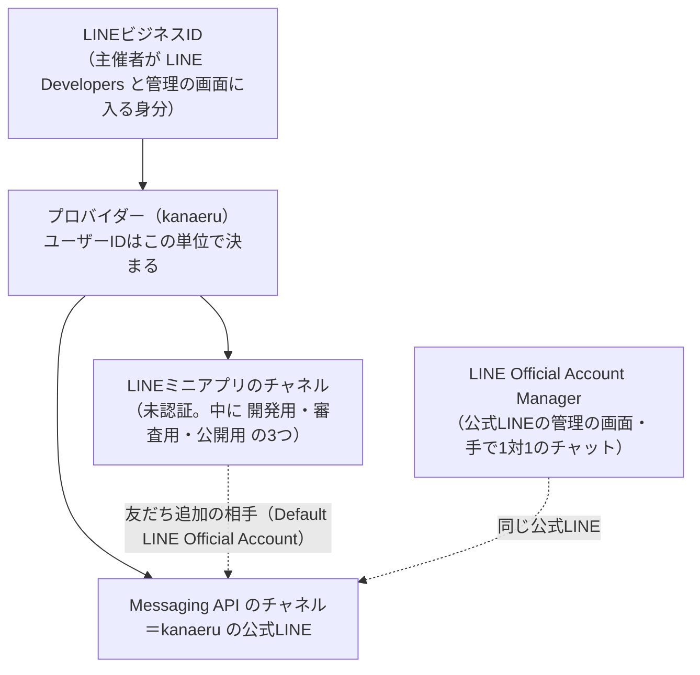

# LINEの学び（kanaeru で使うところだけ）

- 作成日：2026-11-19
- 直した日：—（まだない）
- 読む人：Webのログイン（OAuth・クッキーのセッション）は分かるが、LINEの開発は初めての人。
- この文書は「学び」の文書。考え方と使い方の説明で、**今のシステムの正本でも、決まりの正本でもない**。
  - 構成の決めごと（LINEのチャネル・ログイン・権限・QRのURL）は[構成の決めごと](../../_bmad-output/architecture-kanaeru/architecture-kanaeru.md)の AD-2・AD-4・AD-5・AD-12・AD-14 が正本。ここには要点とリンクだけを書く。
  - 何を作るか（LINEでのチェックイン・友だち追加・受付係の招待）は[PRD](../../_bmad-output/prd-kanaeru-reception/prd-kanaeru-reception.md)の FR-4〜FR-6・FR-21・UJ-1〜UJ-3 が正本。
  - 作り始めに実地で確かめることは、構成の決めごとの「Open Questions」1〜3。確かめの記録は[確かめの見直し](../../_bmad-output/architecture-kanaeru/reviews/review-verify.md)。
- 2026-11-19に LINE Developers の公式の文書で確かめた。確かめられなかったものは（要確認）と書いた。

---

## 0. 3行でいうと

1. kanaeru の画面は **未認証の LINEミニアプリ**として LINE の中で開く。中身は自分の Cloud Run の Web の画面で、SDK は **`@line/liff` 2.32**（2.31.1 未満は脆弱性があり使えなくなる）。
2. ログインは **`liff.getIDToken()` の生のIDトークンを API に送り、API が LINE の verify で確かめて `sub`（LINEのユーザーID）を得て、自前のセッションのクッキーを出す**。画面から送られた名前やIDは信じない。
3. 公式LINE は**友だち追加をしてもらい、テスターに手で1対1の連絡をするためだけ**に使う。1対1のチャットは通数に数えないので、無料のプランのまま 0 円。

---

## 1. 全体の地図

### 1.1 プロバイダー・チャネル・公式LINE



| 言葉 | 何か | kanaeru では |
|---|---|---|
| **プロバイダー** | アプリを出す人・団体の箱。**LINEのユーザーIDはこの単位で決まる** | 1つだけ。すべてのチャネルをこの下に作る（AD-2） |
| **チャネル** | プロバイダーの中の、1つの機能の窓口（LINEログイン・Messaging API・LINEミニアプリ） | LINEミニアプリと Messaging API の2つ |
| LINEミニアプリのチャネル | LINE の中で開く Web のアプリを1つ登録する窓口。**1チャネルにアプリ1つ** | 受付・アンケート・管理の画面を、1つのミニアプリ（1つの Web の画面）で出す |
| 公式LINE（LINE公式アカウント） | 友だちになった人とやりとりできるアカウント。Messaging API を有効にすると、Messaging API のチャネルができる | テスターへの1対1の連絡用（PRD FR-6・UJ-2） |

- **チャネルは、あとから別のプロバイダーに移せない**。最初に置き場所を決めてから作る。
- チャネルやアプリの名前に「LINE」は使えない。

### 1.2 ユーザーIDはプロバイダーごと

- LINEのユーザーID（`U` で始まる長い文字列）は、**同じ人でもプロバイダーが違えば別の値**、**同じプロバイダーならチャネルの種類によらず同じ値**になる。
- だから、ミニアプリのログインで得たユーザーIDと、公式LINE で見える同じ人のIDがそろう。スイートに2つ目のアプリを足しても、同じプロバイダーの下なら同じ人は同じIDのまま（AD-1・AD-2）。
- **主催者**は、設定 `ORGANIZER_LINE_USER_ID` と今の利用者のユーザーIDが同じかで決める（AD-5）。主催者自身のユーザーIDは、コンソールのチャネルの基本設定にある「Your user ID」で見られる（同じプロバイダーならどのチャネルでも同じ値。ミニアプリのチャネルでの表示の場所は要確認）。

---

## 2. LINEミニアプリ（未認証）

### 2.1 何か・なぜ LIFF でなくミニアプリか

- **LIFF**（LINE Front-end Framework）は、LINE の中で Web の画面を開く仕組みと、その SDK（`@line/liff`）。**LINEミニアプリ**は、LIFF の上に「アプリとしての見た目・決まり」を足したもの。作り方は LIFF とほぼ同じで、同じ SDK を使う。
- LINE は「**新しい LIFF アプリは LINEミニアプリとして作る**」ことを勧めていて、**LIFF とミニアプリは1つのブランドに統合する**と発表している。
- LINEログインのチャネルに作った LIFF アプリは、あとからミニアプリへ移せない。だから kanaeru は最初からミニアプリにした（AD-4 の前提。経緯は[記録](../../_bmad-output/architecture-kanaeru/.memlog.md)）。
- ミニアプリの画面の大きさは **Full だけ**（LIFF のように Compact・Tall は選べない）。

### 2.2 未認証のミニアプリ

**2024-11-28 から、ミニアプリのチャネルを作れる人なら誰でも、審査なしで「未認証のミニアプリ」として公開できる**。LINE の審査（1〜2週間ほど）を通ると「認証済み」になる。

| | 未認証（kanaeru） | 認証済み |
|---|---|---|
| 公開まで | チャネルを作れば使える | 審査が要る |
| 上の帯（ヘッダー） | **エンドポイントのドメイン**（例：Cloud Run の URL のドメイン）が出る | アプリの名前と認証の印 |
| ホームタブの「最近使った」・LINE の検索 | 出ない | 出る |
| ホーム画面のショートカット・独自のパス | 使えない | 使える |
| 同意の画面を省く（Channel consent simplification） | 公開用では効かない。**初めての人には同意の画面が出る** | 使える |

- kanaeru の参加者は会場の QR から入るので、検索やホームタブに出なくても困らない。ヘッダーにドメインが出るのは、独自のドメインを足すまでそのまま（構成の決めごと「Deferred」）。
- **未認証のミニアプリを、QR（パーマリンク）から開けるか**は、公式の文書からは読み切れない（要確認：Open Question 1）。開けなければ、QR に Cloud Run の URL を入れてそこからミニアプリを開く形にする（AD-14 の関数の中だけを直す）。

### 2.3 中の3つのチャネルと「開発中」

- コンソールでは1つのチャネルに見えるが、**中は「開発用（Developing）」「審査用（Review）」「公開用（Published）」の3つ**。開発用と審査用はいつも「開発中」、公開用はいつも「公開」。
- それぞれに LIFF ID とエンドポイントの URL がある（要確認：IDトークンの `aud`（チャネルID）がどう分かれるか。AD-4 が `LINE_CHANNEL_IDS` を並びで持つのは、ここに備えるため）。
- 開発用・審査用を開けるのは、そのチャネルの管理者・テスターだけ（要確認）。交流会で参加者が開くのは公開用。

### 2.4 SDK の版（2.31.1 未満は使わない）

- **LIFF v2.20.0〜v2.31.0 に XSS（クロスサイトスクリプティング）の脆弱性**がある。細工した URL を外のブラウザで開くと、アプリのドメインで JavaScript を動かされ、アクセストークンを盗まれうる。LIFF アプリにもミニアプリにも当たる。
- LINE は **2026-11-24（火）ごろ、v2.20.0〜v2.31.0 の利用を制限する**（早まることもある）。制限されると、外のブラウザで LINE ログインなどが動かなくなる。
- kanaeru は **`@line/liff` を `^2.32.0` で入れる**（Stack 表。2.32.0 は 2026-11-09 公開）。交流会（2026-11-25）は制限の後なので、古い版のままだと動かない。
- `npm audit` や Dependabot がこの脆弱性を拾わないことがある、という第三者の指摘がある（要確認）。版は手で確かめる。

### 2.5 URL と QR（パーマリンク）

- ミニアプリを開く URL（**パーマリンク**）は `https://miniapp.line.me/{LIFF ID}` に、エンドポイントの URL より後ろの部分（パス・問い合わせ・`#`）をそのまま足したもの。

  > パーマリンク ＝ LIFF URL ＋（開きたいページの URL − エンドポイントの URL）

  例：エンドポイントが `https://<Cloud Run の URL>/` なら、受付の画面 `/e/{eventId}/checkin` は `https://miniapp.line.me/{LIFF ID}/e/{eventId}/checkin`。
- 古い LINE（13.20 より前）は `https://liff.line.me/{LIFF ID}` を使う。こちらを開いてもミニアプリが開く。
- **QR にはパーマリンクを入れ、Cloud Run の URL を直接入れない**（AD-14）。置き場所の URL を変えても、印刷した QR が使えるため。道とパーマリンクを作る関数は `packages/contracts/src/core` に1つだけ。
- LINE が入っていないスマホでは、Web のブラウザが開き、LINE で開くよう勧める画面が出る（公式）。

### 2.6 どこで開いたか（LINE の中・外のブラウザ・PC）

| どこで開いたか | ログイン | `liff.isInClient()` |
|---|---|---|
| **LINE の中（LIFF ブラウザ）**：QR を読んで LINE が開いたとき | `liff.init()` のときに自動で済む | `true` |
| **外のブラウザ**（スマホの Safari・Chrome、**PC のブラウザ**） | `liff.init()` だけでは済まない。`liff.login()` を呼ぶか、`liff.init({ withLoginOnExternalBrowser: true })` にする | `false` |

- **2025年10月から、ミニアプリは外のブラウザでも使える**（公式）。主催者・受付係が PC で管理の画面を開くときは、この形でログインする。
- ただし、**未認証のミニアプリでも外のブラウザで同じように使えるか**は書かれていない（要確認：Open Question 3）。使えなければ、受付係と主催者はスマホで使う。
- `liff.init()` が動くのは、**エンドポイントの URL と同じか、その下の URL だけ**。だからエンドポイントは源の直下（`https://<Cloud Run の URL>/`）にしておく（[確かめの見直し](../../_bmad-output/architecture-kanaeru/reviews/review-verify.md) 8）。
- 外のブラウザでは、`liff.sendMessages()`・`liff.openWindow()` などは動く保証がない。kanaeru はこれらを使わない。

---

## 3. ログイン（IDトークンを確かめて、自前のセッション）

### 3.1 流れ

QR を読んで LINE の中で開いた、**初めての人**の形（2回目からは同意の画面が出ない）。PC の外のブラウザでは、②〜③の代わりに `liff.login()` で LINE のログインの画面に移って戻ってくる。

```mermaid
sequenceDiagram
  autonumber
  actor P as 参加者
  participant LINE as LINEのアプリ・LINEのサーバー
  participant Web as kanaeru の画面（apps/web）
  participant API as kanaeru の API（Cloud Run）
  participant V as LINE の verify（api.line.me）
  participant DB as Cloud SQL

  P->>LINE: 受付QR（パーマリンク）を読む
  LINE-->>P: 同意の画面（初めてのとき）＋友だち追加の選択肢（4章）
  P->>LINE: 許可する
  LINE->>Web: エンドポイントのURL（/e/{eventId}/checkin）を開く
  Web->>Web: lib/liff.ts：liff.init()（ここでログイン済み）
  Web->>Web: liff.getIDToken()（生のIDトークン）
  Web->>API: POST /api/v1/auth/line（IDトークンだけ）
  API->>V: POST /oauth2/v2.1/verify（id_token・client_id）
  V-->>API: sub（LINEのユーザーID）・name・aud・exp
  API->>DB: account を探す／なければ作る・session の行を作る
  API-->>Web: Set-Cookie（HttpOnly; Secure; SameSite=Lax・30日）
  Web->>API: 以後の要求はクッキーだけ（requireSession）
```

### 3.2 押さえどころ

- **`liff.init()` とログインの処理は `apps/web/src/lib/liff.ts` に1つだけ**置き、ルーターより先に呼ぶ（AD-4）。画面ごとに書かない。`liff.init()` が終わる前に URL を変えない（LIFF が壊れる）。
- 画面が送るのは **`liff.getIDToken()` の生のIDトークンだけ**。`liff.getDecodedIDToken()`・`liff.getProfile()` の中身（名前・ユーザーID）をサーバーへ送らない、と LINE の文書も言っている。送られた値は書き換えられるので、なりすまされる。
- API は `POST https://api.line.me/oauth2/v2.1/verify` に `id_token` と `client_id`（チャネルID）を送る。返った **`sub` を LINEのユーザーID** として使う。`aud`（チャネルID）と `exp`（期限）は verify が見てくれる。
- IDトークンを得るには `openid` のスコープが要る。表示名（名前の欄の初期値。AD-6）を得るには `profile` も選ぶ。
- 確かめたあとは **LINE のトークンを持たず、自前のセッション**にする（`session` の表＋クッキー。期限30日）。クッキーは `HttpOnly`（JavaScript から読めない）・`Secure`（https だけ）・`SameSite=Lax`。画面と `/api` は同じ源なので（AD-8）、これで足りる。
- 今の利用者を読むのは account の `requireSession`・`currentAccount(c)`・`useSession()` だけ（AD-12）。未ログインは `401 UNAUTHENTICATED`。
- IDトークン・クッキーはログに書かない（構成の決めごと Consistency Conventions「ログ」）。

---

## 4. 友だち追加（FR-6）

PRD は「同意の画面で公式LINE の友だち追加を勧める。しなくてもチェックインはできる。チェックインの画面に重ねて案内を出さない」（FR-6）。

| 手段 | 何か | 気をつけること |
|---|---|---|
| **Add friend option** | ミニアプリのチャネルの「Web app settings」で **On (normal)** にし、「Basic settings」の **Default LINE Official Account** に公式LINE を選ぶ。同意の画面に「友だち追加」のチェックが出て、外さずに許可すると友だちになる | 公式LINE の Messaging API のチャネルが**同じプロバイダー**にあること。**認定プロバイダーでないと、チェックは最初から入らない**ことがある（LINEログインの `bot_prompt=normal` の説明）。同意の画面が出るのは初めてのときだけ |
| `bot_prompt` | LINEログインの Web の流れで付ける問い合わせ（`normal`・`aggressive`） | ミニアプリのページは `normal`（On）だけを書いていて、`aggressive` の記載はない。kanaeru は Add friend option を使う |
| `liff.requestFriendship()` | 友だち追加（ブロックの解除）を勧める小さな画面を、いつでも出す（v2.28.0 から） | 結果は返らない。友だちかは `liff.getFriendship()` で見る。FR-6 の「重ねて出さない」に当たらないよう、出す場所を考える |

- **2026-11-09 の変更**：同意の画面に出す公式LINE を切り替える問い合わせが `prompt_bot_id` から **`liff_prompt_bot_id`**（パーマリンクに付ける。**LIFF 2.32.0 以上**）に変わった。これは**公式LINE を複数使う**ときの機能で（地域を日本にする・認証済みが条件と読める。要確認）、公式LINE が1つの kanaeru は使わない見込み。
- **未認証のミニアプリで Add friend option・`liff.requestFriendship()` が出るか**は、公式の文書に書かれていない（要確認：Open Question 2）。出なければ、チェックインのあとの画面に公式LINE の友だち追加のリンクを出す。

---

## 5. 手元で作るとき

- ミニアプリのログインは、**コンソールに登録した HTTPS のエンドポイントの上でしか動かない**（`liff.init()` はエンドポイントの下の URL だけ）。`http://localhost` では本物の LINE ログインはできない。
- だから**手元とテストでは、account の試験用のログインの窓口を使う**（`APP_ENV` が `local`・`test` のときだけ。本番では起動のときに止める。AD-12）。LINE のログインは、Cloud Run に出したもので確かめる。
- LIFF CLI（`@line/liff-cli`）の `serve` で `https://localhost` の通り道を作る手もあるが、`serve` はエンドポイントの URL を書き換えるので、**公開中のアプリには使わない**。ミニアプリのチャネルに使えるかも書かれていない（要確認）。kanaeru は使わない。
- 開発用のチャネルのエンドポイントに Basic 認証つきの URL を入れて、公開前の画面を隠すこともできる（公式。ただし安全の保証はない、とある）。

---

## 6. 公式LINE のプランと通数

| プラン（日本・税別） | 月額 | 月に送れる数 |
|---|---|---|
| **コミュニケーション** | 0円 | 200通 |
| ライト | 5,000円 | 5,000通 |
| スタンダード | 15,000円 | 30,000通（超えた分は追加） |

- **通数に数えないもの**：LINE のチャット（1対1）の送受信・応答メッセージ・あいさつメッセージ・Messaging API の reply。届かない相手（ブロックした人など）への送信も数えない。
- kanaeru は**主催者が LINE Official Account Manager から手で、テスターに1対1で送るだけ**（PRD 6.2：自動では送らない。5章：一斉配信に頼らない）。だから無料のコミュニケーションプランのまま 0 円。Messaging API から push・multicast で送る機能は、この版では作らない。
- Webhook（友だち追加などの知らせ）も、この版では受けない。
- **LINE Pay は日本では 2025-04-30 に終わった**。kanaeru の支払い方法は PayPay・現金・無料だけで、記録するだけ（PRD FR-4・5章「お金を扱わない」）。

---

## 7. よくある間違い

| 間違い | 何が起きるか | どうするか |
|---|---|---|
| ミニアプリと Messaging API のチャネルを別のプロバイダーに作る | ユーザーIDが合わない・友だち追加の相手に選べない。**あとから移せない** | 最初から同じプロバイダーに作る（1.1・AD-2） |
| `@line/liff` を 2.31.0 以下で入れる | 2026-11-24ごろから外のブラウザで動かない・XSS | `^2.32.0`（2.4） |
| `liff.getProfile()` の名前やIDを API に送って信じる | なりすまされる | 生のIDトークンを送り、verify で確かめる（3.2） |
| 画面ごとに `liff.init()` を書く | 二重に始まる・ログインの仕方がずれる | `lib/liff.ts` に1つ（AD-4） |
| QR に Cloud Run の URL を入れる | 置き場所を変えると、印刷した QR が使えない・LINE の中で開かない | パーマリンクを入れる（2.5・AD-14） |
| エンドポイントを `/e/...` など深い道にする | 上の道（管理の画面など）で `liff.init()` が動かない | 源の直下にする（2.6） |
| 手元で本物の LINE ログインを試そうとする | 動かない | 試験用のログイン（5章・AD-12） |
| 公開中のアプリに LIFF CLI の `serve` を使う | 本番のエンドポイントが書き換わり、参加者が開けない | 使わない（5章） |
| 友だち追加の選択肢が毎回出ると思う | 2回目からの人に勧められない | 同意の画面のときだけ出る。要るなら `liff.requestFriendship()`（4章） |
| テスターへの連絡を Messaging API の push で作る | 通数を使う・作る手間が増える | 管理の画面から手で1対1で送る（6章） |

---

## 8. 出典（2026-11-19に確かめた）

LINEミニアプリ
- LINEミニアプリの紹介（未認証と認証済み・ヘッダーのドメイン・ホームタブと検索は認証済みだけ・新しい LIFF はミニアプリで・LIFF との統合）：https://developers.line.biz/en/docs/line-mini-app/discover/introduction/
- 2024-11-28 から誰でも未認証のミニアプリを公開できる（2024 年のお知らせ）：https://developers.line.biz/en/news/2024/
- 開発の始め方（中の3つのチャネル・作れば未認証として使える・Basic 認証）：https://developers.line.biz/en/docs/line-mini-app/develop/develop-overview/
- パーマリンク（`miniapp.line.me`・作り方の式・LINE がないとき）：https://developers.line.biz/en/docs/line-mini-app/develop/permanent-links/
- 外のブラウザ（2025年10月から・`withLoginOnExternalBrowser`）：https://developers.line.biz/en/docs/line-mini-app/develop/external-browser/
- 認可の流れ（同意の画面を省くのは認証済みだけ・`requestFriendship`）：https://developers.line.biz/en/docs/line-mini-app/develop/channel-consent-simplification/
- 友だち追加（Add friend option・Default LINE Official Account・同じプロバイダー・`liff_prompt_bot_id` は 2.32.0 から）：https://developers.line.biz/en/docs/line-mini-app/service/add-friend-option/

LIFF
- リリースノート（2.31.1 の修正・2.32.0・2026-11-24ごろの制限・`requestFriendship` は 2.28.0 から）：https://developers.line.biz/en/docs/liff/release-notes/
- 脆弱性と古い版の制限（2026-10-20 のお知らせ）・友だち追加の公式LINE の切り替えの再開（2026-11-09 のお知らせ）：https://developers.line.biz/en/news/2026/
- LIFF アプリを作る（`liff.init` が動く URL・`getIDToken` と `openid`）：https://developers.line.biz/en/docs/liff/developing-liff-apps/
- LIFF でユーザーの情報を使う（プロフィールを送らず、トークンを送ってサーバーで確かめる）：https://developers.line.biz/en/docs/liff/using-user-profile/
- LIFF CLI（`serve` はエンドポイントを書き換える・公開中には使わない）：https://developers.line.biz/en/docs/liff/liff-cli/

LINEログイン
- IDトークンを確かめる（`POST /oauth2/v2.1/verify`・`id_token`・`client_id`・`sub`）：https://developers.line.biz/en/docs/line-login/verify-id-token/
- ログインのときに友だち追加（同じプロバイダー・`bot_prompt` の normal と aggressive・認定プロバイダー）：https://developers.line.biz/en/docs/line-login/link-a-bot/

公式LINE・料金・そのほか
- Messaging API の料金（コミュニケーションプラン 0円・200通・reply は数えない）：https://developers.line.biz/ja/docs/messaging-api/pricing/
- LINE公式アカウントの料金プラン（チャット・応答・あいさつ・Reply API は数えない）：https://www.lycbiz.com/jp/service/line-official-account/plan/
- 日本の LINE Pay の終わり（2025-04-30）：https://www.lycorp.co.jp/ja/news/release/008628/

kanaeru の前提
- [構成の決めごと](../../_bmad-output/architecture-kanaeru/architecture-kanaeru.md)・[記録（.memlog）](../../_bmad-output/architecture-kanaeru/.memlog.md)・[確かめの見直し](../../_bmad-output/architecture-kanaeru/reviews/review-verify.md)・[PRD](../../_bmad-output/prd-kanaeru-reception/prd-kanaeru-reception.md)・[PRDの補足](../../_bmad-output/prd-kanaeru-reception/addendum.md)
