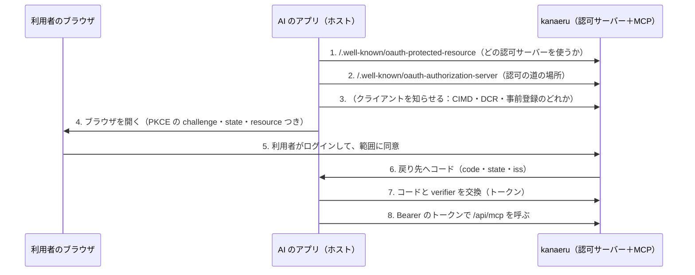

# MCP の学び（kanaeru で使うところだけ）

- 作成日：2026-11-23
- 読む人：Web アプリ（TypeScript・Hono）は作ってきたが、MCP と OAuth の認可は初めての人（kanaeru の開発者）。
- この文書は「学び」の文書。考え方と、kanaeru での使い方の説明で、**今のシステムの正本でも、決まりの正本でもない**。
  - 認可と MCP の決め（AD-20・AD-21）→ [構成の決めごと](../../_bmad-output/architecture-kanaeru/architecture-kanaeru.md)
  - この機能の範囲・要件・作業の一覧 → [specs/core/021-mcp-server](../../specs/core/021-mcp-server/spec.md)（`spec.md`・`plan.md`・`tasks.md`）
  - 作業の決まり（コミット・PR・仕様の置き場所）→ [CLAUDE.md](../../CLAUDE.md)・`docs/rules/`
- 仕様の番号（FR-〇〇・SC-〇〇・T〇〇）は、この機能の仕様を指す。
- 公式の仕様を読んだのは 2026-11-23。版は仕様の URL の `2026-07-28`。確かめきれないことは（要確認）と書いた。

## 1. MCP を一言で

MCP（Model Context Protocol）は、**AI のアプリ（Claude・Codex など）が外のサービスの道具（ツール）と情報を、同じやり方で使うための約束**。Web の API が「画面と外のプログラム」の約束であるのに対し、MCP は「AI と道具」の約束。

kanaeru では、**利用者本人の記録を、利用者が許した範囲だけ、外の AI に読ませる入口**として使う（書く操作は今の版では作らない）。

## 2. 登場人物

| 役 | 誰か（kanaeru の場合） | 役目 |
|---|---|---|
| **ホスト** | Claude・Codex などの AI のアプリ | 利用者の画面を持つ。クライアントを作って、利用者の代わりに道具を使う |
| **クライアント** | ホストの中の MCP の部品 | サーバーと1対1でつながる。接続先ごとに1つ |
| **サーバー** | kanaeru（`/api/mcp`） | 道具（ツール）の一覧を出し、呼ばれたら実行して結果を返す |
| **認可サーバー** | kanaeru（`/api/oauth/*`） | 利用者の同意を取り、札（トークン）を出す |

Web アプリにとっては、**MCP サーバーは「もう1つの API の入口」**と考えるとよい。違いは、呼ぶのが人間の画面ではなく AI で、呼ぶ前に「何ができるか」を一覧で聞けること。

## 3. 通信の中身（JSON-RPC）

MCP の会話は **JSON-RPC 2.0**（`{"jsonrpc":"2.0","id":1,"method":"…","params":{…}}` の形）。HTTP の上では次の順で進む。

1. **initialize**：お互いの版と、できることを言い合う。
2. **tools/list**：サーバーが道具の一覧を返す（名前・説明・入力の形）。
3. **tools/call**：クライアントが1つの道具を名前と引数で呼ぶ。結果は本文（テキストなど）で返る。

サーバーの機能は、道具（**tools**）のほかに、**resources**（読むだけの資料）と **prompts**（決まった指示の雛形）がある。kanaeru の最初の版は**道具だけ**を使う。

### 転送（トランスポート）

- **stdio**：ローカルの子プロセスと標準入出力でやり取りする（デスクトップの AI のアプリが多い）。
- **Streamable HTTP**：HTTP の1つの道（kanaeru では `/api/mcp`）でやり取りする。遠くのサーバーに向く。kanaeru はこちら（[AD-21](../../_bmad-output/architecture-kanaeru/architecture-kanaeru.md)）。
  - 要求は POST の JSON。応答は JSON か、順番に流す形（SSE）のどちらか（要確認：細かい形は計画の段階で公式の仕様を読む）。
  - 道具は普通の HTTP の道と同じく、Bearer のトークンで守る（後述）。

## 4. 認可（OAuth 2.1）の流れ

遠くの MCP サーバーは、利用者の代わりに使うので、**認可**が要る。MCP の仕様は OAuth 2.1 の作法に従う。流れは次のとおり。



### 覚える用語

- **PKCE（S256）**：ブラウザを経由するので、途中で盗まれたコードを使えないようにする仕組み。ホストは秘密の文字列（verifier）を作り、その SHA-256（challenge）を先に送る。最後に verifier を見せて、合うかを確かめる。kanaeru は S256 だけを受ける。
- **resource（RFC 8707）**：このトークンは**どのサーバー向けか**。kanaeru では `https://（画面の源）/api/mcp` と決めて、ほかの宛先のトークンは受けない。トークンを別のサーバーへ流用されないための守り。
- **iss（RFC 9207）**：認可の応答が**本当にこのサーバーから来たか**を確かめる印。
- **メタデータ（RFC 9728・8414）**：サーバーが「私はどこで認可を取るか」「どんな方式を受けるか」を JSON で言う場所（`/.well-known/...`）。
- **クライアントの知らせ方**：MCP の仕様は3つを優先順で挙げる（[client-registration](https://modelcontextprotocol.io/specification/2026-07-28/basic/authorization/client-registration.md)）。
  1. **事前登録**：運営者があらかじめ `client_id` を発行する（Muse のような審査のあるコネクタはこちら）。
  2. **CIMD（Client ID Metadata Document）**：`client_id` を、クライアントが管理する https の URL にする。サーバーはその URL の JSON を取りに行って、名前と戻り先を確かめる。**MCP の仕様は CIMD を勧める**（SHOULD）。
  3. **DCR（RFC 7591）**：サーバーに登録の口があり、クライアントが `client_id` をもらう。仕様は**非推奨（MAY）**で、後方互換のために残す。kanaeru は CIMD と DCR の両方を受ける（[plan.md](../../specs/core/021-mcp-server/plan.md) R2）。

### CIMD の守り（kanaeru）

CIMD は「サーバーが、任意の URL を取りに行く」ことになるので、**SSRF**（内側の番地を叩かせる攻撃）の入口になる。kanaeru は次で守る（実装：`apps/api/src/modules/account/oauth/cimd.ts`）。

- https の URL だけ。IP の直書き・localhost・利用者の情報（`user:pass@`）は断る。
- 解決された番地が私的な番地（10.x・192.168.x・169.254.x・::1 など）なら取りに行かない。
- 転送（リダイレクト）は追わない。時間と大きさに上限を付ける。

## 5. 道具の呼び出しで守ること

道具を呼ぶときの守りは、**画面の API と同じ窓口を通す**こと（AD-20）。

- `/api/mcp` は **Bearer のトークンだけ**で確かめる。クッキーのログインは受けない（画面のログインを外へ流さない）。
- トークンは `Authorization: Bearer …` だけで送る。URL の問い合わせには入れない。
- 範囲（scope）は `<アプリ>:read` の形。道具は、その範囲がないと呼べない（`403`）。
- 道具は、本人の記録だけを返す。ほかの人の名前・困りごと・人物メモは返さない（Constitution II）。
- 読むだけが既定。書く道具は、範囲 `:write` と確認の手順（2段階）を付けて、あとで作る（FR-025〜031）。
- 呼び出しは記録する（道具の名前・誰が・いつ・結果の種類だけ。引数と返した中身は残さない）。

## 6. kanaeru での実装の場所（2026-11-23 時点）

| 部分 | 状態 | 場所 |
|---|---|---|
| 認可のメタデータ・DCR・認可・同意・トークン・更新 | 実装済み（テストあり） | `apps/api/src/modules/account/oauth/`（`routes.ts`・`store.ts`・`cimd.ts`・`pkce.ts`・`redirect.ts`・`resource.ts`・`tokens.ts`） |
| 認可の表（クライアント・同意・コード・トークン・記録） | DB に適用済み | `apps/api/src/modules/account/schema.ts`・`drizzle/0023_mcp_oauth.sql` |
| `/.well-known` を画面に戻さない守り | 実装済み | `apps/api/src/platform/web/web.ts`（`isServerPath`） |
| 同意の画面（`/oauth/consent`） | 未実装（画面の作業） | `apps/web/`（フェーズ4） |
| `/api/mcp`（Streamable HTTP）と道具の一覧 | 未実装（フェーズ3） | `apps/api/src/platform/mcp/`（予定） |
| Bearer を許可リストの道だけで受ける（Muse の API 経路） | 未実装 | `requireSession`（AD-12）と許可リスト（予定） |

道具の決まりと全体の作業は [tasks.md](../../specs/core/021-mcp-server/tasks.md) を見る。

## 7. 手で試す（ローカルの API）

`pnpm dev` で API を立ち上げ、次で認可のメタデータが返ることを確かめられる。

```bash
curl -s http://localhost:8787/.well-known/oauth-authorization-server | jq .
curl -s http://localhost:8787/.well-known/oauth-protected-resource | jq .
```

（ポート番号は `.env` の `API_PORT` による。）`resource` が `…/api/mcp`、`code_challenge_methods_supported` が `["S256"]` になっていれば、入口は正しい。

## 8. よくある誤解

- **「MCP は API と別物」ではない**：道具の中身は、普通の HTTP の窓口を呼ぶだけ（AD-20）。MCP は「AI がどう一覧を聞き、どう呼ぶか」の約束。
- **「クライアントを1つ登録すれば、どの AI でも使える」ではない**：接続先ごとに知らせ方（CIMD・DCR・事前登録）が違う。CLI の接続先は、戻り先がループバック（`http://127.0.0.1:<空きポート>`）になる（FR-033）。
- **「トークンがあれば何でも読める」ではない**：範囲・宛先（resource）・本人の確かめ、の3つが揃って初めて読める。
- **「PKCE は要らない」ではない**：ブラウザを経由する認可では、コードの横取りを防ぐために要る。kanaeru は必ず S256。

## 9. 用語（まとめ）

| 用語 | 一言 |
|---|---|
| MCP | AI と道具の約束（JSON-RPC の上の道具の一覧と呼び出し） |
| ツール（tool） | AI が呼べる1つの操作（名前・説明・入力の形つき） |
| トークン（札） | 認可で出す、Bearer で送る値。DB には SHA-256 だけを持つ |
| PKCE | 認可のコードの横取りを防ぐ仕組み（verifier と challenge） |
| resource | トークンの宛先（どのサーバー向けか） |
| CIMD | client_id を URL にして、その中の JSON で登録を代える方式 |
| DCR | サーバーに登録させて client_id をもらう方式（非推奨） |
| 範囲（scope） | トークンで許された操作の範囲（`<アプリ>:read` など） |
