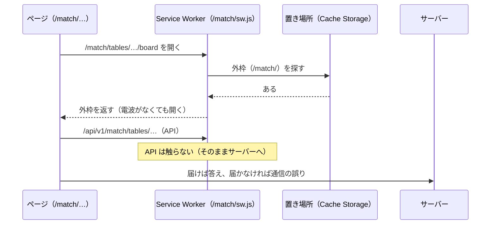

# Service Worker の学び（試合表のネットなし）

- 作成日：2026-11-22（match-005・core-015）
- 直した日：—（まだない）

kanaeru で初めて使う技術なので、**このプロジェクトでの使い方に絞って**説明する（[文書の決まり](../rules/documents.md) 1）。正本は次のとおりで、ここは考え方の説明。

- 守ること：[構成の決めごと](../../_bmad-output/architecture-kanaeru/architecture-kanaeru.md) AD-27（ネットなしで開く仕組みは試合表の道だけ）・AD-28（端末に残して送る）
- 作業の決まり：[コードの書き方](../rules/coding.md) 6-3（Service Worker はアプリの道の下だけ）
- 今の形：[docs/architecture.md](../architecture.md)・[試合表の地図](../apps/match.md)

## 1. Service Worker とは

ブラウザが、ページとは別に動かす小さな JavaScript。登録すると、その**範囲（scope）**の下のページが出す要求（ページを開く・JS や CSS を読む・API を呼ぶ）を、いったん受け取れる（`fetch` の知らせ）。受け取った要求に、手元の置き場所（Cache Storage）のファイルを返せば、**電波がなくてもページが開く**。

覚えておくこと：

- **範囲は、置いたフォルダが上限**。`/match/sw.js` に置くと、範囲は `/match/` より広くできない（サーバーが `Service-Worker-Allowed` の見出しを出さない限り）。だから受付アプリなど、ほかのアプリの道には効かない。kanaeru はこの性質を使って、AD-27 の「試合表の道だけ」を守っている。
- `/match`（末尾の `/` なし）は範囲 `/match/` に入らない（文字の頭で比べるため）。ホーム画面に置くときは、試合表の中の画面（`/match/tables/…` など）から置く（要確認：実機）。
- **https か localhost でしか動かない**（E2E は `http://127.0.0.1` で動く）。
- 登録した Service Worker は、ページを閉じても残る。**壊れた Service Worker は、ページの JS では外せないことがある**（ページの JS 自体が古いまま出続けるため）。だから止め方を先に用意しておく（4章）。

## 2. 一生（install → waiting → activate）

| 段階 | 何が起きるか | kanaeru の本文（`apps/web/src/features/match/offline/sw.js`）がすること |
|---|---|---|
| install | 初めて入る・新しい版が届いた | 持つファイル（組み立てが埋めた並び）を、HTTP の置き場所を飛ばして取り、版ごとの置き場所 `kanaeru-match-<版の印>` に入れる |
| waiting | 前の版がページを受け持っている間、新しい版は待つ | 画面が「新しい版があります」を出す。押されたら `SKIP_WAITING` を受けて進む |
| activate | 新しい版が受け持つ | 古い版の置き場所を消す。`clients.claim()` で開いているページを受け持つ |

ブラウザは、範囲の下のページを開くたびに `sw.js` を取り直し、**1バイトでも違えば新しい版**とみなす。そこで組み立て（`apps/web/scoped-service-worker.ts`）が、持つファイルの名前（中身の印つき）から作った**版の印**を `sw.js` に埋める。画面を組み直すと印が変わり、次につながったときに新しい版が入る。API は `sw.js` に `Cache-Control: no-cache` を付けて返すので、古い `sw.js` を持ち続けない。

## 3. 何を持ち、何を持たないか

- 持つ：画面の外枠（`/match/` の道で取った `index.html`。試合表の道の守りの見出し〈カメラを許す Permissions-Policy・CSP〉ごと持つ）・入口の束・試合表の画面の束と CSS（組み立てが束の図をたどって選ぶ）。
- 持たない：**API の答え**（`/api/…` は触らない）。試合表の中身と送っていない変更は、ページが IndexedDB に置く（AD-28。`offline/store.ts`）。
- 持たない：ほかのアプリの画面の束・LINE の SDK。

ページを開く要求には、持っている外枠を**すぐ**返す（電波が弱いときに待たせない）。新しい画面は、上の「新しい版」の流れで入れ替える。

## 4. 止め方（AD-27）

1. **機能の印 `match.offline` を切にする**（設定 `DOMAIN_FEATURES` の1行。コードを戻さない）。画面は試合表の道を開くたびに `GET /api/v1/match/offline` を読み、切（か、アプリが見えない 404）なら Service Worker を外して置き場所を消す。本文も10分おきに同じ窓口を読み、切なら自分を外す（ページの JS が壊れていても止まる）。
2. **本文が壊れたとき**は、`sw.js` の `SELF_UNREGISTER` を `true` にして出す。入った途端に自分を外し、置き場所を消し、開いているページを読み直す（自分を外すだけの Service Worker）。ブラウザは `sw.js` の変わり目にいつも気づくので、壊れた版でも入れ替えられる。

## 5. 試し方

- 単体：組み立ての plugin（持つファイルの選び方・版の印）は `apps/web/scoped-service-worker.test.ts`。
- E2E（Playwright）：`e2e/tests/match-offline.spec.ts`。範囲が `/match/` で、ほかの道（`/apps` など）を受け持たないこと、1度開いたあと `context.setOffline(true)` で読み直しても開けること、直すと端末に残してつながったら送ること。
- 手元で見る：Chrome の開発者ツールの Application › Service Workers と Cache Storage・IndexedDB（`kanaeru-match`）。「Offline」にして読み直す。
- **実機で確かめること（まだ）**：iPhone の Safari と Android の Chrome で、ホーム画面に置いた試合表の画面がネットなしで開けるか、IndexedDB が残るか（iPhone は使わない日が続くと消すことがある。Open Questions 9）。

## 6. つまずきやすいこと

- TanStack Query は、既定ではブラウザが「つながっていない」と知ると問い合わせを止めて待つ（`networkMode: "online"`）。端末の中身に切りかえたい問い合わせは `networkMode: "always"` にする（試合表の `queries.ts` など）。
- Playwright の `page.route()` は、Service Worker が答えた要求を横取りできない。kanaeru の本文は API を触らないので、API の差しかえはそのまま使える。
- 開発のサーバー（`pnpm dev`）では `sw.js` を書き出さない。確かめるときは `pnpm --filter web build` のあと API に画面を返させる（E2E と同じ形）。
