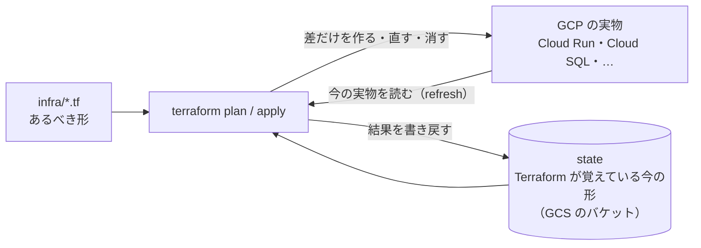
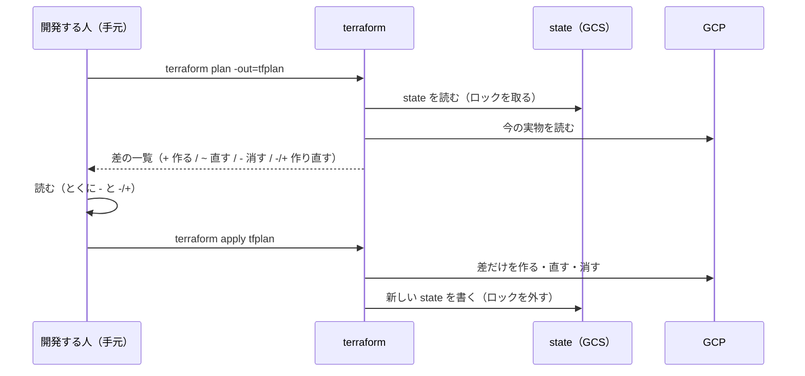
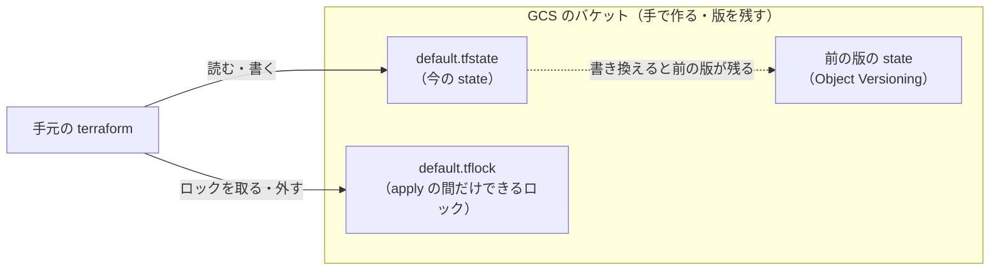
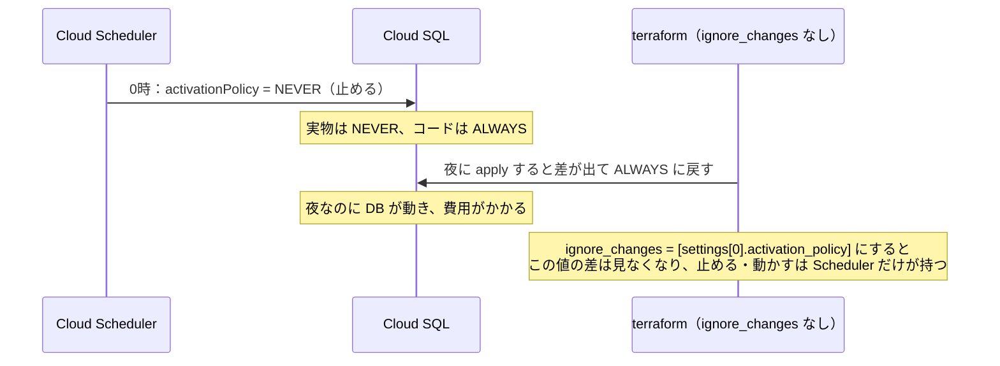
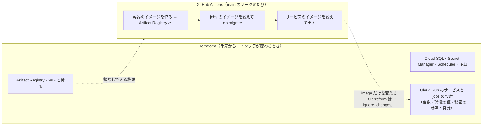

# Terraformの学び（kanaeru で使うところだけ）

> 2026-11-22（core-018）から、`infra/` は「共通の資源」と「環境ごとの部品（`infra/modules/environment`）」に分かれ、本番とステージングを同じ部品で作る。Cloud SQL は内部の IP だけになった。この文書の例（`kanaeru/prod` の state・Unix ソケットの `DATABASE_URL`・`roles/cloudsql.client`）は作り始めのころの形で、今の形は [infra/README.md](../../infra/README.md) が正本。

- 作成日：2026-11-19
- 直した日：2026-11-22（core-018：今の infra の形への注記を頭に足した）
- 読む人：TypeScript で Web を作ってきて、Terraform（インフラをコードで書く道具）は初めての人。GCP のサービスそのもの（Cloud Run・Cloud SQL など）は[GCPの学び](./gcp.md)で先に読むと分かりやすい。
- この文書は「学び」の文書。考え方と使い方の説明で、**今のシステムの正本でも、決まりの正本でもない**。
  - 何を Terraform で持つか・Cloud SQL の型・夜間の停止などの決めごとは、[構成の決めごと](../../_bmad-output/architecture-kanaeru/architecture-kanaeru.md)（AD-8〜AD-11）が正本。
  - デプロイの決まりは[開発の流れの決まり](../rules/development-flow.md) 5章が正本。
  - 資源の名前・役割・ファイルの分け方の最終の形は、これから書く `infra/` の仕様で決める。
- **ここの HCL（Terraform の書き方）はすべて学びのための例**で、そのままでは動かない場合がある。引数の名前は 2026-11-19 に google プロバイダの説明（GitHub の文書の元ファイル）と突き合わせたが、`terraform validate` はまだ流していない。
- 版は 2026-11-19 に確かめた：Terraform 1.17.2、google プロバイダ 8.12.0、random プロバイダ 3.9.1。

---

## 0. 3行でいうと

1. Terraform は「GCP にこれがあるべき」をファイルに書き、**今の形との差だけ**を作る・直す・消す道具。kanaeru では GCP の資源を全部 `infra/` に書く（AD-9）。
2. いつも **plan（何が変わるかを見る）→ 読む → apply（変える）**。plan の `destroy`（消す）と `replace`（作り直す）は、とくに注意して読む。Cloud SQL が作り直されると、交流会の記録が消える。
3. Terraform が覚えている「今の形」（state）は、**GCS のバケットに置き、版を残し、Git には入れない**。state には秘密の値が入りうるので、読める人を絞る。

---

## 1. IaC と Terraform（なぜ画面で押さないのか）

**IaC**（Infrastructure as Code）は、サーバー・DB・権限などの「インフラ」を、画面でポチポチ作る代わりに、**コードのファイルに書いて作る**考え方。Terraform はその代表的な道具で、HashiCorp が作っている。

| | GCP の画面（コンソール）で作る | Terraform で作る |
|---|---|---|
| 何を作ったか | 自分の記憶か、画面を1つずつ開いて見る | `infra/` のファイルを読めば分かる |
| 作り直す | 同じ手順をもう一度、間違えずに押す | `terraform apply` をもう一度 |
| 変える前の確かめ | 押したら即反映 | `terraform plan` で差を先に見る |
| 変えた記録 | 残りにくい | Git の履歴と PR に残る。レビューできる |
| 消し忘れ（費用） | 試しに作ったものが残りやすい | ファイルにないものは「ない」と分かる |

kanaeru が Terraform を使う理由は、[構成の決めごと](../../_bmad-output/architecture-kanaeru/architecture-kanaeru.md) AD-9 の「Prevents」のとおり：画面で手で作った資源が残って、作り直せない・費用が分からなくなるのを防ぐため。加えて、主催者が Terraform を学ぶため（[決めたことの記録](../decisions.md) 2026-11-19）。

Terraform の動きを1枚にすると次のとおり。



- Terraform は「あるべき形（コード）」と「今の形（state と実物）」を比べ、**差を埋める手順を自分で考える**。どの順で作るか（DB を先に作ってから Cloud Run に DB の名前を渡す、など）も、資源どうしの参照から自分で決める。
- AWS の CloudFormation や CDK と同じ役目。Terraform は AWS・GCP・Cloudflare など、いろいろな相手に同じ書き方で使える。

---

## 2. 覚える言葉

Terraform のファイルは `.tf` で終わり、**HCL**（HashiCorp Configuration Language）という書き方で書く。JSON に近いが、コメントや参照が書ける。

| 言葉 | やさしく言うと | kanaeru での例 |
|---|---|---|
| **provider**（プロバイダ） | 相手（GCP など）の API を話すための部品。npm のパッケージのように、版を決めて取ってくる | `hashicorp/google`（GCP）、`hashicorp/random`（乱数のパスワード） |
| **resource**（資源） | Terraform が**作って持つ**もの。1つのブロックが、GCP の1つの物に当たる | `google_sql_database_instance`（Cloud SQL）・`google_cloud_run_v2_service`（Cloud Run） |
| **data source**（データソース） | Terraform が**読むだけ**のもの。作らない。ほかで作られた物の情報を引く | `data "google_project"`（プロジェクト番号を引く） |
| **variable**（変数） | 外から渡す値。関数の引数のようなもの | プロジェクトID・請求先アカウントID・GitHub のリポジトリ名 |
| **output**（出力） | apply のあとに表に出す値。関数の戻り値のようなもの | Cloud Run の URL・GitHub Actions に渡す WIF のプロバイダ名 |
| **locals**（ローカル） | ファイルの中だけで使う名前つきの値。同じ式を何度も書かないため | `local.name = "kanaeru"` |
| **module**（モジュール） | `.tf` をまとめて部品にしたもの | 環境が本番の1つだけなので、最初は使わない（ステージングを足すときに考える） |
| **state**（状態） | Terraform が「自分が作った物」と「実物のID」の対応を覚えておくファイル | GCS のバケットに置く（4章） |
| **backend**（バックエンド） | state をどこに置くかの設定 | `gcs`（Cloud Storage） |

小さな例で全部の形を見ると、こうなる（例（そのままでは動かない場合がある））。

```hcl
# variable：外から渡す値
variable "project_id" {
  type        = string
  description = "GCP のプロジェクトID"
}

# locals：中だけで使う値
locals {
  name = "kanaeru"
}

# data source：読むだけ（プロジェクト番号を引く）
data "google_project" "this" {
  project_id = var.project_id
}

# resource：作って持つ（容器のイメージの置き場所）
resource "google_artifact_registry_repository" "app" {
  location      = "asia-northeast1"
  repository_id = local.name
  format        = "DOCKER"
}

# output：apply のあとに出す値
output "repository_path" {
  value = "asia-northeast1-docker.pkg.dev/${var.project_id}/${google_artifact_registry_repository.app.repository_id}"
}
```

- 参照の書き方：`var.名前`（変数）・`local.名前`（ローカル）・`data.種類.名前.属性`（データソース）・`種類.名前.属性`（資源）。
- 資源のブロックは `resource "種類" "Terraform の中の名前"`。2つ目の名前は Terraform の中だけで使う名前で、GCP 上の名前（`name = ...`）とは別。
- 資源どうしを参照すると、Terraform は「こちらを先に作る」と自分で分かる。参照がないのに順番が要るときだけ `depends_on` を書く。
- `.tf` のファイルは、同じフォルダの中なら**全部つながった1つの設定**として読まれる。ファイルの分け方は人が読みやすくするためだけ（6章）。

---

## 3. 動かす流れ（init → plan → 読む → apply）

### 3.1 よく使うコマンド

| コマンド | 何をするか | いつ |
|---|---|---|
| `terraform init` | プロバイダを取ってくる・backend（GCS）につなぐ | 最初の1回と、プロバイダや backend を変えたとき |
| `terraform fmt` | 書き方をそろえる（Prettier のようなもの） | 書いたあと毎回 |
| `terraform validate` | 書き方の間違いを、GCP に触らずに見る | 書いたあと毎回 |
| `terraform plan -out=tfplan` | 何が変わるかを計算して見せ、その計画をファイルに残す | 変える前に毎回 |
| `terraform apply tfplan` | 読んだ計画のとおりに変える | plan を読んで、よいと思ったら |
| `terraform destroy` | 全部消す | **kanaeru ではふだん使わない**（7章の守りで止まる） |
| `terraform state list` | state が覚えている資源の一覧 | 何を持っているか見たいとき |



- `-out=tfplan` で残した計画を `apply tfplan` に渡すと、**読んだものと違うことは起きない**。`terraform apply` だけで流すと、もう一度計算して「yes と打つか」を聞いてくる。その間に何かが変わっていても気づきにくいので、計画のファイルを渡すほうが安心。
- `tfplan` のファイルには秘密の値が入りうる。Git に入れない（4.4）。

### 3.2 plan の差の読み方

plan は、資源ごとに次の印をつけて見せる。

| 印 | 意味 | 気をつけ方 |
|---|---|---|
| `+` | 作る（create） | 増える資源は費用も増えるかもしれない |
| `~` | その場で直す（update in-place） | ふつうは安全。何の値が変わるかを見る |
| `-` | 消す（destroy） | **本当に消してよいか**を必ず確かめる |
| `-/+` | 消してから作り直す（replace） | **いちばん危ない**。DB なら中のデータが消える |
| `+/-` | 作ってから古いのを消す（replace） | 作り直しは同じ。順番が違うだけ |
| `<=` | データソースを読む | 読むだけ。実物は変わらない |

kanaeru で出そうな plan の例（形を見るための例。実際の出力とは細部が違う）：

```text
  # google_cloud_run_v2_service.app will be updated in-place
  ~ resource "google_cloud_run_v2_service" "app" {
        name     = "kanaeru"
      ~ template {
          ~ scaling {
              ~ max_instance_count = 3 -> 2
            }
        }
    }

  # google_sql_database_instance.main must be replaced
-/+ resource "google_sql_database_instance" "main" {
      ~ name = "kanaeru-db" -> "kanaeru-db2" # forces replacement
        ...
    }

Plan: 1 to add, 1 to change, 1 to destroy.
```

- 最後の行 `Plan: X to add, Y to change, Z to destroy.` を最初に見る。**destroy が0でないとき**は、どれが消えるのかを上にさかのぼって探す。
- `# forces replacement` が付いた値は、「その値を変えると作り直しになる」という意味。Cloud SQL の名前やリージョンなどがこれに当たる。
- 上の例のように Cloud SQL が `-/+` になったら、**apply しない**。kanaeru では `prevent_destroy` と `deletion_protection` を付けるので、plan か apply の時点でエラーになって止まる（7章）。
- 何も直していないのに差が出るときは、だれかが画面で手で直した（ドリフト。9章）か、ほかの仕組み（夜間の停止など）が値を変えたのかもしれない。理由が分かるまで apply しない。

---

## 4. state（状態）と、最初に手でやること

### 4.1 state はなぜ大事か

- state には「Terraform が作った資源」と「GCP の実物のID」の対応が入っている。なくなると、Terraform は自分が作ったものを忘れ、**同じ物をもう1つ作ろうとしたり、消せなくなったりする**。
- state には資源の属性がそのまま入る。書き方によっては、**DB のパスワードなどの秘密の値が、暗号にしていない文字のまま入る**（Terraform の公式の説明でも「state は秘密として扱う」とある）。だから：
  - Git にコミットしない（4.4）。
  - 置き場所（GCS のバケット）を読める人を絞る。
  - 秘密の値は、できるだけ state に入らない書き方にする（5章）。

### 4.2 置き場所は GCS（リモートの state）

手元のファイル（`terraform.tfstate`）のままだと、パソコンが壊れたら終わる。kanaeru では **GCS のバケットに置く**（AD-9）。



- **ロック**：GCS の backend は state のロックに対応している。apply の間はロックのファイルを作り、2つの apply が同時に state を書き換えないようにする。途中で落ちてロックが残ったら `terraform force-unlock <ID>` で外せるが、**ほかで本当に動いていないか確かめてから**。
- **版を残す（Object Versioning）**：公式の説明でも強くすすめている。state を間違えて壊しても、前の版に戻せる。
- ロックのファイルの名前（`.tflock`）はロックの仕組みの中の話で、ふだん意識しなくてよい（要確認：名前は版によって変わるかもしれない）。

backend の書き方（例（そのままでは動かない場合がある））：

```hcl
terraform {
  backend "gcs" {
    bucket = "<手で作ったバケットの名前>" # ここには変数（var.…）を使えない
    prefix = "kanaeru/prod"              # バケットの中のフォルダ
  }
}
```

- backend のブロックの中では変数を使えない。値を変えたいときは `terraform init -backend-config=...` で渡す。
- バケットの名前は世界で1つなので、そのまま書くか、コミットしない設定ファイルから渡す。

### 4.3 最初の1回だけ手でやること（ブートストラップ）

Terraform は「state を置くバケット」を自分では作れない（**バケットは backend の設定より先にある必要がある**）。そこで、AD-9 のとおり、次の2つだけは手で作る。

1. **GCP のプロジェクト**（と、請求先アカウントへのひもづけ）。
2. **state を置く GCS のバケット**（版を残す設定つき）。

手でやる流れの例（例（そのままでは動かない場合がある）。`<…>` は自分の値。値そのものは文書やコミットに書かない）：

```bash
# 0) 道具を入れる（macOS）
brew tap hashicorp/tap
brew install hashicorp/tap/terraform
# gcloud（Google Cloud CLI）も入れておく

# 1) ログインする。2つ目は「手元の Terraform が使う資格（ADC）」
gcloud auth login
gcloud auth application-default login

# 2) プロジェクトは画面か gcloud で作り、請求先アカウントにひもづける（GCPの学びを参照）

# 3) state のバケットを東京に作る。公開させない・権限はバケット単位
gcloud storage buckets create gs://<バケットの名前> \
  --project=<プロジェクトID> \
  --location=asia-northeast1 \
  --uniform-bucket-level-access \
  --public-access-prevention

# 4) 版を残す
gcloud storage buckets update gs://<バケットの名前> --versioning

# 5) infra/ で init（バケットにつながる）
cd infra && terraform init
```

- バケットを読み書きできる人は、今は主催者（プロジェクトのオーナー）だけ。GitHub Actions などに読ませるときは、そのバケットにだけ権限を足す。
- Terraform が動くための API（`cloudresourcemanager`・`serviceusage` など）は、最初の apply で「有効になっていない」と言われることがある。そのときは言われた API だけ `gcloud services enable` で手で有効にする（要確認：どれが要るかは最初の apply で分かる）。
- プロジェクトとバケットは Terraform の外にあるので、**`terraform destroy` しても消えない**。逆に言うと、この2つを消すときは手で消す。

### 4.4 Git に入れるもの・入れないもの

`infra/.gitignore`（またはリポジトリの `.gitignore`）に足すものの例：

```gitignore
# Terraform
.terraform/
*.tfstate
*.tfstate.*
*.tfplan
tfplan
crash.log
crash.*.log
# 値を入れた変数のファイル（プロジェクトIDや請求先アカウントIDを入れるなら）
*.tfvars
!*.tfvars.example
```

| ファイル | Git に入れるか | 理由 |
|---|---|---|
| `*.tf` | 入れる | これが本体 |
| `.terraform.lock.hcl` | **入れる** | プロバイダの版を固定する（`pnpm-lock.yaml` と同じ役目） |
| `.terraform/` | 入れない | 取ってきたプロバイダの実物（大きい）と、backend の設定の写し |
| `*.tfstate`・`tfplan` | 入れない | 秘密の値が入りうる。state は GCS にある |
| `terraform.tfvars` | 入れない（見本の `.example` だけ入れる） | 請求先アカウントIDなどの値。秘密の値はそもそも書かない（5章） |

- 秘密の値をコミットしない決まりは[コードの書き方の決まり](../rules/coding.md) 2章が正本。コミットの前の gitleaks も `.tf` を見る。

---

## 5. 秘密の値（DB のパスワード）の扱い

AD-9 は「秘密の値（DB のパスワード）は Secret Manager に置き、Terraform のコードとリポジトリには書かない」と決めている。ここでは、それを Terraform でどう書くかの考え方を説明する。

### 5.1 「入れ物」と「中身」を分けて考える

Secret Manager の秘密には2つの層がある（くわしくは[GCPの学び](./gcp.md)）。

| 層 | Terraform の資源 | 中に入るもの |
|---|---|---|
| 入れ物（secret） | `google_secret_manager_secret` | 名前・置き場所・権限だけ。値は入らない |
| 中身（version） | `google_secret_manager_secret_version` | 秘密の値そのもの。版ごとに増える |

- 入れ物は Terraform で作ってよい（名前と権限はコードで持ちたい）。
- 中身の入れ方は2つある。
  1. **Terraform の中で作って、state に残さず書き込む**（5.2）。DB のパスワードのように、Terraform が DB の利用者と一緒に作れる値に向く。
  2. **値は手で入れる**（`gcloud secrets versions add`）。LINE のチャネルのシークレットのように、外から来る値に向く。Terraform は入れ物だけを持つ。

### 5.2 state に残さない書き方（書くだけの欄と、その場だけの値）

昔の書き方の `password = "..."` や `secret_data = "..."` は、**値が state に平文で残る**。Terraform 1.10・1.11 から、残さない仕組みが2つ入った。

| 仕組み | 何か | 版 |
|---|---|---|
| その場だけの値（ephemeral） | 動いている間だけあって、state にも plan のファイルにも書かれない値 | Terraform 1.10 以上 |
| 書くだけの欄（write-only argument） | 名前が `_wo` で終わる欄。値を GCP に渡したら捨て、state に残さない。対になる `_wo_version` の数を上げたときだけ書き込む | Terraform 1.11 以上 |

- `sensitive = true` は**画面に出さないだけ**で、state には残る。秘密を守る仕組みではないので、取り違えない。

kanaeru の DB のパスワードの例（例（そのままでは動かない場合がある））：

```hcl
# その場だけの乱数。state にも plan にも残らない。
# plan・apply のたびに新しい値ができるが、下の *_wo_version を上げないかぎり書き込まれない
ephemeral "random_password" "db" {
  length  = 32
  special = false # 接続の URL に入れても壊れないように記号を使わない
}

# Cloud SQL の利用者。パスワードは書くだけの欄で渡す
resource "google_sql_user" "app" {
  name                = "kanaeru"
  instance            = google_sql_database_instance.main.name
  password_wo         = ephemeral.random_password.db.result
  password_wo_version = 1
}

# 入れ物：アプリが読む DATABASE_URL
resource "google_secret_manager_secret" "database_url" {
  secret_id = "kanaeru-database-url"
  replication {
    auto {}
  }
}

# 中身：同じ apply の同じパスワードで URL を作り、書くだけの欄で渡す
resource "google_secret_manager_secret_version" "database_url" {
  secret                 = google_secret_manager_secret.database_url.id
  secret_data_wo         = "postgresql://kanaeru:${ephemeral.random_password.db.result}@/kanaeru?host=/cloudsql/${google_sql_database_instance.main.connection_name}"
  secret_data_wo_version = 1 # パスワードを変えるときは、上の password_wo_version と一緒に上げる
}
```

- 2つの `_wo_version` は**同じ apply で一緒に上げる**。片方だけ上げると、Secret Manager の値と DB のパスワードが食い違う。
- 秘密に入れるのを「パスワードだけ」にするか「`DATABASE_URL` 丸ごと」にするかは、`infra/` の仕様で決める。`?host=/cloudsql/...` の URL の形で pg がつながるかは、まだ確かめていない（要確認。[点検の記録](../../_bmad-output/architecture-kanaeru/reviews/review-verify.md) 6）。
- Cloud Run には、値ではなく「どの秘密のどの版を読むか」だけを渡す（6.5 の `secret_key_ref`）。値はコードにも state にも出てこない。
- 手で入れる秘密（例：あとで LINE のシークレットを足すとき）は、Terraform では入れ物と権限だけを書き、値は `gcloud secrets versions add <名前> --data-file=-` で入れる。

---

## 6. kanaeru の `infra/`（形の案と主な資源の例）

### 6.1 ファイルの分け方の案

kanaeru は環境が本番の1つだけ（AD-11）なので、モジュールを作らず、**1つのフォルダに資源の種類ごとのファイル**を置く形が分かりやすい。最終の形は `infra/` の仕様で決める。

```text
infra/
  versions.tf        # Terraform とプロバイダの版・backend（GCS）・provider の設定
  variables.tf       # 外から渡す値（プロジェクトID・請求先アカウントID・リポジトリ名など）
  locals.tf          # 名前などの共通の値
  outputs.tf         # Cloud Run の URL・WIF のプロバイダ名など
  apis.tf            # 使う API の有効化
  artifact_registry.tf
  cloud_sql.tf       # Cloud SQL の台・DB・利用者
  secrets.tf         # Secret Manager の入れ物と、DB の接続の値
  cloud_run.tf       # Cloud Run のサービスと jobs・その身分（サービスアカウント）と権限
  scheduler.tf       # 夜間の停止と朝の起動
  iam_wif.tf         # GitHub Actions から鍵なしで入る仕組み（WIF＋サービスアカウントのなりすまし）
  budget.tf          # 請求の予算と知らせ
  terraform.tfvars.example  # 値の見本（本物の tfvars はコミットしない）
  .terraform.lock.hcl       # コミットする
```

- `main.tf`・`variables.tf`・`outputs.tf` の3つに全部を入れる形もよくある。資源が10を超えるので、kanaeru では種類ごとに分けたほうが PR で読みやすい。
- 2章のとおり、ファイルを分けても Terraform には1つの設定として読まれる。

### 6.2 版・provider・変数（versions.tf・variables.tf・locals.tf）

```hcl
# versions.tf — 例（そのままでは動かない場合がある）
terraform {
  required_version = ">= 1.11" # 書くだけの欄（password_wo など）に要る版

  required_providers {
    google = {
      source  = "hashicorp/google"
      version = "~> 8.12" # 8.12 以上・9.0 より前
    }
    random = {
      source  = "hashicorp/random"
      version = "~> 3.9"
    }
  }

  backend "gcs" {
    bucket = "<手で作ったバケットの名前>"
    prefix = "kanaeru/prod"
  }
}

provider "google" {
  project = var.project_id
  region  = var.region

  # 予算（google_billing_budget）を手元の資格（ADC）で作るときに要る
  user_project_override = true
  billing_project       = var.project_id
}
```

```hcl
# variables.tf — 例
variable "project_id" {
  type = string
}

variable "region" {
  type    = string
  default = "asia-northeast1"
}

variable "billing_account_id" {
  type = string # 値は tfvars で渡す。文書には書かない
}

variable "github_repo" {
  type        = string
  description = "owner/repo の形"
}

variable "organizer_line_user_id" {
  type        = string
  description = "主催者の LINE のユーザーID（秘密ではない。AD-5）"
}

# locals.tf — 例
locals {
  name = "kanaeru"
}

data "google_project" "this" {
  project_id = var.project_id
}
```

- `~> 8.12` は「8.12 以上・9.0 より前」。大きな版（9.0）に上げるときは、変更点を読んでから手で書き換える。
- 変数の値は `terraform.tfvars`（コミットしない）か、環境の値 `TF_VAR_project_id` などで渡す。

### 6.3 API の有効化（apis.tf）

```hcl
# 例（そのままでは動かない場合がある）
resource "google_project_service" "apis" {
  for_each = toset([
    "run.googleapis.com",
    "artifactregistry.googleapis.com",
    "sqladmin.googleapis.com",
    "secretmanager.googleapis.com",
    "cloudscheduler.googleapis.com",
    "iam.googleapis.com",
    "iamcredentials.googleapis.com",
    "sts.googleapis.com",
    "billingbudgets.googleapis.com",
  ])
  service = each.value
}
```

- `for_each` は「並びの1つずつに同じ資源を作る」書き方。`each.value` がその1つ。
- `disable_on_destroy` は書かなければ「資源を消しても API は有効のまま」になる。そのままでよい。

### 6.4 Cloud SQL（cloud_sql.tf）

AD-8 の型と AD-9 のバックアップ・消さない設定、AD-10 の夜間の停止を、1つの資源に書く。

```hcl
# 例（そのままでは動かない場合がある）
resource "google_sql_database_instance" "main" {
  name             = "${local.name}-db"
  region           = var.region
  database_version = "POSTGRES_18" # uuidv7() を使うので 18（AD-8）

  # Terraform からの削除を止める（7章）
  deletion_protection = true

  settings {
    edition           = "ENTERPRISE"  # 書かないと PostgreSQL 16 以上は Enterprise Plus になり、db-f1-micro が選べず落ちる
    tier              = "db-f1-micro" # 共有コア。SLA の対象外
    availability_type = "ZONAL"
    activation_policy = "ALWAYS"      # 作るときは動かしておく。あとの変更は無視する（下の lifecycle）

    # GCP の側でも削除を止める（画面・gcloud からの削除も止まる）
    deletion_protection_enabled = true

    ip_configuration {
      ipv4_enabled = true # 公開IPはあるが、承認済みネットワークは書かない。つなぐのは Cloud Run の組み込みの接続だけ（AD-8）
    }

    backup_configuration {
      enabled    = true
      start_time = "03:00" # UTC で書く。日本時間の12時（DB が動いている昼。AD-9）
      backup_retention_settings {
        retained_backups = 7
      }
    }
  }

  lifecycle {
    prevent_destroy = true                               # 消す・作り直す plan が出たら止める
    ignore_changes  = [settings[0].activation_policy]    # 夜間の停止は Scheduler が持つ（AD-10）
  }

  depends_on = [google_project_service.apis]
}

resource "google_sql_database" "app" {
  name     = "kanaeru"
  instance = google_sql_database_instance.main.name
}

# google_sql_user は 5.2 の例
```

- **`edition = "ENTERPRISE"` を書き忘れると、apply が `Invalid Tier (db-f1-micro) for (ENTERPRISE_PLUS) Edition` で落ちる**。google プロバイダの説明にも、PostgreSQL 16 以上はエディションを書かないと Enterprise Plus になる、と書いてある。高い台を選んで通してしまうと費用が大きく変わる（[点検の記録](../../_bmad-output/architecture-kanaeru/reviews/review-verify.md) 3）。
- `start_time` は **UTC**（Cloud SQL Admin API の説明で確かめた）。日本時間 = UTC + 9時間。
- `settings[0].activation_policy` の `[0]` は、「`settings` のブロックの1つ目」という意味。Terraform の中では `settings` は並びとして扱われるため。

### 6.5 Cloud Run（cloud_run.tf）

1つの容器が画面と `/api` を返す（AD-8）。Cloud SQL には Unix ソケットでつなぎ、`DATABASE_URL` は Secret Manager から読む。

```hcl
# 例（そのままでは動かない場合がある）

# Cloud Run が動くときの身分（既定のサービスアカウントは権限が広いので使わない）
resource "google_service_account" "run" {
  account_id   = "${local.name}-run"
  display_name = "kanaeru の Cloud Run"
}

# Cloud SQL につないでよい（Cloud SQL の役割はプロジェクトの単位で付ける）
resource "google_project_iam_member" "run_sql_client" {
  project = var.project_id
  role    = "roles/cloudsql.client"
  member  = google_service_account.run.member
}

# この秘密だけを読んでよい
resource "google_secret_manager_secret_iam_member" "run_database_url" {
  secret_id = google_secret_manager_secret.database_url.id
  role      = "roles/secretmanager.secretAccessor"
  member    = google_service_account.run.member
}

resource "google_cloud_run_v2_service" "app" {
  name                = local.name
  location            = var.region
  deletion_protection = true # Cloud Run では書かなくても true が既定

  ingress              = "INGRESS_TRAFFIC_ALL" # 参加者のスマホから届く
  invoker_iam_disabled = true                  # 誰でも開ける（ログインはアプリの中で確かめる）

  template {
    service_account = google_service_account.run.email

    scaling {
      min_instance_count = 0
      max_instance_count = 2 # Cloud SQL の接続の上限を超えないように（AD-8）
    }

    volumes {
      name = "cloudsql"
      cloud_sql_instance {
        instances = [google_sql_database_instance.main.connection_name]
      }
    }

    containers {
      image = "us-docker.pkg.dev/cloudrun/container/hello" # 最初だけの仮のイメージ。本物は GitHub Actions が出す

      env {
        name  = "ORGANIZER_LINE_USER_ID"
        value = var.organizer_line_user_id
      }
      env {
        name  = "TRUSTED_PROXY_HOPS"
        value = "1"
      }
      env {
        name  = "RATE_LIMIT_MAX"
        value = "600"
      }
      env {
        name = "DATABASE_URL"
        value_source {
          secret_key_ref {
            secret  = google_secret_manager_secret.database_url.secret_id
            version = "latest"
          }
        }
      }

      volume_mounts {
        name       = "cloudsql"
        mount_path = "/cloudsql"
      }
    }
  }

  lifecycle {
    # イメージは GitHub Actions が出すので、Terraform は元に戻そうとしない
    ignore_changes = [
      template[0].containers[0].image,
      client,
      client_version,
    ]
  }

  depends_on = [
    google_secret_manager_secret_iam_member.run_database_url,
    google_secret_manager_secret_version.database_url,
  ]
}
```

- 環境の値（`ORGANIZER_LINE_USER_ID` など）は Terraform が持ち、イメージは GitHub Actions が持つ、という分け方（8章）。`LINE_CHANNEL_IDS` なども同じ形で足す。
- `client`・`client_version` は、gcloud でデプロイしたときに GCP が書き込む印。無視しないと毎回差が出る。
- DB の変更を当てる Cloud Run jobs（AD-11）は `google_cloud_run_v2_job` で、ほぼ同じ形で書ける（`template { template { containers ... } }` と入れ子が1段深い）。再試行の数は `template[0].template[0].max_retries`（既定は3）で、DB の変更を何度も当て直さないよう 0〜1 にする案がある（[点検の記録](../../_bmad-output/architecture-kanaeru/reviews/review-verify.md) 7）。

### 6.6 夜間の停止（scheduler.tf）

Cloud Scheduler が、決まった時刻に Cloud SQL Admin API へ `PATCH` を送り、`activationPolicy` を `NEVER`（止める）・`ALWAYS`（動かす）に変える（AD-10）。間に関数を挟まない。

```hcl
# 例（そのままでは動かない場合がある）

# Scheduler が名乗る身分
resource "google_service_account" "db_scheduler" {
  account_id   = "${local.name}-db-scheduler"
  display_name = "kanaeru の DB を止める・動かす"
}

# Cloud SQL の設定を変えてよい（cloudsql.instances.update を含む役割）
resource "google_project_iam_member" "db_scheduler_sql" {
  project = var.project_id
  role    = "roles/cloudsql.editor"
  member  = google_service_account.db_scheduler.member
}

locals {
  db_schedules = {
    stop  = { schedule = "0 0 * * *", policy = "NEVER" }  # 毎日0時に止める
    start = { schedule = "0 8 * * *", policy = "ALWAYS" } # 毎日8時に動かす
  }
}

resource "google_cloud_scheduler_job" "db" {
  for_each  = local.db_schedules
  name      = "${local.name}-db-${each.key}"
  region    = var.region
  schedule  = each.value.schedule
  time_zone = "Asia/Tokyo"

  http_target {
    http_method = "PATCH"
    uri         = "https://sqladmin.googleapis.com/v1/projects/${var.project_id}/instances/${google_sql_database_instance.main.name}"
    headers     = { "Content-Type" = "application/json" }
    body        = base64encode(jsonencode({ settings = { activationPolicy = each.value.policy } }))

    # Google の API（*.googleapis.com）を呼ぶときは OIDC ではなく OAuth のトークン
    oauth_token {
      service_account_email = google_service_account.db_scheduler.email
      scope                 = "https://www.googleapis.com/auth/cloud-platform"
    }
  }

  lifecycle {
    # 交流会が0時を越える日は、主催者が gcloud scheduler jobs pause で止める（AD-10）。それを戻さない
    ignore_changes = [paused]
  }

  depends_on = [google_project_service.apis]
}
```

- `body` は **base64 にした文字**で渡す決まり（プロバイダの説明）。`jsonencode` で JSON にしてから `base64encode` で包む。
- `PATCH` の URL と本文の形は、Cloud SQL の「止める・動かす」の公式の手順にあるものと同じ。ただ、Scheduler から直接呼ぶ組み合わせの公式のチュートリアルは見つかっていない（要確認：作り始めに `gcloud scheduler jobs run` で一度動かして確かめる）。
- Scheduler の設定をする人（Terraform を動かす人）には、そのサービスアカウントとして振る舞う権限（`iam.serviceAccounts.actAs`）が要る。プロジェクトのオーナーなら持っている。

なぜ `ignore_changes` が要るのかを図にすると：



### 6.7 GitHub Actions から鍵なしで入る（iam_wif.tf）

GitHub Actions がデプロイするときは、サービスアカウントの鍵（JSON）を置かず、**Workload Identity Federation（WIF）**で入る。kanaeru は、WIF で入ったあとデプロイ用のサービスアカウント `kanaeru-deployer` になりすます形を使う（AD-9。Cloud Run がプールへ直接権限を付ける Direct WIF に対応していないため。仕組みの説明は[GCPの学び](./gcp.md)）。下の例は Direct WIF の形のままなので、実際の書き方は `infra/iam_wif.tf` を見る。

```hcl
# 例（そのままでは動かない場合がある）

# 外の身分証を受け入れる箱
resource "google_iam_workload_identity_pool" "github" {
  workload_identity_pool_id = "github"
  display_name              = "GitHub Actions"
}

# GitHub を信じる設定。条件で「このリポジトリの main だけ」に絞る
resource "google_iam_workload_identity_pool_provider" "github" {
  workload_identity_pool_id          = google_iam_workload_identity_pool.github.workload_identity_pool_id
  workload_identity_pool_provider_id = "github"

  attribute_mapping = {
    "google.subject"       = "assertion.sub"
    "attribute.repository" = "assertion.repository"
    "attribute.ref"        = "assertion.ref"
  }
  attribute_condition = "assertion.repository == \"${var.github_repo}\" && assertion.ref == \"refs/heads/main\""

  oidc {
    issuer_uri = "https://token.actions.githubusercontent.com"
  }
}

locals {
  # 「このリポジトリから来た GitHub Actions」を表す名前
  github_principal = "principalSet://iam.googleapis.com/${google_iam_workload_identity_pool.github.name}/attribute.repository/${var.github_repo}"
}

# イメージを押し込んでよい（このリポジトリの置き場所だけ）
resource "google_artifact_registry_repository_iam_member" "github_push" {
  location   = google_artifact_registry_repository.app.location
  repository = google_artifact_registry_repository.app.name
  role       = "roles/artifactregistry.writer"
  member     = local.github_principal
}

# Cloud Run のサービスと jobs を更新してよい
resource "google_project_iam_member" "github_run" {
  project = var.project_id
  role    = "roles/run.developer"
  member  = local.github_principal
}

# Cloud Run を「kanaeru-run の身分で動かす」設定にしてよい
resource "google_service_account_iam_member" "github_act_as_run" {
  service_account_id = google_service_account.run.name
  role               = "roles/iam.serviceAccountUser"
  member             = local.github_principal
}
```

- `attribute_condition` を付けないと、ほかの人のリポジトリの GitHub Actions からも入れてしまうおそれがある。公式の説明も、いつも条件を付けるようにすすめている。リポジトリの名前の代わりに持ち主の数字のID（`assertion.repository_owner_id`）でも絞ると、名前を取り直されたときにも安全。
- `google_iam_workload_identity_pool.github.name` は `projects/<番号>/locations/global/workloadIdentityPools/github` の形。GitHub Actions の `workload_identity_provider` に渡すのは、プロバイダの `name`（output で出す）。
- Cloud Run は Direct WIF に対応していない（公式）。そのため `infra/iam_wif.tf` では、上の3つの役割を `kanaeru-deployer` に付け、プールの身分には `roles/iam.workloadIdentityUser`（なりすましてよい）だけを付けている（core-002 R-1）。
- プールを消すと、しばらく同じIDで作り直せない（要確認）。名前を決めたら変えない。
- プールや権限の変更が効くまで、最大5分ほどかかる。

### 6.8 請求の予算（budget.tf）

AD-9：月2,000円、50%・100% でメールで知らせる。

```hcl
# 例（そのままでは動かない場合がある）
resource "google_billing_budget" "monthly" {
  billing_account = var.billing_account_id
  display_name    = "${local.name}-monthly"

  budget_filter {
    projects = ["projects/${data.google_project.this.number}"]
  }

  amount {
    specified_amount {
      currency_code = "JPY" # 請求先アカウントの通貨と同じにする
      units         = "2000"
    }
  }

  threshold_rules {
    threshold_percent = 0.5
  }
  threshold_rules {
    threshold_percent = 1.0
  }
}
```

- 何も足さなければ、知らせは請求先アカウントの管理者と利用者にメールで届く。
- **予算はお金を止めない**。知らせるだけ。
- 手元の資格（ADC）で予算を作ると、`user_project_override` と `billing_project` がないと 403 になる（6.2 の provider の設定）。
- Terraform を動かす人に、請求先アカウントの予算を作る権限が要る。個人のアカウントで請求先を作った本人なら持っている（要確認）。

### 6.9 出力（outputs.tf）

```hcl
# 例
output "service_url" {
  value = google_cloud_run_v2_service.app.uri
}

output "wif_provider" {
  value       = google_iam_workload_identity_pool_provider.github.name
  description = "GitHub Actions の workload_identity_provider に渡す"
}

output "sql_connection_name" {
  value = google_sql_database_instance.main.connection_name
}
```

- `terraform output` で見られる。GitHub の「変数（Variables）」に写すときに使う。これらは秘密ではないが、文書には書かない（プロジェクトの番号などが入るため）。

---

## 7. `lifecycle` と、消さないための仕組み

### 7.1 `lifecycle` のブロック

`lifecycle` は、どの資源にも書ける「Terraform の振る舞いを変える」設定。kanaeru で使うのは2つ。

| 書き方 | 何をするか | kanaeru で使う所 |
|---|---|---|
| `ignore_changes = [値の場所, …]` | その値の差を、直す計画に入れない。**外の仕組みがその値を持つ**ときに使う | Cloud SQL の `activation_policy`（Scheduler が持つ）・Scheduler の `paused`（主催者が持つ）・Cloud Run の `image`（GitHub Actions が持つ） |
| `prevent_destroy = true` | その資源を消す・作り直す計画が出たら、エラーで止める | Cloud SQL |

- `ignore_changes` は「最初に作るとき」は値を使う。作ったあとの変更だけを無視する。だから 6.4 では `activation_policy = "ALWAYS"` を書いて、作るときは動かしておく。
- `prevent_destroy` は、**資源のブロックごとコードから消すと効かない**（公式の説明）。「消したつもりはないのにブロックを消した」PR は、plan の destroy で気づくしかない。

### 7.2 Cloud SQL を消さないための3つの段

| 仕組み | どこで効くか | 何を止めるか |
|---|---|---|
| `lifecycle { prevent_destroy = true }` | Terraform（plan のとき） | 消す・作り直す plan そのものをエラーにする |
| `deletion_protection = true` | google プロバイダ | Terraform からの削除を止める。消すには、まず `false` にして apply してから |
| `settings.deletion_protection_enabled = true` | GCP そのもの | 画面・gcloud・API・Terraform の、どこからの削除も止める |

- AD-9 は `deletion_protection` を決めている。3つとも付けると、うっかりの削除がより起きにくい（6.4 の例は3つとも付けた）。
- 消すのを止めても、**中のデータを守るのはバックアップ**。自動のバックアップ（AD-9：昼・7日分）が最後の保険になる。
- Cloud Run も `deletion_protection` が既定で true。試しに作って消したいときは、まず `false` にして apply する。

---

## 8. Terraform はどこで動かすか・GitHub Actions との分担

### 8.1 今は手元から

- 当面は、**開発する人の手元（パソコン）から** `terraform plan`・`apply` を流す形を想定している。GitHub Actions から Terraform を動かすかは、`infra/` の仕様で決める（今は決めていない）。
- 手元で動かすときの資格は `gcloud auth application-default login`（4.3）。
- **apply する場所は1か所にする**のが安全。手元と GitHub Actions の両方から apply すると、ロックはあっても「どちらの変更が最新か」が分かりにくくなる。
- DB が止まっている夜（0時〜8時）は、DB の中の物（`google_sql_database`・`google_sql_user`）を読むところで plan が落ちるかもしれない（要確認）。デプロイと同じく昼に流すのが無難。

### 8.2 GitHub Actions との分担



| 何を変えるか | 誰が持つか |
|---|---|
| どんな資源があるか・型・台数・環境の値・権限 | Terraform（`infra/` の PR） |
| どのイメージ（どの版のアプリ）が動いているか | GitHub Actions（`main` のマージ。AD-11） |

- GitHub Actions はイメージだけを変え、Terraform はイメージの差を無視する（6.5 の `ignore_changes`）。こうすると、2つが同じ値を取り合わない。
- 逆に、GitHub Actions のデプロイで環境の値（`--set-env-vars` など）も変えると、Terraform の持つ値と取り合いになり、次の plan に差が出る。環境の値を変えるのは Terraform だけにする形が分かりやすい。
- デプロイの流れ（コンテナ → `db:migrate` → 出す）と時間帯（8時15分〜23時に始める）の決まりは、[開発の流れの決まり](../rules/development-flow.md) 5章と AD-11 が正本。

---

## 9. よくある間違い

| 間違い | 何が起きるか | 避け方 |
|---|---|---|
| 画面（コンソール）で手で直す | コードと実物がずれる（ドリフト）。次の apply で元に戻される | 直すのはコードで。急ぎで手で直したら、すぐコードにも書く |
| 手元と GitHub Actions など、2か所から apply する | どちらが最新か分からなくなる。ロックの取り合い | apply は1か所から（8.1） |
| `.terraform/`・`*.tfstate`・`tfplan` をコミットする | 秘密の値が漏れる。古い state が混ざる | `.gitignore`（4.4）。コミットの前の gitleaks |
| `.terraform.lock.hcl` をコミットしない | 人によってプロバイダの版が違う | コミットする |
| state のバケットの版の保管をオンにしない | state を壊したら戻せない | `--versioning`（4.3） |
| state のバケットを広く読めるようにする | state の中の秘密の値が読まれる | バケットの権限を絞る・公開を止める（4.3） |
| Cloud SQL で `edition` を書き忘れる | Enterprise Plus になり、`db-f1-micro` が選べず apply が落ちる。高い台で通すと費用が大きく増える | `edition = "ENTERPRISE"`（6.4） |
| `activation_policy` を `ignore_changes` に入れない | 夜の apply で DB が起き、昼の apply で止めた設定が戻る | 6.6 の図 |
| Cloud Run の `image` を `ignore_changes` に入れない | apply のたびに仮のイメージに戻る（アプリが消える） | 6.5 |
| `password = "..."`・`secret_data = "..."` を使う | 値が state に平文で残る | `password_wo`・`secret_data_wo`＋ephemeral（5.2） |
| `sensitive = true` で秘密を守ったつもりになる | 画面に出ないだけで state には残る | 5.2 |
| plan を読まずに apply する | DB の作り直しに気づかない | `plan -out` → 読む → `apply tfplan`（3.1） |
| backup の `start_time` を日本時間で書く | 夜中（DB が止まっている時間）にバックアップの時刻が来る | UTC で書く（12時 → `"03:00"`） |
| `terraform destroy` をうっかり流す | 全部消そうとする | ふだん使わない。`prevent_destroy`・`deletion_protection`（7章） |

---

## 10. 出典（2026-11-19 に確かめた）

- Terraform の最新の版（1.17.2）：https://github.com/hashicorp/terraform/releases
- google プロバイダの最新の版（8.12.0）：https://github.com/hashicorp/terraform-provider-google/releases
- random プロバイダの最新の版（3.9.1）：https://github.com/hashicorp/terraform-provider-random/releases
- GCS の backend（ロック・版の保管を強くすすめる・バケットは先に作る）：https://developer.hashicorp.com/terraform/language/backend/gcs
- `lifecycle`（`prevent_destroy` はブロックを消すと効かない・`ignore_changes` の書き方）：https://developer.hashicorp.com/terraform/language/meta-arguments/lifecycle
- 秘密の値の扱い（state は平文・`sensitive` は表示だけ・ephemeral は 1.10・書くだけの欄は 1.11）：https://developer.hashicorp.com/terraform/language/manage-sensitive-data
- Terraform の入れ方：https://developer.hashicorp.com/terraform/install
- `google_sql_database_instance`（`edition` の既定と `Invalid Tier` の落ち方・`activation_policy`・`deletion_protection`・`deletion_protection_enabled`・バックアップ）：https://registry.terraform.io/providers/hashicorp/google/latest/docs/resources/sql_database_instance （元ファイル：https://github.com/hashicorp/terraform-provider-google/blob/main/website/docs/r/sql_database_instance.html.markdown ）
- `google_sql_user`（`password_wo`）：https://registry.terraform.io/providers/hashicorp/google/latest/docs/resources/sql_user
- `google_secret_manager_secret`・`google_secret_manager_secret_version`（`secret_data_wo`）：https://registry.terraform.io/providers/hashicorp/google/latest/docs/resources/secret_manager_secret_version
- random の `random_password`（ephemeral）：https://registry.terraform.io/providers/hashicorp/random/latest/docs/ephemeral-resources/password
- `google_cloud_run_v2_service`（Cloud SQL のボリューム・`secret_key_ref`・`deletion_protection` の既定・`invoker_iam_disabled`）：https://registry.terraform.io/providers/hashicorp/google/latest/docs/resources/cloud_run_v2_service
- `google_cloud_run_v2_job`（入れ子の形・`max_retries` の既定）：https://registry.terraform.io/providers/hashicorp/google/latest/docs/resources/cloud_run_v2_job
- `google_cloud_scheduler_job`（`paused`・`oauth_token`・`body` は base64）：https://registry.terraform.io/providers/hashicorp/google/latest/docs/resources/cloud_scheduler_job
- `google_iam_workload_identity_pool`・`google_iam_workload_identity_pool_provider`（GitHub Actions の例・条件）：https://registry.terraform.io/providers/hashicorp/google/latest/docs/resources/iam_workload_identity_pool_provider
- `google_billing_budget`（ADC のときの `user_project_override`）：https://registry.terraform.io/providers/hashicorp/google/latest/docs/resources/billing_budget
- `google_project_service`（`disable_on_destroy`）：https://registry.terraform.io/providers/hashicorp/google/latest/docs/resources/google_project_service
- Cloud SQL を止める・動かす（`PATCH`・`activationPolicy`・止めてもストレージと IP の料金は続く）：https://docs.cloud.google.com/sql/docs/postgres/start-stop-restart-instance
- Cloud SQL Admin API（バックアップの `startTime` は UTC・`activationPolicy` の値）：https://docs.cloud.google.com/sql/docs/postgres/admin-api/rest/v1/instances
- Cloud SQL の役割（`roles/cloudsql.editor` が `cloudsql.instances.update` を持つ）：https://docs.cloud.google.com/sql/docs/postgres/iam-roles
- Scheduler の HTTP のターゲットの認証（Google の API には OAuth）：https://docs.cloud.google.com/scheduler/docs/http-target-auth
- 予算の知らせの宛先：https://docs.cloud.google.com/billing/docs/how-to/budgets-notification-recipients
- GitHub Actions の認証（Direct WIF・`principalSet` の形・条件のすすめ・対応しないサービス）：https://github.com/google-github-actions/auth
- kanaeru の前提：[構成の決めごと](../../_bmad-output/architecture-kanaeru/architecture-kanaeru.md)・[点検の記録（確かめの見直し）](../../_bmad-output/architecture-kanaeru/reviews/review-verify.md)・[開発の流れの決まり](../rules/development-flow.md)・[コードの書き方の決まり](../rules/coding.md)
