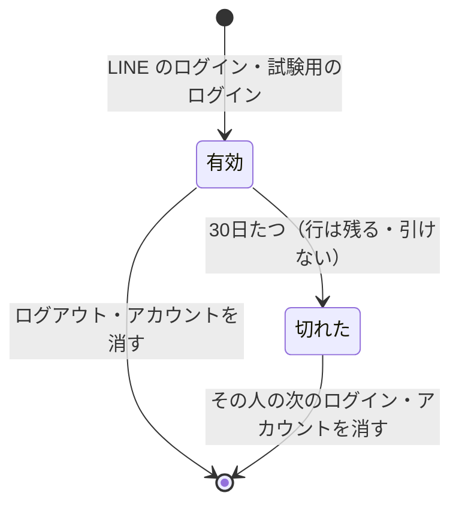

# Data Model: account-001

表の名前は単数の snake_case、主キーは uuid（`uuidv7()`）、時刻は `timestamptz`（coding.md 6-4）。持ち主は account だけ（AD-2・AD-3）。

## `account`

| 列 | 型 | 決まり |
|---|---|---|
| `id` | uuid | 主キー・`uuidv7()` |
| `line_user_id` | text | NOT NULL・一意（`account_line_user_id_unique`）。LINE のユーザー ID（プロバイダーごとに決まる。AD-2） |
| `display_name` | text | NOT NULL・既定は空の文字。LINE でログインするたびに確かめた `name` で上書き（research R6） |
| `created_at` | timestamptz | NOT NULL・`now()`。**登録日** |
| `updated_at` | timestamptz | NOT NULL・`now()`・直すたびに `now()` |

- メール・電話・プロフィールの画像は持たない（Constitution II）。
- ほかの領域は `account.id` を外部キーで参照するだけ（`accountTable` を `.references()` にだけ使う）。本人のデータは `ON DELETE CASCADE`（AD-7）。

## `session`

| 列 | 型 | 決まり |
|---|---|---|
| `id` | uuid | 主キー・`uuidv7()` |
| `token_hash` | text | NOT NULL・一意（`session_token_hash_unique`）。クッキーの札の SHA-256（16進64文字）。札そのものは持たない（research R4） |
| `account_id` | uuid | NOT NULL・`account.id` を参照・`ON DELETE CASCADE`・索引 `session_account_id_idx` |
| `expires_at` | timestamptz | NOT NULL。作った時刻＋30日（延ばさない。research R5） |
| `created_at` | timestamptz | NOT NULL・`now()` |

- 直すことがないので `updated_at` は持たない。
- 引くとき：`token_hash = $1 AND expires_at > now()` を `account` と結んで1回で読む。
- 消すとき：ログアウト（その行）・アカウントを消す（CASCADE）・その人の次のログイン（期限切れの行）。

## 状態の移り変わり（セッション）

