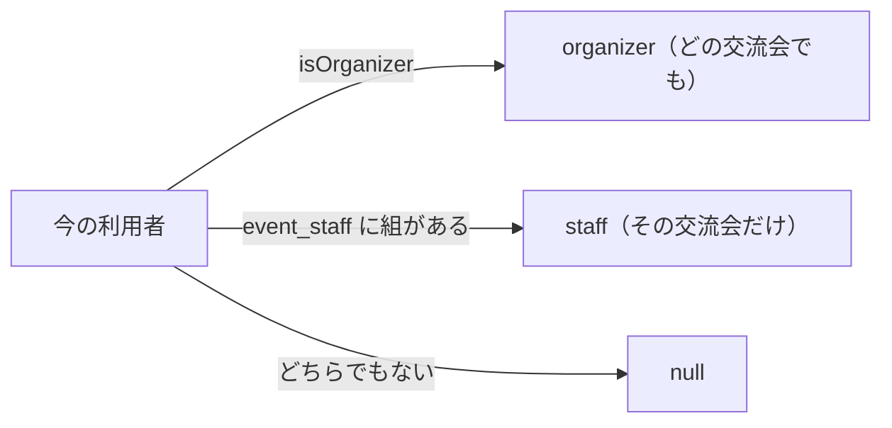

# Data Model: event-001

表の名前は単数の snake_case、主キーは uuid（`uuidv7()`）、時刻は `timestamptz`（coding.md 6-4）。持ち主は event だけ（AD-3）。

## `event`

| 列 | 型 | 決まり |
|---|---|---|
| `id` | uuid | 主キー・`uuidv7()` |
| `name` | text | NOT NULL。1〜100文字（約束で確かめる） |
| `starts_at` | timestamptz | NOT NULL。始まりの日時。索引 `event_starts_at_idx`（一覧の並び） |
| `venue` | text | NOT NULL。1〜200文字 |
| `fee` | integer | NOT NULL・CHECK `fee >= 0`（`event_fee_check`）。円 |
| `google_form_url` | text | 空を許す。`https://` の URL |
| `line_group_url` | text | 空を許す。`https://` の URL |
| `survey_open` | boolean | NOT NULL・既定 false |
| `created_at`・`updated_at` | timestamptz | NOT NULL・`now()` |

- 消さない（この版は消す機能がない）。`event` を指す外部キーはどれも `RESTRICT`（AD-7）。

## `event_staff`

| 列 | 型 | 決まり |
|---|---|---|
| `id` | uuid | 主キー・`uuidv7()` |
| `event_id` | uuid | NOT NULL・`event.id`・`ON DELETE RESTRICT` |
| `account_id` | uuid | NOT NULL・`account.id`・`ON DELETE CASCADE`（AD-7）。索引 `event_staff_account_id_idx`（自分の交流会の一覧・CASCADE） |
| `created_at` | timestamptz | NOT NULL・`now()`（加えた時刻） |

- 一意：`event_staff_event_id_account_id_unique`（同じ組は1つ。同時に受けても1つ）。

## `staff_invite`

| 列 | 型 | 決まり |
|---|---|---|
| `id` | uuid | 主キー・`uuidv7()` |
| `event_id` | uuid | NOT NULL・`event.id`・`ON DELETE RESTRICT`・一意 `staff_invite_event_id_unique`（交流会ごとに1本） |
| `token` | text | NOT NULL・一意 `staff_invite_token_unique`。32 バイトの乱数の base64url（43文字。research R3） |
| `created_at` | timestamptz | NOT NULL・`now()`。作り直すと替わる |

- 期限は列に持たない。受けるときに `now() < endOfJstDate(event.starts_at)` で決める（AD-5）。

## 役目

