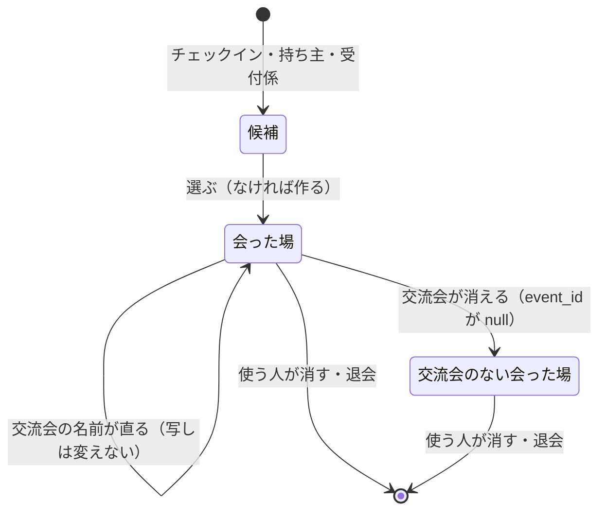

# Data Model：PaletKit の交流会を会った場に選ぶ（person-002）

2026-11-28 作成。**DB の変更はない**。person-001 の表（[data-model.md](../001-notes/data-model.md)）をそのまま使う。

## 使う欄（person_meeting）

| 欄 | 交流会から作るとき |
|---|---|
| `source` | `event`（作ったあと変えない） |
| `event_id` | 選んだ交流会。交流会が消えたら `null`（`ON DELETE SET NULL`） |
| `name` | 作ったときの交流会の名前の写し（1〜100字） |
| `name_key` | `normalizeMeetingName(name)`。400字を超えるときだけ400字で切る（research R5） |
| `met_on` | 作ったときの交流会の始まりの、日本時間の日付 |
| `owner_account_id` | 使う人 |

- 一意：`(owner_account_id, event_id) WHERE event_id IS NOT NULL`（person-001 の部分の索引）。同じ交流会は使う人ごとに1つ。
- CHECK：`source = 'event' or event_id is null`（person-001）。交流会から作ったものは、交流会が消えたあとも `source='event'` のまま。

## 読むだけのもの（人物メモに残さない）

| もの | 出すところ | 形 |
|---|---|---|
| チェックインした交流会の ID | reception の `listCheckedInEventIds(db, accountId)` | `string[]` |
| 持ち主か受付係の交流会と、渡した ID の交流会 | event の `listAccountEventSummaries(db, accountId, ids)` | `{ eventId, name, startsAt }[]` |
| 受付アプリが見えるか | suite の `isAppVisible(db, "reception", 見る人)` | `boolean` |

## 移り変わり

