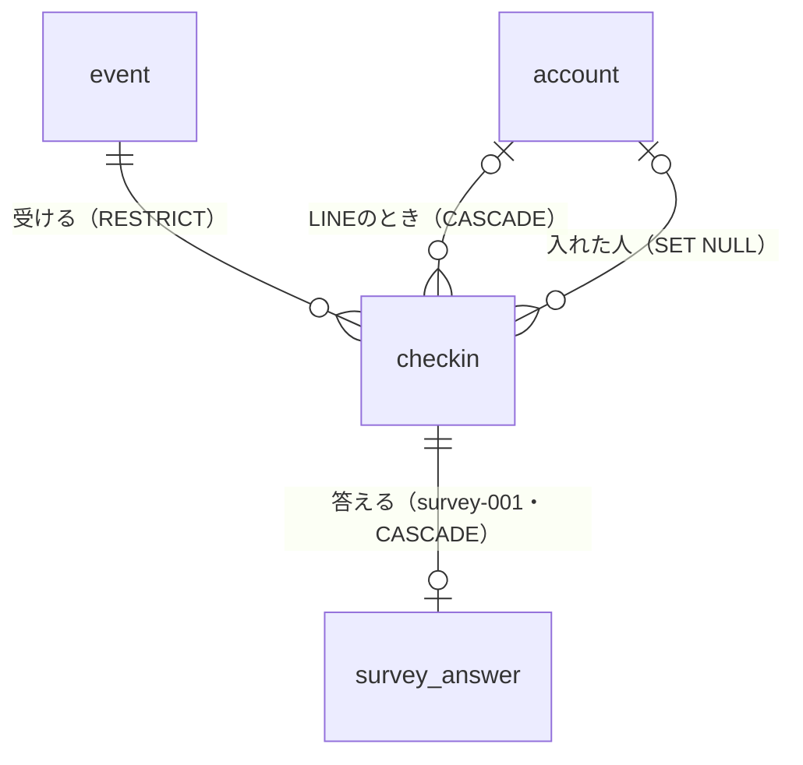

# Data Model: reception-001

表の名前は単数の snake_case、主キーは uuid（`uuidv7()`）、時刻は `timestamptz`（coding.md 6-4）。持ち主は reception だけ（AD-3）。

## `checkin`

| 列 | 型 | 決まり |
|---|---|---|
| `id` | uuid | 主キー・`uuidv7()` |
| `event_id` | uuid | NOT NULL・`event.id`・`ON DELETE RESTRICT`（AD-7） |
| `account_id` | uuid | 空を許す・`account.id`・`ON DELETE CASCADE`（本人のデータ。AD-7）。LINE のチェックインだけ |
| `entered_by` | uuid | 空を許す・`account.id`・`ON DELETE SET NULL`（誰がしたかの記録。AD-7）。手のチェックインで入れた人 |
| `name` | text | NOT NULL。1〜50文字（約束で確かめる）。そのときの名前を写す（AD-6） |
| `application_source` | text | NOT NULL・CHECK `IN ('connpass','peatix','direct','other')` |
| `referral` | text | NOT NULL・CHECK `IN ('friend','sns','announcement','other')` |
| `payment_method` | text | NOT NULL・CHECK `IN ('paypay','cash','free')` |
| `amount` | integer | NOT NULL・CHECK `amount >= 0`。円。作るときと支払い方法を直すときだけ決める（AD-6） |
| `created_at` | timestamptz | NOT NULL・`now()`。チェックインの時刻 |
| `updated_at` | timestamptz | NOT NULL・`now()` |

- 一意：`checkin_event_id_account_id_unique` ＝ `(event_id, account_id) WHERE account_id IS NOT NULL`（同じ人は1つの交流会に1回。手は何件でも）。
- 索引：`checkin_event_id_created_at_idx`（一覧・合計）・`checkin_account_id_created_at_idx`（前回の名前・CASCADE）・`checkin_entered_by_idx`（SET NULL）。
- 手で入れたか ＝ `account_id IS NULL`。
- 取り消しは行を消す（`DELETE`）。survey の回答（`survey_answer.checkin_id`）は `ON DELETE CASCADE` で一緒に消える（survey-001）。

