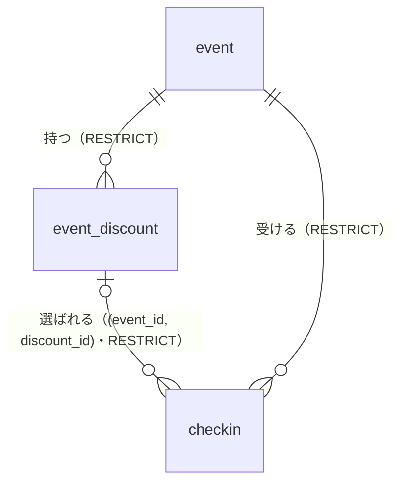

# Data Model: reception-002

表の名前は単数の snake_case、主キーは uuid（`uuidv7()`）、時刻は `timestamptz`（coding.md 6-4）。どちらの変更も「表を足す」「空を許す列を足す」だけで、前の版のアプリでも壊れない（coding.md 3）。

## `event_discount`（持ち主：event。DB の変更 `0006_event_discount.sql`）

| 列 | 型 | 決まり |
|---|---|---|
| `id` | uuid | 主キー・`uuidv7()` |
| `event_id` | uuid | NOT NULL・`event.id`・`ON DELETE RESTRICT` |
| `name` | text | NOT NULL。1〜30文字（約束で確かめる。同じ交流会の使っている割引で重ねない） |
| `amount` | integer | NOT NULL・CHECK `amount > 0`（`event_discount_amount_check`）。円 |
| `asks_referrer` | boolean | NOT NULL・既定 false。紹介者の名前を聞くか |
| `archived_at` | timestamptz | 空を許す。使うのをやめた時刻（行は消さない。research R1） |
| `created_at`・`updated_at` | timestamptz | NOT NULL・`now()` |

- 一意：`event_discount_event_id_id_unique` ＝ `UNIQUE (event_id, id)`（チェックインからの複合の外部キーのため。`event_id` の索引も兼ねる）。

## `checkin` に足す列（持ち主：reception。DB の変更 `0007_checkin_discount.sql`）

| 列 | 型 | 決まり |
|---|---|---|
| `discount_id` | uuid | 空を許す。`(event_id, discount_id)` → `event_discount(event_id, id)`・`ON DELETE RESTRICT`（`checkin_discount_fk`） |
| `discount_name` | text | 空を許す。選んだときの割引の名前の写し |
| `discount_amount` | integer | 空を許す・CHECK `>= 0`（`checkin_discount_amount_check`）。選んだときの割引の額の写し |
| `referrer_name` | text | 空を許す。紹介者の名前（任意・50文字まで・主催者だけが読む） |

- CHECK `checkin_discount_check`：`(discount_id, discount_name, discount_amount, referrer_name)` がすべて空か、割引の3列がすべて入っている（紹介者は任意）。
- 金額：`amount` ＝ 無料なら0、ほかは `max(参加費 − discount_amount, 0)`（research R5）。

