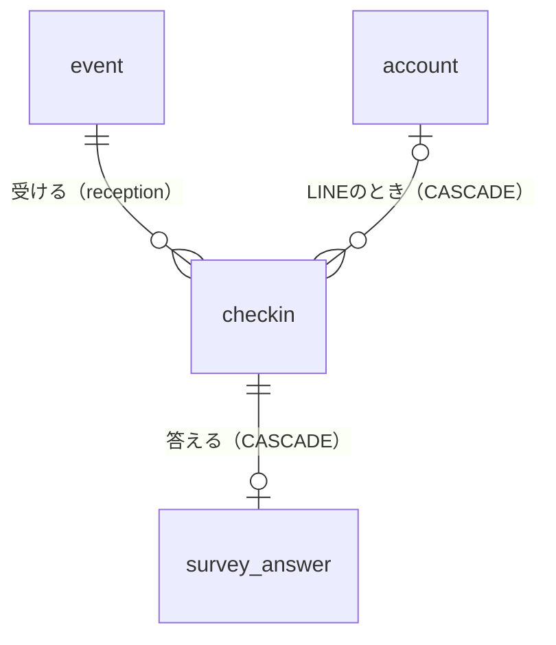

# Data Model: survey-001

表の名前は単数の snake_case、主キーは uuid（`uuidv7()`）、時刻は `timestamptz`（coding.md 6-4）。持ち主は survey だけ（AD-3）。

## `survey_answer`

| 列 | 型 | 決まり |
|---|---|---|
| `id` | uuid | 主キー・`uuidv7()` |
| `checkin_id` | uuid | NOT NULL・一意（`survey_answer_checkin_id_unique`）・`checkin.id`・`ON DELETE CASCADE`（AD-7） |
| `concern` | text | 空を許す。困りごと（前後の空白を除いて2,000文字まで。約束で確かめる）。ログに出さない |
| `monthly_price` | text | 空を許す・CHECK `IN ('jpy0','jpy500','jpy1000','jpy3000plus','unknown')` |
| `tester` | text | 空を許す・CHECK `IN ('yes','no')` |
| `job_role` | text | 空を許す・CHECK `IN ('executive','manager','employee','freelance','student','other')`。「答えない」は空 |
| `job_type` | text | 空を許す・CHECK `IN ('engineer','designer','sales','marketing','planning','backoffice','management','other')`。「答えない」は空 |
| `created_at` | timestamptz | NOT NULL・`now()`。初めて答えた時刻（一覧の並び） |
| `updated_at` | timestamptz | NOT NULL・`now()`。直すたびに変わる（CSV の回答の時刻） |

- 交流会と名前は持たない。`checkin_id` → reception の `getCheckin`・`listCheckins` でたどる（AD-3・AD-6。research R1）。
- 書き方は `INSERT … ON CONFLICT (checkin_id) DO UPDATE`（同時の2回も1行）。
- チェックインの取り消し・本人のアカウントの削除（`checkin.account_id` の CASCADE）で一緒に消える。

